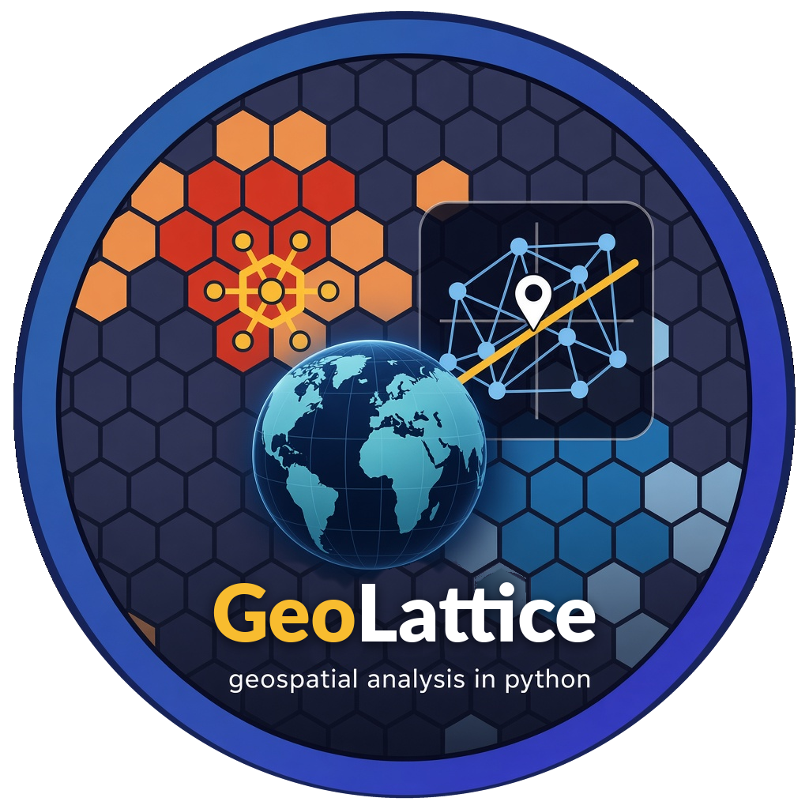

# GeoLattice

<p align="center">
  
</p>

GeoLattice is a Python library for geospatial analysis that brings vector and raster processing, spatial analysis, spatial statistics, geostatistics, spatial causal inference, spatial databases, web and cloud GIS, and remote sensing together under one import, `geolattice`.

It is built on GDAL, NumPy, SciPy, pandas, GeoPandas, Shapely and xarray, so its functions read and return the objects these libraries already use: GeoDataFrames, xarray DataArrays and Datasets, NumPy arrays and GDAL-readable files. Compute-heavy parts of the library run on the CPU by default and on a GPU (CuPy, PyTorch or JAX) when one is available, and `geolattice.distributed` runs vector and raster work on all CPU cores, a Dask cluster or Spark. Installing GeoLattice installs all of its dependencies (listed in `requirements.txt`); only GPU, cluster and Spark extras are added by name.

GeoLattice comes with a set of tutorials: 360 Jupyter notebooks in eight chapters that explain each method, work through examples on real data and use the sample data in `Data/`.

GeoLattice was called PyGIS until version 0.3.49. See [Moving from PyGIS](#moving-from-pygis) if you have code or an environment that uses the old name.

## What GeoLattice covers

| Area | Import | What it does |
|---|---|---|
| Coordinate reference systems | `geolattice.crs` | Search EPSG and ESRI codes, define custom projections, choose datum transformations |
| Vector data | `geolattice.vector` | Read and write desktop and cloud-native formats (GeoPackage, Shapefile, GeoParquet, FlatGeobuf), geoprocessing (clip, buffer, dissolve, overlay), geometry tools and attribute tables |
| Raster data | `geolattice.raster` | Read, write and reproject GDAL rasters, raster algebra, clip, mosaic, reclassify, zonal statistics, polygonize, proximity and contours |
| Spatial analysis | `geolattice.spatial_analysis` | Terrain analysis, surface hydrology, multi-criteria suitability (weighted and fuzzy overlay), multidimensional rasters (NetCDF, Zarr), network analysis, segregation analysis and vector analysis |
| Spatial causal inference | `geolattice.spatial_analysis.spatialcausal` | Interference and spillover effects, spatial confounding, spatial double machine learning, geographic regression discontinuity, spatial difference-in-differences, synthetic control and causal discovery |
| Spatial statistics | `geolattice.spatial_statistics` | Spatial weights, global and local autocorrelation (Moran, Geary, Getis-Ord), GWR and MGWR, point patterns, spatial regression, spatial sampling and Bayesian disease mapping |
| Geostatistics | `geolattice.geostatistics` | Variograms, the kriging family (simple, ordinary, universal, indicator, co-, Poisson, Bayesian, regression and space-time kriging), sequential and multiple-point simulation, with GPU and JAX backends |
| Spatial databases | `geolattice.geolatticedb` | One API for PostGIS, SpatiaLite, GeoPackage and DuckDB spatial: loading, spatial SQL, joins, nearest neighbours, PostGIS raster, pgRouting and vector tiles |
| Web and cloud GIS | `geolattice.web` | Cloud-Optimized GeoTIFF, GeoParquet, PMTiles, XYZ tiles and an OGC API Features server, with reading from S3, Google Cloud Storage, Azure and HTTP |
| Remote sensing | `geolattice.rsense` | Data access (STAC, Earth Engine, ASF, Copernicus), optical indices and composites, SAR, InSAR, NISAR, lidar, hyperspectral imaging, UAV, time series, fusion, texture, super-resolution, classification, deep learning, foundation models (Prithvi, Clay, DOFA, TerraMind, AlphaEarth and 40 others), surface energy balance evapotranspiration (SEBAL, METRIC, SSEBop, S-SEBI, PT-JPL, TSEB) and explainable AI |
| Visualization | `geolattice.viz` | Static maps, choropleths, raster displays and interactive Folium maps |
| Distributed and GPU computing | `geolattice.distributed` | One API for chunked raster processing, partitioned vector joins, raster-vector operations, spatial statistics, clustering, networks, hydrology and machine learning on all CPU cores, a Dask cluster (local, multi-GPU, SLURM, PBS, Kubernetes), Spark with Apache Sedona, or CUDA GPUs |

Every subpackage is available after `import geolattice` (for example `geolattice.raster.open_raster` or `geolattice.geostatistics.Variogram`) and loads on first use, so `import geolattice` stays fast.

## Installation

GeoLattice needs Python 3.10 or newer (tested on 3.11 and 3.14; its dependencies need 3.10, for example libpysal 4.10). GDAL and PROJ must be installed first, with Python GDAL bindings that match the GDAL library; install them with conda or your system package manager.

Installing GeoLattice installs every runtime dependency listed in [`requirements.txt`](requirements.txt), whether you install from PyPI, the wheel or the sdist (`pip install dist/geolattice-0.3.49-cp314-cp314-linux_x86_64.whl` or `pip install dist/geolattice-0.3.49.tar.gz`). That list is the conflict-free set that installation option 6 (`geolattice[all]`) resolves to: about 80 packages, including PyTorch. `pip install -r requirements.txt` installs the same set without GeoLattice itself.

### Installation options

The option names below still work, and existing install commands keep working, but a plain install already includes all of them. Each option includes everything in the one above it.

| Option | Install | Adds |
|---|---|---|
| 1. Core | `geolattice[core]` | Vector and raster I/O including GeoParquet, CRS tools, maps and plots (rasterio, fiona, GeoPandas, pyarrow, matplotlib, folium, contextily, plotly) |
| 2. Spatial analysis | `geolattice[analysis]` | Terrain and hydrology, suitability, multidimensional rasters, network and segregation analysis (xarray, netCDF4, zarr, dask, networkx, OSMnx, libpysal, WhiteboxTools) |
| 3. Spatial statistics | `geolattice[statistics]` | ESDA, spatial weights, GWR, point patterns, spatial regression, and spatial causal inference (scikit-learn, joblib) |
| 4. Geostatistics | `geolattice[geostats]` | Variograms, kriging and simulation, with plotting helpers |
| 5. Remote sensing | `geolattice[remote-sensing]` | Optical, SAR, lidar, hyperspectral and UAV processing, STAC access, classification (rioxarray, scikit-image, pystac-client, laspy, h5py, OpenCV, xgboost, leafmap) |
| 6. All | `geolattice[all]` | Everything above plus web and cloud GIS, spatial databases, deep learning (PyTorch, torchgeo), Bayesian models (PyMC), boosting, JAX kriging, Earth Engine and distributed computing (Dask, dask-geopandas) |

```bash
python3 -m pip install "geolattice[core]"             # 1. core, vector, raster, CRS, visualization
python3 -m pip install "geolattice[analysis]"         # 2. core + spatial analysis
python3 -m pip install "geolattice[statistics]"       # 3. core + spatial analysis + spatial statistics
python3 -m pip install "geolattice[geostats]"         # 4. ... + geostatistics
python3 -m pip install "geolattice[remote-sensing]"   # 5. ... + remote sensing
python3 -m pip install "geolattice[all]"              # 6. all
```

A few groups need special hardware or conflict with other packages, so neither a plain install nor `geolattice[all]` includes them; add them by name when you need them: `compute`, `geostatistics-gpu` and `rsense-gpu` (CUDA GPUs), `geostatistics-h2o` and `geostatistics-tensorflow`, `rsense-uav-dl`, `rsense-vision` and `rsense-foundation` (large vision and foundation models), `rsense-biopar` (needs pandas below 3), `distributed-gpu` (CUDA GPUs), `distributed-hpc` (SLURM, PBS and Kubernetes clusters), `distributed-spark` (Apache Sedona, needs Java 17 or newer) and `dev`. When a function needs a library that is not installed, its error message names the extra and the installation option that contains it.

For a GPU, see [GPU support](#gpu-support) below.

### Install from source

GeoLattice includes a small C extension, so building it needs a C compiler and NumPy. From the repository root:

```bash
python3 -m pip install build
python3 -m build
python3 -m pip install dist/geolattice-0.3.49-cp314-cp314-linux_x86_64.whl   # installs every dependency in requirements.txt
```

`python3 -m build` writes an sdist and a wheel for the Python that ran it (`cp314` above). For another Python version, build a wheel from the sdist with that Python: `python3 -m pip wheel --no-deps -w dist dist/geolattice-0.3.49.tar.gz`. For development, install in editable mode with `python3 -m pip install -e ".[dev]"`.

The [user guide](docs/USER_GUIDE.md#installation) lists the 65 individual extras the installation options are built from and explains how to fix the common GDAL import errors (`libgdal.so` not found, `No module named '_gdal'`).

### Moving from PyGIS

The package was renamed from PyGIS to GeoLattice. Existing code keeps working for now, but should move to the new names:

| PyGIS | GeoLattice |
|---|---|
| `pip install pygis`, `pygis[all]` | `pip install geolattice`, `geolattice[all]` |
| `import pygis`, `from pygis.raster import ...` | `import geolattice`, `from geolattice.raster import ...` |
| `pygis.pygisdb`, `pygis.spatial_bd.pygisdb` | `geolattice.geolatticedb`, `geolattice.spatial_bd.geolatticedb` |
| `PYGIS_EXPLORER`, `PYGIS_FTW_CACHE`, `PYGIS_SEDONA_PACKAGES`, `PYGIS_UAV_WEIGHTS` | `GEOLATTICE_EXPLORER`, `GEOLATTICE_FTW_CACHE`, `GEOLATTICE_SEDONA_PACKAGES`, `GEOLATTICE_UAV_WEIGHTS` |
| Model cache `~/.cache/pygis/` | `~/.cache/geolattice/` |

- Uninstall the old package first (`python3 -m pip uninstall pygis`), because GeoLattice installs its own `pygis` alias.
- The alias makes `import pygis` and `from pygis.x import y` return the `geolattice` modules, with a `FutureWarning`. It will be removed in a future release.
- The old `PYGIS_` environment variables are no longer read; rename them in your shell profile or job scripts.
- To keep model weights you have already downloaded, move the cache folder: `mv ~/.cache/pygis ~/.cache/geolattice`.

## Quick start

Run these examples from the repository root. They use the sample data in `Data/00_shared` and need installation option 5 (`geolattice[remote-sensing]`).

```python
from pathlib import Path

DATA = Path("Data/00_shared")  # sample data in the repository

# Vector: read US counties, reproject New York to metres and buffer each county by 5 km
from geolattice.vector import buffer, read_vector_data

with read_vector_data(DATA / "vector_data/USA/US_COUNTY.shp") as layer:
    counties = layer.to_dataframe()  # GeoDataFrame with 3,108 counties
ny = counties[counties["STATE"] == "New York"].to_crs(5070)  # CONUS Albers, metres
zones = buffer(ny, 5_000)

# Raster and terrain: summary statistics, slope and hillshade of a DEM
from geolattice.raster import summarize_raster
from geolattice.spatial_analysis import hillshade, slope

dem = DATA / "raster_data/USA/Onondaga_DEM.tif"
print(summarize_raster(dem)["mean"])
slope(dem, "slope.tif", units="degrees", overwrite=True)
hillshade(dem, "hillshade.tif", azimuth=315, altitude=45)

# Geostatistics: variogram and ordinary kriging of log zinc in the Meuse data
import numpy as np
import pandas as pd
from geolattice.geostatistics import OrdinaryKriging, Variogram

meuse = pd.read_csv(DATA / "data_geostatistics/meuse.csv")
xy, z = meuse[["x", "y"]].to_numpy(), np.log(meuse["zinc"].to_numpy())
vgm = Variogram(xy, z, model="spherical", n_lags=12)
vgm.fit()
ok = OrdinaryKriging(vgm).fit(xy, z)
print(ok.predict(np.array([[179500.0, 331500.0]])))

# Remote sensing: NDVI from Landsat 9 surface reflectance
import xarray as xr
import geolattice.rsense as rs

scene = DATA / "data_remote_sensing/landsat9_vegas_20240708/LC09_L2SP_039035_20240708_02_T1"
bands = xr.Dataset({b: rs.read(scene / f"{b}.tif").squeeze("band", drop=True) for b in ("red", "nir")})
bands.attrs["pyrsense:sensor"] = "landsat"  # tells GeoLattice which scaling rules apply
ndvi = bands.rs.scale().rs.index("NDVI")  # scale to reflectance, then compute NDVI
print(float(ndvi.mean()))

# Foundation models: embed a raster with DOFA, then find chips that look like the first one
import geolattice.rsense.foundation_models as fm  # needs geolattice[rsense-foundation]

fm.recommend("soil")                          # AlphaEarth, Clay, Presto, SSL4EO
enc = fm.load_model("dofa-base", bands=["red", "nir"])
emb = enc.embed_raster(bands.rs.scale().to_dataarray("band"), chip_size=224)
sim = fm.similarity_map(emb, emb.isel(y=0, x=0))

# Evapotranspiration: METRIC on a Landsat scene (sr: scaled reflectance, lst: surface temperature in K)
import geolattice.rsense.surface_energy_balance as seb

ndvi, lai = seb.ndvi(sr.red, sr.nir), seb.leaf_area_index(seb.savi(sr.red, sr.nir, L=0.1))
alb, e0 = seb.albedo(sr, sensor="landsat8"), seb.surface_emissivity(lai, ndvi)
anchors = seb.select_anchors(ndvi, lst, albedo_=alb)          # hot and cold pixels (Allen et al. 2013)
rs_in = seb.incoming_shortwave(cos_theta=0.92, tau_sw=0.78)   # clear-sky shortwave at overpass
rl_in = seb.incoming_longwave(anchors["cold"]["lst"], seb.air_emissivity(tau_sw=0.78))
rn = seb.net_radiation(rs_in, alb, rl_in, seb.outgoing_longwave(lst, e0), e0)
g = seb.soil_heat_flux(rn, lst, lai=lai, method="metric")
et = seb.run_metric(lst, rn, g, seb.momentum_roughness(lai=lai), seb.wind_at_blending_height(2.5),
                    100.6, etr_inst=0.93, anchors=anchors, etr_daily=12.0)   # Dataset: h, le, etrf, et24
```

The [user guide](docs/USER_GUIDE.md) has worked examples for every module, including the full raster toolset, hydrology, suitability analysis, geostatistical simulation, SAR and InSAR processing, lidar, hyperspectral analysis, image classification and evapotranspiration from the surface energy balance.

## GPU support

GeoLattice runs on the CPU by default. On a machine with an NVIDIA GPU, the parts below can run on the GPU, and they fall back to the CPU when no usable GPU is found.

| Module | GPU library | How to use it |
|---|---|---|
| `geolattice.geostatistics`: variograms, kriging, cross-validation and sequential, turning bands, direct sequential and multiple-point simulation | CuPy | `use_gpu=True` on the class or function |
| `geolattice.geostatistics.jax_variogram_kriging`: simple, ordinary, universal and cokriging | JAX | `use_gpu="auto"` |
| `geolattice.rsense`: raster cubes, indices, composites and other array operations | CuPy (NVIDIA) or PyTorch MPS (Apple) | `rs.backend.set_backend("cuda")` or `"mps"` |
| `geolattice.rsense.dl`, `geolattice.rsense.classify`, `geolattice.rsense.foundation_models`: deep learning, image classification, segmentation, detection and foundation model embeddings | PyTorch | runs on the GPU when PyTorch sees one |
| `geolattice.spatial_statistics`: GNNWR and GTNNWR | PyTorch | `device="cuda"` or `"auto"` |
| `geolattice.distributed`: raster algebra, focal filters and terrain, vector measures, point-in-polygon joins, nearest neighbours, zonal statistics, spatial statistics, clustering, networks, flow direction and model prediction | CuPy, cuDF, cuML, cuGraph, PyTorch | `compute="gpu"` or `"auto"` on each function |

```python
import numpy as np
from geolattice.geostatistics import OrdinaryKriging, Variogram
from geolattice.geostatistics.utils.backend import cupy_gpu_usable

print(cupy_gpu_usable())  # True when CuPy can run a kernel on the GPU

rng = np.random.default_rng(0)
xy = rng.uniform(0, 100, size=(200, 2))
z = np.sin(xy[:, 0] / 20) + rng.normal(0, 0.1, size=200)
grid = np.stack(np.meshgrid(np.linspace(0, 100, 300), np.linspace(0, 100, 300)), -1).reshape(-1, 2)

vgm = Variogram(xy, z, model="spherical", n_lags=12, use_gpu=True)
vgm.fit()
pred = OrdinaryKriging(vgm, use_gpu=True).fit(xy, z).predict(grid)  # 90,000 cells on the GPU

import geolattice.rsense as rs

rs.backend.set_backend("cuda")  # rsense arrays now live on the GPU as CuPy arrays
print(rs.backend.get_backend())
rs.backend.set_backend("cpu")
```

The GPU extras (`compute`, `geostatistics-gpu` and `rsense-gpu`) install `cupy-cuda13x`, the CuPy build for CUDA 13. Check your CUDA version with `nvidia-smi`. For an older CUDA, install the matching CuPy yourself (`cupy-cuda12x` or `cupy-cuda11x`) together with `geolattice[geostats]` or `geolattice[remote-sensing]` instead of a GPU extra, and keep only one CuPy package in an environment, because they all provide the same `cupy` module. PyTorch and JAX choose their CUDA build at install time, so install them by following their own instructions; `geolattice[all]` installs the default PyTorch build from PyPI.

## Distributed computing

`geolattice.distributed` gives one API for spatial data that scales from all cores of a laptop to a cluster. Every function takes `compute="auto" | "cpu" | "gpu"` and returns the type and memory space it was given; Dask-backed input stays lazy. Without a cluster it runs on Dask's threads, so it already uses every CPU core.

```python
import geolattice.distributed as pdist

with pdist.start("cuda"):                                  # one Dask worker per GPU ("local" for CPU)
    dem = pdist.read_raster("dem.tif")                     # lazy and chunked
    slope = pdist.raster.slope(dem, compute="gpu")         # CuPy chunks with a 1-pixel halo
    stats = pdist.zonal_stats(parcels, slope)              # per-chunk partial sums, combined at the end
    hits = pdist.vector.sjoin(points, parcels, predicate="within")   # GPU point-in-polygon test
    w = pdist.analysis.weights(parcels, "queen")
    lisa = pdist.analysis.local_morans(stats["mean"], w)  # 999 permutations as batched matrix products
    pdist.write_raster(slope, "slope.zarr")
```

| Module | What it does |
|---|---|
| `raster` | Map algebra (`calc`, `where`, `reclassify`), focal filters, convolution and terrain (slope, aspect, hillshade, curvature, TPI, TRI, roughness), chunk by chunk with halos so results equal whole-array results |
| `vector` | Geometry operations, `clip`, `sjoin` on spatially partitioned data (Dask, GPU or Sedona engine), `knn` |
| `bridge` | `rasterize`, `zonal_stats`, `extract_values`, `polygonize` (polygons cut by chunk seams are merged) |
| `analysis` | Spatial weights, Moran's I, Geary's C, LISA, Getis-Ord G*, DBSCAN, HDBSCAN, k-means and kernel density |
| `network` | Graphs from lines, shortest paths, centrality and components (cuGraph or SciPy and NetworkX) |
| `hydrology` | Chunked D8 flow direction, depression filling and flow accumulation |
| `ml` | Model fitting, per-pixel raster prediction, tiled PyTorch inference over several GPUs and DDP training |
| `io` | Parallel GeoParquet and OGR reading and writing, rasters, Zarr and STAC |
| `diagnostics` | `benchmark`, `check_equivalence` (CPU against GPU), `explain`, `memory_report`, `profile` |

`pdist.start` also connects to SLURM, PBS and Kubernetes clusters (`geolattice[distributed-hpc]`) or an existing scheduler, and `vector.sjoin(..., engine="sedona")` runs the join as Spark SQL (`geolattice[distributed-spark]`). Results are checked against GeoPandas, rasterio, scipy.ndimage, libpysal, esda and NetworkX in the test suite. Measured on an RTX A5500 laptop GPU:

| Operation | CPU | GPU |
|---|---:|---:|
| Focal median 7 x 7, 8000 x 8000 DEM | 17.5 s | 0.24 s |
| Moran's I, 22,500 cells, 999 permutations | 0.71 s | 0.07 s |
| Local Moran's I, 22,500 cells, 999 permutations | 1.55 s | 0.25 s |
| Slope, 8000 x 8000 DEM | 0.82 s | 0.22 s |
| Point-in-polygon join, 2 million points, 2,000 polygons | 5.4 s (geopandas: 15.4 s) | 4.7 s |

Where the GPU version is slower on typical inputs (`rasterize`, `dbscan`), `compute="auto"` keeps the CPU; `pdist.explain("bridge.rasterize")` says which implementation runs and why. The [user guide](docs/USER_GUIDE.md#distributed-computing-geolatticedistributed) has worked examples.

## Tutorials

The notebooks in [`Tutorials/notebooks`](Tutorials/notebooks) are organized like a course. They explain the theory behind each method and work through examples on real data, and each notebook starts with a note that names the installation option it needs.

| Chapter | Notebooks | Topics |
|---|---:|---|
| [01 Vector data](Tutorials/notebooks/01_vector) | 6 | Reading and writing vector data, map projections, visualization, geoprocessing, geometry operations |
| [02 Raster data](Tutorials/notebooks/02_raster) | 4 | Reading and writing rasters, projections, basic raster operations |
| [03 Spatial analysis](Tutorials/notebooks/03_spatial_analysis) | 51 | Terrain and hydrology, multidimensional data, multi-criteria suitability, network analysis, segregation analysis, spatial causal inference, capstones |
| [04 Spatial statistics](Tutorials/notebooks/04_spatial_statistics) | 77 | Point patterns, spatial autocorrelation, spatial regression, spatial clusters, disease mapping, geographically weighted models, interpolation, sampling design, space-time analysis, capstones |
| [05 Geostatistics](Tutorials/notebooks/05_geostatistics) | 55 | Variograms, kriging, regression kriging, specialized and space-time kriging, Poisson kriging, simulation, Bayesian kriging, capstones |
| [06 Spatial databases](Tutorials/notebooks/06_spatialDB) | 15 | Spatial database concepts, spatial SQL, joins, indexing, PostGIS raster, pgRouting, DuckDB and GeoParquet, cloud engines, deployment |
| [07 Web and cloud GIS](Tutorials/notebooks/07_web_cloud_gis) | 12 | Cloud-native raster and vector data, spatial SQL, interactive web maps, map serving, geospatial APIs, web apps, scalable processing, cloud platforms |
| [09 Remote sensing](Tutorials/notebooks/09_remote_sensing) | 140 | Foundations, optical, radar, UAV, hyperspectral, lidar, texture analysis, super-resolution, image classification, object detection, foundation models, surface energy balance and evapotranspiration (SEBAL, METRIC, SSEBop, TSEB, seasonal crop water use), capstones |

The sample data the notebooks read is in [`Data/`](Data/README.md), organized by chapter. HTML versions of the notebooks with all outputs are in [`docs/notebooks`](docs/notebooks) (chapters 01 to 03 so far); `Tutorials/_tools/export_notebooks_html.py` builds them.

## Documentation

- [User guide](docs/USER_GUIDE.md): features, installation and troubleshooting, the package layout and worked examples for every module.
- [API reference](docs/API_REFERENCE.md): every public class and function, grouped by module, with a one-line description.
- [CHANGELOG](CHANGELOG.md): changes in each release.
- [Module organization](docs/GeoLattice_modules_organization_and_rebuild.md): how the GeoLattice subpackages were assembled from earlier packages (PyRSense, pygstat and PySpatialCausal) and how to rebuild the package.
- [Data by chapter](Tutorials/DATA_BY_CHAPTER.md): the data files each tutorial notebook reads.

## Repository layout

```
GeoLattice/
├── src/          # the geolattice package (installed under the name geolattice); src/distributed/ is geolattice.distributed
├── compat/       # pygis: deprecated alias that forwards old imports to geolattice
├── tests/        # pytest suite
├── tools/        # make_requirements.py: regenerates requirements.txt from pyproject.toml
├── Tutorials/    # tutorial notebooks and the tools that maintain them
├── Data/         # sample data used by the tutorials
├── docs/         # user guide, notebook HTML pages and design notes
├── examples/     # standalone example scripts
├── Images/       # the GeoLattice logo, banners and figures used by the notebooks
├── requirements.txt   # every runtime dependency (read by pyproject.toml)
├── pyproject.toml
└── CHANGELOG.md
```

## Development

Install GeoLattice with the `dev` extra, then run the tests from the repository root:

```bash
python3 -m pytest
```

The tests import the installed package, so rebuild and reinstall the wheel after changing files in `src/`. After changing an extra in `pyproject.toml`, run `python3 tools/make_requirements.py` to regenerate `requirements.txt`; `tests/test_requirements.py` fails until the two agree. [CONTRIBUTING.md](CONTRIBUTING.md) describes how to propose changes.

## License

GeoLattice is released under the MIT License. See [LICENSE](LICENSE).
