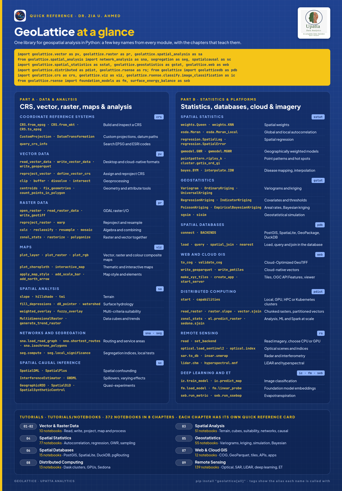

::: {.gl-hero}

::: {.gl-intro}

### GeoLattice

GeoLattice brings vector and raster processing, spatial analysis, spatial statistics, geostatistics, spatial databases, web and cloud GIS, distributed computing and remote sensing together under one import, `geolattice`. It is built on GDAL, NumPy, SciPy, pandas, GeoPandas, Shapely and xarray, so its functions read and return the objects these libraries already use: GeoDataFrames, xarray DataArrays and Datasets, NumPy arrays and GDAL-readable files. Compute-heavy parts run on the CPU by default and on a GPU when one is available.



```{=html}
<div class="gl-badges">
  <a href="https://pypi.org/project/geolattice/"></a>
  <a href="https://pypi.org/project/geolattice/"></a>
  <a href="https://github.com/zia207/GeoLattice/blob/main/LICENSE"></a>
  <code>pip install geolattice</code>
</div>
```

:::



<p class="gl-credit">Background: county-level NO<sub>2</sub> across the conterminous United States, one frame per year.</p>

:::

## Install

GeoLattice needs Python 3.10 or newer. Install GDAL and PROJ first with conda or your system package manager, then:

```bash
python3 -m pip install geolattice
```

GeoLattice is published on [PyPI](https://pypi.org/project/geolattice/) with ready-built packages for Linux, macOS and Windows.

[Getting Started](getting_started.qmd) lists the smaller installation options, GPU support and a quick start for every part of the library.

## One library, one import

::: {.gl-features}

::: {.gl-feature}
**Standard objects in, standard objects out**

Functions take and return GeoDataFrames, xarray objects, NumPy arrays and GDAL-readable files, so GeoLattice fits into code you already have.
:::

::: {.gl-feature}
**CPU, GPU and clusters**

The same calls run on the CPU, on a GPU with CuPy, PyTorch or JAX, and on all cores, a Dask cluster or Spark with `geolattice.distributed`.
:::

::: {.gl-feature}
**From data to models**

Read and process data, measure spatial patterns, krige and simulate, classify imagery and run foundation models without leaving one package.
:::

::: {.gl-feature}
**Learn by doing**

Every chapter is a set of Jupyter notebooks that explain a method and work through it on real data from Bangladesh, the United States and around the world.
:::

:::

## Quick reference

[{.gl-qref fig-alt="Quick reference card for the GeoLattice library"}](assets/geolattice_quick_reference.png)

## License

GeoLattice is released under the MIT License. See [LICENSE](https://github.com/zia207/GeoLattice/blob/main/LICENSE). Developed by Zia Ahmed, Upatta Analytics.
