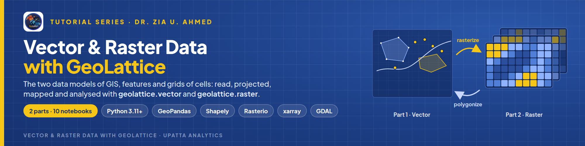
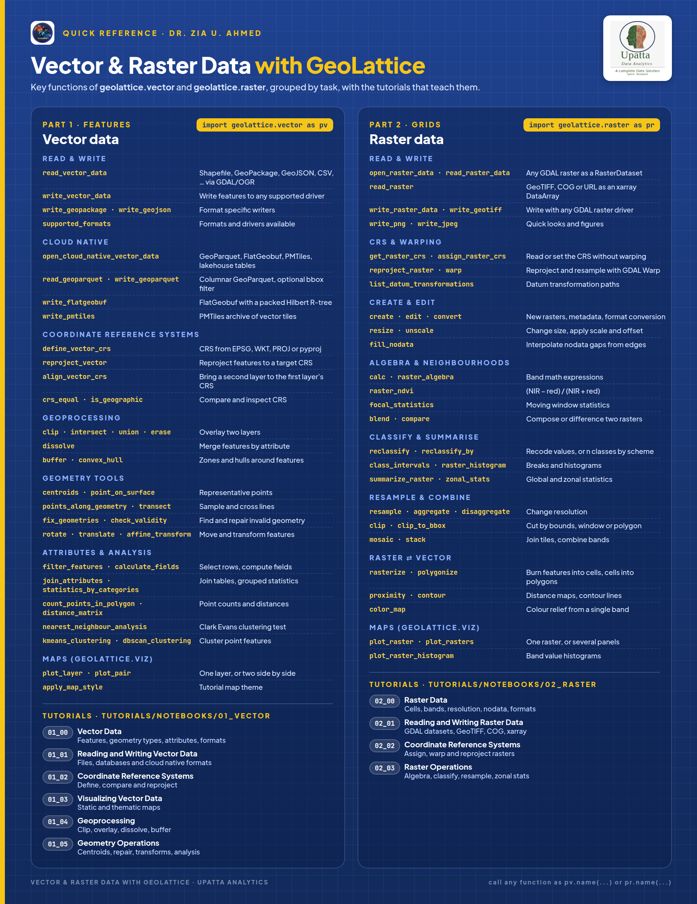

<p align="center">
  
</p>

GIS stores the world in two ways. **Vector data** describes discrete features as points, lines and polygons, each with a row of attributes. **Raster data** describes continuous surfaces and imagery as a grid of cells, each holding a value. Almost every spatial workflow starts with one of them, and most combine the two.

These ten notebooks are the first two chapters of the [GeoLattice](https://github.com/zia207/GeoLattice) tutorials. They cover reading and writing both data models, coordinate reference systems, mapping, and the core operations on features and grids, using `geolattice.vector` and `geolattice.raster` with real data from the United States and Bangladesh.

## GeoLattice

GeoLattice is a Python library for geospatial analysis that brings vector and raster processing, spatial analysis, spatial statistics, geostatistics, spatial databases, web and cloud GIS and remote sensing together under one import. It is built on GDAL, NumPy, pandas, GeoPandas, Shapely and xarray, so its functions take and return objects these libraries already use: GeoDataFrames, NumPy arrays and GDAL-readable files.

| | |
|---|---|
| **Package** | `geolattice` |
| **Repository** | [github.com/zia207/GeoLattice](https://github.com/zia207/GeoLattice) |
| **Python** | 3.10 or newer |
| **License** | MIT |
| **Author** | Zia Ahmed, Upatta Analytics |

GDAL and PROJ must be installed first, with Python GDAL bindings that match the GDAL library (conda or your system package manager). Then install the core option, which covers everything these two chapters use:

```bash
python3 -m pip install "geolattice[core]"
```

## Vector data

A vector layer is a table in which every row is a feature and one column holds its geometry. Points mark locations such as wells or soil samples, lines trace roads and rivers, and polygons outline counties, fields and watersheds. Because each feature keeps its exact shape and its attributes, vector data suits boundaries, networks and anything you count, join or select by attribute.

### Vector functions in GeoLattice

`geolattice.vector` reads through GDAL/OGR and returns GeoDataFrames, so its output works directly with GeoPandas.

| Task | Functions |
|---|---|
| Read desktop formats (Shapefile, GeoPackage, GeoJSON, KML, CSV and other OGR drivers) | `read_vector_data`, `open_vectors_data`, `supported_formats` |
| Read cloud-native formats (GeoParquet, FlatGeobuf, PMTiles, lakehouse tables) | `open_cloud_native_vector`, `read_geoparquet`, `geoparquet_info` |
| Write | `write_vector_data`, `write_geopackage`, `write_shapefile`, `write_geojson`, `write_csv`, `write_geoparquet`, `write_flatgeobuf`, `write_pmtiles` |
| Coordinate reference systems | `define_vector_crs`, `reproject_vector`, `align_vector_crs`, `crs_equal`, `is_geographic` |
| Geoprocessing | `buffer`, `clip`, `dissolve`, `intersect`, `union`, `erase`, `convex_hull` |
| Geometry tools | `centroids`, `point_on_surface`, `fix_geometries`, `check_validity`, `add_geometry_attributes`, `rotate`, `translate`, `points_along_geometry`, `transect`, `snap_points_to_grid` |
| Attribute tables and analysis | `select_fields`, `rename_fields`, `calculate_fields`, `filter_features`, `join_attributes`, `statistics_by_categories`, `count_points_in_polygon`, `nearest_neighbor_analysis`, `distance_matrix`, `kmeans_clustering`, `dbscan_clustering` |

Maps for both chapters come from `geolattice.viz` (`plot_layer`, `plot_layers`, `plot_pair`, `apply_map_style`).

```python
from geolattice.vector import buffer, clip, count_points_in_polygon, read_vector_data, write_geoparquet

counties = read_vector_data("US_COUNTY.shp").to_dataframe()      # GeoDataFrame
colorado = read_vector_data("CO_STATE_BD.shp").to_dataframe()
samples = read_vector_data("CO_SOC_data.shp").to_dataframe()

co_counties = clip(counties, colorado)                             # cookie-cut overlay
co_counties = count_points_in_polygon(co_counties, samples, count_field="n_samples")
sample_zones = buffer(samples, 10_000)                             # 10 km around each sample

write_geoparquet("co_counties.parquet", co_counties)               # cloud-native output
```

## Raster data

A raster is a grid of equal-sized cells laid over the ground. Each cell holds one value per band: elevation in a DEM, reflectance in a satellite image, a land-cover class or a modelled soil property. The cell size sets the resolution, the geotransform ties the grid to map coordinates, and a nodata value marks cells with no measurement. Rasters suit anything that varies continuously over space.

### Raster functions in GeoLattice

`geolattice.raster` reads and writes through GDAL. Most operations take a source path and a destination path, so they work on files of any size without loading them into memory first.

| Task | Functions |
|---|---|
| Read and inspect | `read_raster_data`, `open_raster`, `read_raster`, `summarize_raster`, `raster_histogram`, `supported_formats` |
| Write | `write_raster_data`, `write_geotiff`, `write_png`, `write_jpeg`, `convert` |
| Coordinate reference systems | `get_raster_crs`, `assign_raster_crs`, `define_raster_crs`, `reproject_raster`, `warp`, `list_datum_transformations` |
| Raster algebra | `calc`, `raster_ndvi`, `reclassify`, `focal_statistics`, `fill_nodata`, `compare` |
| Resolution and extent | `resample`, `aggregate`, `disaggregate`, `clip`, `clip_to_bbox`, `mosaic`, `stack` |
| Raster and vector together | `zonal_stats`, `polygonize`, `rasterize`, `proximity`, `contour` |

```python
from geolattice.raster import calc, clip, open_raster, reproject_raster, zonal_stats

dem = open_raster("dem.tif")                                       # GDAL dataset wrapper
reproject_raster("dem.tif", "dem_5070.tif", dst_crs="EPSG:5070")    # warp to a new CRS
clip("dem_5070.tif", "dem_co.tif", cutline="CO_STATE_BD.shp")       # clip to a polygon
calc("A * 3.28084", "dem_feet.tif", source="dem_co.tif")            # raster algebra
stats = zonal_stats("dem_co.tif", "US_COUNTY.shp", zone_field="FIPS")
```

## Tutorials {#tutorials}

Work through the vector chapter first; the raster chapter builds on its CRS and mapping sections.

### Part 1 · Working with vector data


| Tutorial | Topic |
|----------|--------|
| [Vector data](01_vector/01_00_vector_data.ipynb) | Points, lines and polygons, attributes, the GeoDataFrame |
| [Reading and writing vector data](01_vector/01_01_read_write_vector_data.ipynb) | Shapefile, GeoPackage, GeoJSON, KML, GeoParquet, FlatGeobuf |
| [Coordinate reference systems](01_vector/01_02_map_projection_vector_data.ipynb) | Defining, checking and reprojecting vector CRS |
| [Visualizing vector data](01_vector/01_03_visualizing_vector_data.ipynb) | Static maps, choropleths and interactive maps |
| [Geoprocessing](01_vector/01_04_geoprocessing_vector_data.ipynb) | Buffer, clip, dissolve, intersect, union, erase |
| [Geometry operations](01_vector/01_05_geometry_operation_vector_data.ipynb) | Centroids, validity, transforms, geometry attributes |

### Part 2 · Working with raster data


| Tutorial | Topic |
|----------|--------|
| [Raster data](02_raster/02_00_raster_data.ipynb) | Cells, bands, resolution, nodata and the geotransform |
| [Reading and writing raster data](02_raster/02_01_read_write_raster_data.ipynb) | GeoTIFF, Cloud-Optimized GeoTIFF and other GDAL formats |
| [Coordinate reference systems](02_raster/02_02_map_projection_raster.ipynb) | Assigning CRS, reprojecting and warping grids |
| [Raster operations](02_raster/02_03_basic_raster_operation.ipynb) | Raster algebra, reclassify, resample, mosaic, clip, zonal statistics |

### Quick reference

<p align="center">
  
</p>

## Sample data

The notebooks read the sample data in [`Data/00_shared/`](https://github.com/zia207/GeoLattice/tree/main/Data) of the repository: US states and counties, Colorado soil carbon samples, New York counties and Bangladesh districts for the vector chapter, and DEMs and satellite imagery for the raster chapter.

## License

GeoLattice is released under the MIT License. See [LICENSE](https://github.com/zia207/GeoLattice/blob/main/LICENSE).

<p align="center">
  <br>
  Developed by Zia Ahmed, Upatta Analytics
</p>
