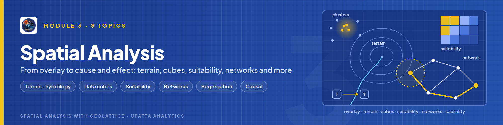
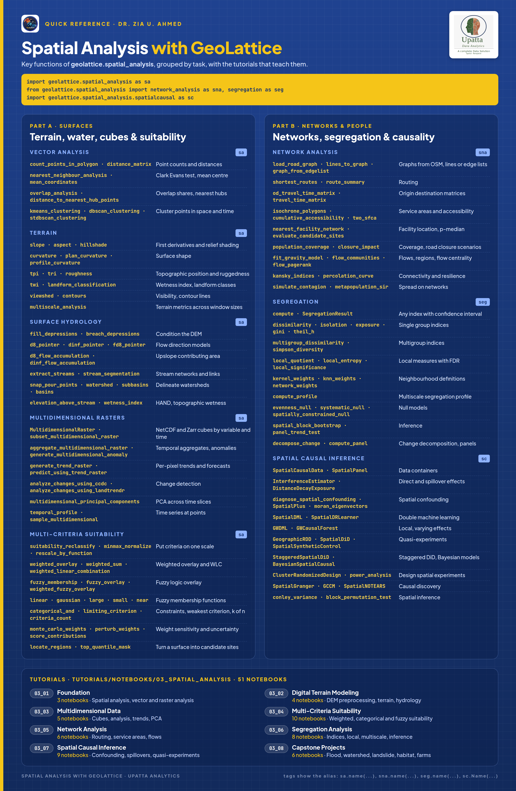

<p align="center">
  
</p>

Spatial analysis turns layers into answers. It asks where water flows, which land is suitable for a crop or a clinic, how far people are from services, how groups are spread across a city and whether a policy changed outcomes in the places it reached. Every one of these questions starts from the vector and raster data of the first two chapters and adds a method built for space.

These 51 notebooks are chapter 03 of the [GeoLattice](https://github.com/zia207/GeoLattice) tutorials. They cover terrain and hydrology, multidimensional data cubes, multi-criteria suitability, spatial networks, segregation and spatial causal inference, and finish with six capstone projects, using `geolattice.spatial_analysis` with real data from the United States and Bangladesh.

## GeoLattice

GeoLattice is a Python library for geospatial analysis that brings vector and raster processing, spatial analysis, spatial statistics, geostatistics, spatial databases, web and cloud GIS and remote sensing together under one import. It is built on GDAL, NumPy, pandas, GeoPandas, Shapely and xarray, so its functions take and return objects these libraries already use: GeoDataFrames, xarray DataArrays, NumPy arrays and GDAL-readable files.

| | |
|---|---|
| **Package** | `geolattice` |
| **Repository** | [github.com/zia207/GeoLattice](https://github.com/zia207/GeoLattice) |
| **Python** | 3.10 or newer |
| **License** | MIT |
| **Author** | Zia Ahmed, Upatta Analytics |

GDAL and PROJ must be installed first, with Python GDAL bindings that match the GDAL library (conda or your system package manager). Then install the spatial statistics option, which includes spatial analysis and the scikit-learn models that spatial causal inference needs:

```bash
python3 -m pip install "geolattice[statistics]"
```

The chapter uses four imports:

```python
import geolattice.spatial_analysis as sa
from geolattice.spatial_analysis import network_analysis as sna, segregation as seg
import geolattice.spatial_analysis.spatialcausal as sc
```

## Terrain and hydrology

A digital elevation model (DEM) is a raster of heights. Its derivatives describe the shape of the land: slope, aspect and curvature, the position of a cell relative to its neighbours and how wet it is likely to be. Hydrology follows water over that surface: fill or breach the pits a DEM always has, give each cell a flow direction, accumulate the area that drains through it, and cut the network into streams and watersheds.

| Task | Functions (`sa`) |
|---|---|
| Surface derivatives | `slope`, `aspect`, `hillshade`, `curvature`, `plan_curvature`, `profile_curvature` |
| Position and ruggedness | `tpi`, `tri`, `roughness`, `twi`, `landform_classification`, `multiscale_analysis` |
| Visibility and contours | `viewshed`, `contours` |
| Condition the DEM | `fill_depressions`, `breach_depressions` |
| Flow direction and accumulation | `d8_pointer`, `dinf_pointer`, `fd8_pointer`, `d8_flow_accumulation`, `dinf_flow_accumulation` |
| Streams and watersheds | `extract_streams`, `stream_segmentation`, `snap_pour_points`, `watershed`, `subbasins`, `basins` |
| Height above drainage | `elevation_above_stream`, `wetness_index` |

The terrain and hydrology tools read a DEM from a path and write their result to another path:

```python
import geolattice.spatial_analysis as sa

sa.slope("dem.tif", "slope.tif")                                  # degrees
sa.hillshade("dem.tif", "hillshade.tif", azimuth=315, altitude=45)
sa.breach_depressions("dem.tif", "dem_breached.tif")              # condition the DEM
sa.d8_pointer("dem_breached.tif", "d8.tif")                       # flow direction
sa.d8_flow_accumulation("dem_breached.tif", "facc.tif")           # upslope cells
sa.extract_streams("facc.tif", "streams.tif", threshold=1000)     # cells draining > 1000 cells
sa.watershed("d8.tif", "outlets.shp", "watersheds.tif")           # watershed of each outlet
```

## Multidimensional data

Climate and satellite records come as cubes: one raster per variable per time step, stored in NetCDF or Zarr. Multidimensional tools select and aggregate along time, compute anomalies against a baseline, fit a trend to every pixel and reduce many layers to a few principal components.

| Task | Functions (`sa`) |
|---|---|
| Open and subset cubes | `MultidimensionalRaster`, `subset_multidimensional_raster`, `make_netcdf_raster_layer` |
| Aggregate and compare | `aggregate_multidimensional_raster`, `generate_multidimensional_anomaly`, `zonal_statistics_as_table` |
| Trends and change | `generate_trend_raster`, `predict_using_trend_raster`, `analyze_changes_using_ccdc`, `analyze_changes_using_landtrendr` |
| Reduce and sample | `multidimensional_principal_components`, `temporal_profile`, `sample_multidimensional` |
| Export | `raster_to_netcdf`, `feature_to_netcdf`, `table_to_netcdf` |

## Multi-criteria suitability

Suitability modelling ranks places against several criteria at once: slope, distance to roads, soil, rainfall and so on. Each criterion is put on a common scale, then the criteria are combined, either by hard rules (Boolean), by weights (weighted overlay or weighted linear combination) or by fuzzy membership, which lets a place be partly suitable. The last step tests how much the answer depends on the weights.

| Task | Functions (`sa`) |
|---|---|
| Common scale | `suitability_reclassify`, `minmax_normalize`, `percentile_rank_normalize`, `rescale_by_function` |
| Boolean and categorical rules | `categorical_and`, `categorical_or`, `criteria_count`, `limiting_criterion` |
| Weighted overlay | `weighted_overlay`, `weighted_sum`, `weighted_linear_combination`, `score_contributions` |
| Fuzzy logic | `fuzzy_membership`, `fuzzy_overlay`, `weighted_fuzzy_overlay`, `linear`, `gaussian`, `large`, `small`, `near` |
| Sensitivity and sites | `monte_carlo_weights`, `perturb_weights`, `locate_regions`, `top_quantile_mask` |

```python
import geolattice.spatial_analysis as sa

# Fuzzy "small" membership: close to 1 for low values, 0.5 at the midpoint
sa.fuzzy_membership("slope.tif", "slope_fz.tif", membership_type="small", midpoint=8, spread=5)          # 8 degrees
sa.fuzzy_membership("dist_road.tif", "road_fz.tif", membership_type="small", midpoint=2000, spread=4)   # 2 km

# Combine: fuzzy AND keeps the weakest criterion; a weighted overlay trades them off
sa.fuzzy_overlay(["slope_fz.tif", "road_fz.tif"], "suit_fuzzy.tif", overlay_type="and")
sa.weighted_overlay(["slope_class.tif", "road_class.tif"], "suit_weighted.tif", weights=[0.6, 0.4])
```

## Network analysis

A road network is a graph: intersections are nodes and road segments are edges with a length and a travel time. Network analysis finds shortest routes, the area reachable within a time budget, how well each place is served by facilities and how goods, people or a disease move along the links.

| Task | Functions (`sna`) |
|---|---|
| Build graphs | `load_road_graph`, `lines_to_graph`, `graph_from_edgelist`, `snap_points_to_nodes` |
| Routes and travel times | `shortest_routes`, `route_summary`, `od_travel_time_matrix`, `travel_time_matrix` |
| Service areas and access | `isochrone_polygons`, `cumulative_accessibility`, `two_sfca`, `population_coverage` |
| Facility location | `nearest_facility_network`, `evaluate_candidate_sites`, `closure_impact` |
| Flows and structure | `fit_gravity_model`, `flow_communities`, `flow_pagerank`, `kansky_indices`, `percolation_curve` |
| Spread on networks | `simulate_contagion`, `metapopulation_sir` |

## Segregation analysis

Segregation measures describe how two or more groups are spread across the units of a city or region. Indices summarise the whole area, local measures map where groups are concentrated, multiscale profiles show how the answer changes with neighbourhood size, and null models and bootstraps say whether a value is larger than chance.

| Task | Functions (`seg`) |
|---|---|
| One call for any index | `compute` |
| Single group and multigroup indices | `dissimilarity`, `isolation`, `exposure`, `gini`, `theil_h`, `multigroup_dissimilarity`, `simpson_diversity` |
| Local measures | `local_quotient`, `local_entropy`, `local_significance` |
| Neighbourhoods and scale | `kernel_weights`, `knn_weights`, `network_weights`, `compute_profile` |
| Inference | `evenness_null`, `systematic_null`, `spatially_constrained_null`, `spatial_block_bootstrap`, `panel_trend_test` |
| Change over time | `decompose_change`, `compute_panel`, `areal_interpolate` |

## Spatial causal inference

Correlation in space is easy to find and hard to interpret. Spatial causal inference estimates the effect of a treatment when nearby places share unmeasured causes (spatial confounding), when treating one place affects its neighbours (interference and spillovers) and when the effect itself varies over space. Quasi-experiments use borders and the timing of policies, and the last two notebooks design spatial experiments and learn causal graphs.

| Task | Functions (`sc`) |
|---|---|
| Data | `SpatialCausalData`, `SpatialPanel`, `datasets.simulate_spatial_confounding` |
| Spatial confounding | `diagnose_spatial_confounding`, `SpatialPlus`, `moran_eigenvectors`, `compare_adjustments` |
| Spillovers | `ExposureMapping`, `DistanceDecayExposure`, `InterferenceEstimator` |
| Machine learning estimators | `SpatialDML`, `SpatialDRLearner`, `GWDML`, `GWCausalForest` |
| Quasi-experiments | `GeographicRDD`, `SpatialDiD`, `StaggeredSpatialDiD`, `SpatialSyntheticControl` |
| Bayesian models and experiments | `BayesianSpatialCausal`, `ClusterRandomizedDesign`, `SaturationDesign`, `power_analysis` |
| Causal discovery | `SpatialGranger`, `GCCM`, `SpatialNOTEARS` |
| Inference under dependence | `standard_error`, `conley_variance`, `spatial_block_bootstrap` |

```python
import geolattice.spatial_analysis.spatialcausal as sc

data = sc.datasets.simulate_spatial_confounding(n=400, random_state=0)
print(sc.diagnose_spatial_confounding(data))                 # Moran's I on treatment and outcome
print(sc.SpatialDML(se="conley", cutoff=0.2).fit(data).summary())
```

## Tutorials {#tutorials}

Start with the foundation notebooks. The topics after that can be read in any order, and the capstones combine them.

### Foundation

| Tutorial | Topic |
|----------|--------|
| [Spatial analysis](03_01_foundation/03_01_01_spatial_analysis_intruction.ipynb) | What spatial analysis is and the questions it answers |
| [Vector data analysis](03_01_foundation/03_01_02_vector_analyis.ipynb) | Spatial analysis and attribute tools on US data |
| [Raster data analysis](03_01_foundation/03_01_03_raster_analysis.ipynb) | Local, focal, zonal and proximity analysis, map algebra |

### Digital terrain modeling

| Tutorial | Topic |
|----------|--------|
| [Digital terrain modeling](03_02_digital_terrain_modeling/03_02_00_digital_terrain_modeling_introduction.ipynb) | DEMs and what they measure |
| [DEM preprocessing](03_02_digital_terrain_modeling/03_02_01_dem_preprocessing.ipynb) | Metadata, clipping, resampling and terrain visualization |
| [Terrain derivatives](03_02_digital_terrain_modeling/03_02_02_terrain_analysis.ipynb) | Slope, aspect, curvature, TPI, landforms |
| [Hydrology modeling](03_02_digital_terrain_modeling/03_02_03_hydrology_modeling.ipynb) | Flow direction, accumulation, streams, watersheds |

### Multidimensional data

| Tutorial | Topic |
|----------|--------|
| [Multidimensional raster data](03_03_multidimentional_data/03_03_00_introduction_to_multidimentional_data.ipynb) | NetCDF and Zarr cubes |
| [Data management](03_03_multidimentional_data/03_03_01_multidimensional_data_mangement.ipynb) | NetCDF to multi-band rasters and back |
| [Multidimensional analysis](03_03_multidimentional_data/03_03_02_multidimensional_analysis.ipynb) | Seasonal and monthly means, anomalies |
| [Trend analysis](03_03_multidimentional_data/03_03_03_multidimentioanl_trend_analysis.ipynb) | Per-pixel trends and predictions |
| [Principal components](03_03_multidimentional_data/03_03_04_multidimensional_PCA.ipynb) | PCA across time slices |

### Multi-criteria suitability

| Tutorial | Topic |
|----------|--------|
| [Multi-criteria suitability modeling](03_04_multi_criteria_suitability_analysis/03_04_00_introduction_MCSM.ipynb) | The suitability workflow |
| [Vector-based suitability](03_04_multi_criteria_suitability_analysis/03_04_01_00_introduction_vector_based_suitability_analysis.ipynb) | Suitability on polygons |
| [Deriving criteria](03_04_multi_criteria_suitability_analysis/03_04_01_01_deriving_criteria.ipynb) | Criteria for clinic site selection |
| [Categorical suitability](03_04_multi_criteria_suitability_analysis/03_04_01_02_categorical_suitability.ipynb) | Boolean rules |
| [Weighted suitability](03_04_multi_criteria_suitability_analysis/03_04_01_03_weighted_suitability.ipynb) | Weighted overlay and ranking |
| [Fuzzy logic foundations](03_04_multi_criteria_suitability_analysis/03_04_02_00_fuzzy_logic_foundations.ipynb) | Membership functions and operators |
| [Fuzzy suitability for polygons](03_04_multi_criteria_suitability_analysis/03_04_02_01_fuzzy_vector_suitability.ipynb) | Fuzzy overlay on vector data |
| [Fuzzy suitability for rasters](03_04_multi_criteria_suitability_analysis/03_04_02_03_fuzzy_raster_suitability.ipynb) | Fuzzy overlay on grids |
| [Advanced fuzzy suitability](03_04_multi_criteria_suitability_analysis/03_04_02_04_advanced_fuzzy_suitability.ipynb) | Sensitivity, weighting and rule-based inference |
| [Sensitivity and uncertainty](03_04_multi_criteria_suitability_analysis/03_04_03_sensitivity_uncertainty.ipynb) | How stable the ranking is |

### Network analysis

| Tutorial | Topic |
|----------|--------|
| [Spatial network analysis](03_05_network_analysis/03_05_00_introduction_network_analysis.ipynb) | Graphs in geographic space |
| [Geographic embedding](03_05_network_analysis/03_05_01_geographic_embedding.ipynb) | Nodes and edges with locations |
| [Routing with OSMnx](03_05_network_analysis/03_05_02_osmnx_routing.ipynb) | Road networks, routing and accessibility |
| [Networks from GeoPandas](03_05_network_analysis/03_05_03_geopandas_networks.ipynb) | Graphs from your own lines |
| [Service areas and access](03_05_network_analysis/03_05_04_service_area_access.ipynb) | Isochrones and facility access |
| [Flow networks](03_05_network_analysis/03_05_05_flow_networks.ipynb) | Commuting, gravity and contagion |

### Segregation analysis

| Tutorial | Topic |
|----------|--------|
| [Segregation analysis](03_06_segregation_analysis/03_06_00_introduction_segregation_analysis.ipynb) | Dimensions of segregation |
| [Single-group indices](03_06_segregation_analysis/03_06_01_single_group_indices.ipynb) | Dissimilarity, isolation, exposure |
| [Multigroup indices](03_06_segregation_analysis/03_06_02_multigroup_indices.ipynb) | Measures for many groups |
| [Local segregation](03_06_segregation_analysis/03_06_03_local_segregation.ipynb) | Where groups concentrate |
| [Multiscale profiles](03_06_segregation_analysis/03_06_04_multiscale_profiles.ipynb) | Segregation by neighbourhood size |
| [Null models and simulation](03_06_segregation_analysis/03_06_05_null_models_simulation.ipynb) | What chance alone produces |
| [Inference](03_06_segregation_analysis/03_06_06_inference.ipynb) | Tests and confidence intervals |
| [Segregation over time](03_06_segregation_analysis/03_06_07_decomposition_dynamics.ipynb) | Boundaries, panels and decomposition |

### Spatial causal inference

| Tutorial | Topic |
|----------|--------|
| [Spatial causal inference](03_07_spatial_causal/03_07_00_data_and_causal_setup.ipynb) | Data and causal setup |
| [Spatial confounding](03_07_spatial_causal/03_07_01_spatial_confounding.ipynb) | Diagnose and adjust |
| [Interference and spillovers](03_07_spatial_causal/03_07_02_interference_spillovers.ipynb) | Direct and spillover effects |
| [Spatially varying effects](03_07_spatial_causal/03_07_03_spatially_varying_effects.ipynb) | GWDML and causal forests |
| [Geographic RDD](03_07_spatial_causal/03_07_04_geographic_rdd.ipynb) | Effects at a boundary |
| [Panel designs](03_07_spatial_causal/03_07_05_panel_did_synthetic_control.ipynb) | DiD with spillovers, staggered adoption, synthetic control |
| [Bayesian spatial causal models](03_07_spatial_causal/03_07_06_bayesian_spatial_models.ipynb) | ICAR and BYM |
| [Designing spatial experiments](03_07_spatial_causal/03_07_07_designing_spatial_experiments.ipynb) | Allocation, balance and power |
| [Spatial causal discovery](03_07_spatial_causal/06_03_08_causal_discovery.ipynb) | Granger, GCCM and NOTEARS |

### Capstone projects

| Tutorial | Topic |
|----------|--------|
| [Flood susceptibility](03_08_capston/03_08_01_flood_susceptibility_mapping.ipynb) | Sylhet haor basin, Bangladesh |
| [Watershed characterization](03_08_capston/03_08_02_watershed_characterization.ipynb) | Onondaga Lake watershed, New York |
| [Agricultural suitability](03_08_capston/03_08_03_agricultural_suitability.ipynb) | Land suitability for wheat in Bangladesh |
| [Landslide susceptibility](03_08_capston/03_08_04_landslide_susceptibility.ipynb) | Rocky Mountains and Great Plains |
| [Habitat suitability](03_08_capston/03_08_05_habitat_suitability.ipynb) | Forest musk deer habitat and connectivity |
| [Farmer networks](03_08_capston/03_08_06_farmer_networks_case_study.ipynb) | Information networks and technology diffusion |

### Quick reference

<p align="center">
  
</p>

## Sample data

The notebooks read the sample data in [`Data/03_spatial_analysis/`](https://github.com/zia207/GeoLattice/tree/main/Data/03_spatial_analysis) and [`Data/00_shared/`](https://github.com/zia207/GeoLattice/tree/main/Data/00_shared) of the repository: DEMs, a NetCDF data cube, New York and Texas suitability layers, Buffalo census blocks for segregation, a US county frame for causal inference, and the data for the six capstones (Sylhet floods, Onondaga Lake, wheat suitability in Bangladesh, Great Plains landslides and forest musk deer).

## License

GeoLattice is released under the MIT License. See [LICENSE](https://github.com/zia207/GeoLattice/blob/main/LICENSE).

<p align="center">
  <br>
  Developed by Zia Ahmed, Upatta Analytics
</p>
