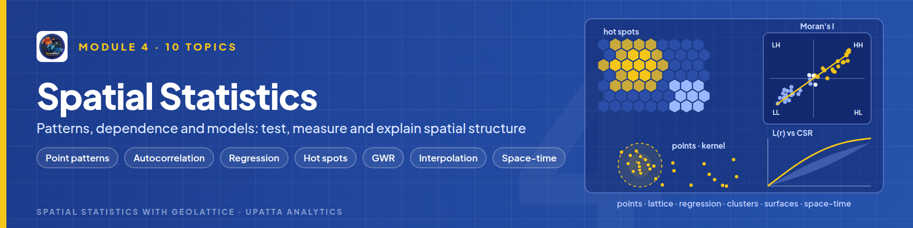
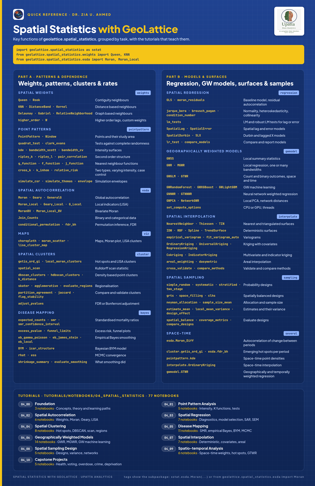

<p align="center">
  
</p>

Spatial statistics asks whether a pattern on a map is real. Are cases of a disease closer together than chance would put them? Are high values next to high values? Does a relationship hold everywhere, or change from place to place? Which counties are hot spots, and how stable is a rate based on a few hundred people? Each method in this chapter replaces a visual impression with a model, a test and a measure of uncertainty that respects the fact that nearby places are alike.

These 77 notebooks are chapter 04 of the [GeoLattice](https://github.com/zia207/GeoLattice) tutorials. They cover point patterns, spatial autocorrelation, spatial regression, clustering, disease mapping, geographically weighted models, interpolation, sampling design and space-time analysis, and finish with five capstone projects, using `geolattice.spatial_statistics` with real data from the United States.

## GeoLattice

GeoLattice is a Python library for geospatial analysis that brings vector and raster processing, spatial analysis, spatial statistics, geostatistics, spatial databases, web and cloud GIS and remote sensing together under one import. It is built on GDAL, NumPy, pandas, GeoPandas, Shapely and xarray, so its functions take and return objects these libraries already use: GeoDataFrames, NumPy arrays and GDAL-readable files.

| | |
|---|---|
| **Package** | `geolattice` |
| **Repository** | [github.com/zia207/GeoLattice](https://github.com/zia207/GeoLattice) |
| **Python** | 3.10 or newer |
| **License** | MIT |
| **Author** | Zia Ahmed, Upatta Analytics |

GDAL and PROJ must be installed first, with Python GDAL bindings that match the GDAL library (conda or your system package manager). Then install the spatial statistics option:

```bash
python3 -m pip install "geolattice[statistics]"
```

`geolattice.spatial_statistics` is organised in subpackages. Import the package, or import names from a subpackage:

```python
import geolattice.spatial_statistics as sstat
from geolattice.spatial_statistics.weights import KNN, Queen
from geolattice.spatial_statistics.esda import Moran, Moran_Local
```

## Spatial weights and autocorrelation

Every spatial test starts by saying who is a neighbour of whom. A spatial weights matrix records that: polygons that share an edge or a corner, the k nearest points, everything within a distance, or the edges of a graph. Autocorrelation statistics then ask whether neighbours are more alike than chance, for the whole map (global) or around each place (local).

| Task | Functions |
|---|---|
| Contiguity weights (`weights`) | `Queen`, `Rook`, `higher_order` |
| Distance and graph weights (`weights`) | `KNN`, `DistanceBand`, `Kernel`, `Delaunay`, `Gabriel`, `RelativeNeighborhood` |
| Global autocorrelation (`esda`) | `Moran`, `Geary`, `GeneralG`, `Join_Counts`, `MoranBV`, `Moran_Diff` |
| Local autocorrelation (`esda`) | `Moran_Local`, `Geary_Local`, `G_Local`, `Moran_Local_BV` |
| Inference (`esda`) | `conditional_permutation`, `fdr_bh` |
| Maps (`viz`) | `choropleth`, `moran_scatter`, `lisa_cluster_map` |

## Point patterns

A point pattern is a set of event locations, such as crimes, trees or disease cases, inside a study window. First-order analysis estimates how intensity varies over the window; second-order analysis asks whether points attract or repel each other at a given distance, compared with complete spatial randomness (CSR).

| Task | Functions (`pointpattern`) |
|---|---|
| Points and windows | `PointPattern`, `Window` |
| Intensity | `quadrat_test`, `kde`, `bandwidth_scott`, `bandwidth_cv`, `relative_risk` |
| Distance functions | `clark_evans`, `g_function`, `f_function`, `j_function` |
| Second-order functions | `ripley_k`, `ripley_l`, `pair_correlation`, `cross_k`, `k_inhom` |
| Simulation and envelopes | `simulate_csr`, `simulate_thomas`, `simulate_matern_inhibition`, `envelope` |

## Spatial regression

Ordinary least squares assumes the errors are independent, which spatial data rarely allow. Diagnostics on the OLS residuals, especially the Lagrange multiplier tests, say whether the dependence belongs in the outcome (a spatial lag model) or in the errors (a spatial error model).

| Task | Functions (`regression`) |
|---|---|
| Baseline and diagnostics | `OLS`, `moran_residuals`, `jarque_bera`, `breusch_pagan`, `condition_number` |
| Model selection | `lm_tests` |
| Spatial models | `SpatialLag`, `SpatialError`, `SpatialDurbin`, `SLX` |
| Comparison | `lr_test`, `compare_models` |

The Georgia data bundled with the package (159 county centroids) runs this whole workflow:

```python
import geolattice.spatial_statistics as sstat
from geolattice.spatial_statistics.weights import KNN
from geolattice.spatial_statistics.esda import Moran, Moran_Local
from geolattice.spatial_statistics.regression import OLS, lm_tests, SpatialLag
from geolattice.spatial_statistics.gwmodel import GWR

georgia, predictors, response = sstat.datasets.load_georgia()   # 159 county centroids
w = KNN(georgia, k=6)                                             # 6 nearest counties

print(Moran(georgia["PctBach"], w, seed=0))                       # global autocorrelation
lisa = Moran_Local(georgia["PctBach"], w, seed=0)                 # local clusters (LISA)

X = georgia[["PctRural", "PctPov", "PctBlack"]]
ols = OLS(georgia["PctBach"], X, w=w)                             # baseline model
print(lm_tests(ols, w))                                           # lag or error?
print(SpatialLag(georgia["PctBach"], X, w))                       # spatial lag model
gwr = GWR().fit(X, georgia["PctBach"], georgia.geometry)          # local coefficients
```

## Clusters and disease mapping

Cluster methods find where values or events concentrate: hot and cold spots of a measured value, dense groups of points, circles that hold more cases than their population predicts, or regions of similar, contiguous areas. Disease mapping deals with the rates behind those maps: in small populations a raw rate is noisy, so empirical Bayes and Bayesian (BYM) models borrow strength from the rest of the map and from neighbours.

| Task | Functions |
|---|---|
| Hot spots (`cluster`) | `getis_ord_gi`, `local_moran_clusters`, `adjust_pvalues` |
| Point and case clusters (`cluster`) | `dbscan_clusters`, `hdbscan_clusters`, `k_distance`, `spatial_scan` |
| Regionalisation (`cluster`) | `skater`, `agglomerative`, `evaluate_regions`, `partition_agreement`, `flag_stability` |
| Raw rates (`bayes`) | `expected_counts`, `smr`, `smr_confidence_interval`, `excess_pvalue`, `funnel_limits` |
| Smoothing (`bayes`) | `eb_gamma_poisson`, `eb_james_stein`, `eb_local`, `BYM`, `icar_structure` |
| Checks (`bayes`) | `rhat`, `ess`, `shrinkage_summary`, `evaluate_smoothing` |

## Geographically weighted models

A global regression gives one coefficient for the whole map. Geographically weighted models fit a separate, distance-weighted model around every location, so each coefficient becomes a surface. The bandwidth sets how local "local" is.

| Task | Functions (`gwmodel`) |
|---|---|
| Local statistics | `GWSS` |
| Local regression | `GWR`, `MGWR`, `GWGLM` |
| Space and time | `GTWR`, `GTNNWR` |
| Machine learning and deep models | `GWRandomForest`, `GWXGBoost`, `GWLightGBM`, `GNNWR` |
| Other variants | `GWPCA`, `NetworkGWR` |
| Compute | `set_compute_options`, `get_compute_config` |

## Interpolation and sampling design

Interpolation predicts a surface from samples, either with deterministic rules (nearest neighbour, inverse distance, splines) or with kriging, and moves counts between incompatible zones (areal interpolation). Sampling design works the other way: it decides where to take the samples so that estimates are unbiased and precise.

| Task | Functions |
|---|---|
| Deterministic surfaces (`interpolate`) | `NearestNeighbor`, `Thiessen`, `TIN`, `IDW`, `RBF`, `Spline`, `ThinPlateSpline`, `TrendSurface` |
| Kriging (`interpolate`) | `empirical_variogram`, `fit_variogram_auto`, `OrdinaryKriging`, `UniversalKriging`, `RegressionKriging` |
| Areal interpolation (`interpolate`) | `areal_weighting`, `dasymetric` |
| Validation (`interpolate`) | `cross_validate`, `grid_search`, `compare_methods` |
| Designs (`sampling`) | `simple_random`, `systematic`, `stratified`, `two_stage`, `grts`, `space_filling`, `clhs` |
| Estimation and evaluation (`sampling`) | `estimate_mean`, `local_mean_variance`, `design_effect`, `spatial_balance`, `compare_designs` |

## Space-time analysis

Space-time data add a second axis: the same counties every year, or crimes with a time stamp. The space-time notebooks combine the tools above: Moran's I per year and on the change between years (`Moran_Diff`), Gi* per year with a trend test for emerging hot spots, kernel density by time slice, space-time variograms and IDW, and GTWR.

## Tutorials {#tutorials}

Start with the foundation notebooks and spatial autocorrelation, since the weights and tests introduced there are used everywhere else. The other topics can be read in any order, and the capstones combine them.

### Foundation

| Tutorial | Topic |
|----------|--------|
| [Spatial Statistics](04_00_foundation/04_00_01_spatial_statistics_introduction.ipynb) | What spatial statistics is and the questions it answers |
| [Core Theoretical Concepts](04_00_foundation/04_00_02_core_theoretical_concepts.ipynb) | Spatial dependence, data types, stationarity, MAUP, CSR, weights |
| [Module Map and Learning Paths](04_00_foundation/04_00_03_module_map_and_learning_paths.ipynb) | The spatial_statistics API and suggested learning paths |

### Point Pattern Analysis

| Tutorial | Topic |
|----------|--------|
| [Point Pattern Analysis](04_01_point_pattern/04_01_01_point_pattern_fundamentals.ipynb) | Point processes, windows and marks on Buffalo crime data |
| [Spatial Intensity](04_01_point_pattern/04_01_02_spatial_intensity.ipynb) | Quadrats, kernel density, bandwidths and relative risk |
| [Second-order Functions](04_01_point_pattern/04_01_03_second_order_functions.ipynb) | Clark-Evans, G, F, J, Ripley's K and L, pair correlation |
| [Hypothesis Testing](04_01_point_pattern/04_01_04_hypothesis_testing.ipynb) | Monte Carlo envelopes, inhomogeneous K and cross-K |
| [Areal Integration and Pitfalls](04_01_point_pattern/04_01_05_areal_integration_pitfalls.ipynb) | Aggregating points to areas, counts vs rates, MAUP |

### Spatial Autocorrelation

| Tutorial | Topic |
|----------|--------|
| [Spatial Autocorrelation](04_02_spatial_autocorrelation/04_02_01_concepts_and_foundations.ipynb) | Spatial dependence, heterogeneity and scale |
| [Spatial Weights](04_02_spatial_autocorrelation/04_02_02_spatial_weights.ipynb) | Contiguity, distance and graph weights, higher orders |
| [Visualisation and Exploration](04_02_spatial_autocorrelation/04_02_03_visualization_exploratory.ipynb) | Choropleth classes and the Moran scatterplot |
| [Global Autocorrelation](04_02_spatial_autocorrelation/04_02_04_global_autocorrelation.ipynb) | Moran's I, Geary's C, General G, join counts, bivariate |
| [Local Spatial Autocorrelation (LISA)](04_02_spatial_autocorrelation/04_02_05_local_autocorrelation_lisa.ipynb) | Local Moran, permutation inference, LISA maps, Gi* |
| [Sensitivity and Pitfalls](04_02_spatial_autocorrelation/04_02_06_sensitivity_pitfalls_exercises.ipynb) | How weights, permutations and seeds change results |

### Spatial Regression

| Tutorial | Topic |
|----------|--------|
| [Spatial Regression](04_03_spatial_regression/04_03_01_foundations.ipynb) | Why OLS fails on spatial data, model taxonomy |
| [OLS Baseline and Diagnostics](04_03_spatial_regression/04_03_02_ols_baseline_diagnostics.ipynb) | OLS fit, classical diagnostics, residual Moran's I |
| [Model Selection](04_03_spatial_regression/04_03_03_model_selection.ipynb) | Lagrange multiplier tests and Anselin's decision rule |
| [Model Families](04_03_spatial_regression/04_03_04_model_families.ipynb) | Spatial lag, spatial error, SLX and Durbin models |
| [Comparison and Reporting](04_03_spatial_regression/04_03_05_comparison_reporting.ipynb) | Side-by-side comparison, likelihood-ratio tests, reporting |
| [Limits and Connections](04_03_spatial_regression/04_03_06_limits_connections.ipynb) | Global models and the bridge to local regression |
| [Exercises](04_03_spatial_regression/04_03_07_exercises.ipynb) | A code skeleton to adapt |

### Spatial Clustering

| Tutorial | Topic |
|----------|--------|
| [Spatial Cluster Analysis](04_04_spatial_cluster/04_04_01_concepts_overview.ipynb) | Four families of cluster methods on the same data |
| [Hot-Spot Detection](04_04_spatial_cluster/04_04_02_hotspot_detection.ipynb) | Getis-Ord Gi*, local Moran and local Geary |
| [Density-Based Clustering](04_04_spatial_cluster/04_04_03_density_clustering.ipynb) | k-distance plots, DBSCAN and HDBSCAN |
| [Spatial Scan Statistic](04_04_spatial_cluster/04_04_04_scan_statistic.ipynb) | Kulldorff scan statistic for clusters of cases |
| [Regionalisation](04_04_spatial_cluster/04_04_05_regionalisation.ipynb) | SKATER and constrained agglomerative clustering |
| [Comparing and Validating](04_04_spatial_cluster/04_04_06_comparing_validating.ipynb) | Agreement between methods and regionalisations |
| [Bridges](04_04_spatial_cluster/04_04_07_bridges.ipynb) | Toward emerging hot spots and population-adjusted risk |
| [Exercises](04_04_spatial_cluster/04_04_08_exercises.ipynb) | Practice with cluster methods |

### Disease Mapping

| Tutorial | Topic |
|----------|--------|
| [Disease Mapping](04_05_disease_mapping/04_05_01_introduction_objectives.ipynb) | What disease mapping does and a first look |
| [The Small-Area Problem](04_05_disease_mapping/04_05_02_small_area_problem.ipynb) | Poisson variability, funnel plots, unstable rankings |
| [Data Preparation](04_05_disease_mapping/04_05_03_data_preparation.ipynb) | Observed and expected counts, weights for ICAR |
| [Raw Estimates](04_05_disease_mapping/04_05_04_raw_estimates.ipynb) | Crude rates, SMR, exact intervals, excess p-values |
| [Empirical Bayes Smoothing](04_05_disease_mapping/04_05_05_empirical_bayes.ipynb) | Gamma-Poisson, James-Stein and local empirical Bayes |
| [BYM and BYM2 Models](04_05_disease_mapping/04_05_06_bym_models.ipynb) | BYM and BYM2 with and without covariates |
| [MCMC Implementation](04_05_disease_mapping/04_05_07_mcmc_implementation.ipynb) | Built-in sampler, PyMC backend, convergence, DIC |
| [Comparing Smoothing Methods](04_05_disease_mapping/04_05_08_comparing_evaluating.ipynb) | Raw vs smoothed maps, evaluation against a known truth |
| [Shrinkage Assessment](04_05_disease_mapping/04_05_09_shrinkage_assessment.ipynb) | How much each area moved and why |
| [Reporting and Ethics](04_05_disease_mapping/04_05_10_reporting_ethics.ipynb) | Uncertainty, small-cell suppression, ecological fallacy |
| [Hand-offs and Exercises](04_05_disease_mapping/04_05_11_handoffs_exercises.ipynb) | Links to GW models and space-time analysis |

### Geographically Weighted Models

| Tutorial | Topic |
|----------|--------|
| [Geographically Weighted Models](04_06_geographically_weighted_models/04_06_01_introduction_motivation.ipynb) | Non-stationarity and bandwidth as a spatial scale |
| [Data](04_06_geographically_weighted_models/04_06_02_data.ipynb) | The diabetes_atlantic data and the space-time panel |
| [Kernels and Bandwidths](04_06_geographically_weighted_models/04_06_03_kernels_bandwidth.ipynb) | Kernel functions, fixed vs adaptive, bandwidth search |
| [GWSS](04_06_geographically_weighted_models/04_06_04_gwss_exploratory.ipynb) | Local means, spread and correlation |
| [GWR and Inference](04_06_geographically_weighted_models/04_06_05_gwr_inference.ipynb) | Local coefficients, significance, local R², prediction |
| [Advanced Variants](04_06_geographically_weighted_models/04_06_06_advanced_variants.ipynb) | MGWR, mixed GWR and GWGLM |
| [Diagnostics](04_06_geographically_weighted_models/04_06_07_diagnostics.ipynb) | Residual autocorrelation, non-stationarity tests, collinearity |
| [Comparing Models](04_06_geographically_weighted_models/04_06_08_comparing_models.ipynb) | Global, spatial and local models on the same data |
| [Machine-Learning GW Models](04_06_geographically_weighted_models/04_06_09_ml_ensemble_models.ipynb) | GW random forest, XGBoost and LightGBM, spatial CV |
| [Spatio-Temporal and Multivariate](04_06_geographically_weighted_models/04_06_10_spatiotemporal_multivariate.ipynb) | GTWR and GWPCA |
| [Deep and Network Models](04_06_geographically_weighted_models/04_06_11_deep_network_models.ipynb) | GNNWR, GTNNWR and NetworkGWR |
| [Performance and Scaling](04_06_geographically_weighted_models/04_06_12_performance_scaling.ipynb) | Compute options, fit times, GPUs |
| [Model Selection and Troubleshooting](04_06_geographically_weighted_models/04_06_13_model_selection_troubleshooting.ipynb) | Choosing a model and four failure modes |
| [Exercises](04_06_geographically_weighted_models/04_06_14_exercises.ipynb) | Practice with GW models |

### Spatial Interpolation

| Tutorial | Topic |
|----------|--------|
| [Spatial Interpolation](04_07_spatial_interpolation/04_07_01_introduction_concepts.ipynb) | Fields, exact vs smoothing interpolators, uncertainty |
| [Data and Preparation](04_07_spatial_interpolation/04_07_02_data_preparation.ipynb) | California PM2.5 site means and a prediction grid |
| [Deterministic Interpolation](04_07_spatial_interpolation/04_07_03_deterministic_interpolation.ipynb) | Trend surface, Thiessen, nearest, TIN, IDW, splines |
| [Model Validation](04_07_spatial_interpolation/04_07_04_model_validation.ipynb) | Leave-one-out vs spatial-block CV, tuning IDW |
| [Covariate-Assisted Interpolation](04_07_spatial_interpolation/04_07_05_covariate_assisted_interpolation.ipynb) | GWR and regression kriging with covariates |
| [Areal Interpolation](04_07_spatial_interpolation/04_07_06_areal_interpolation.ipynb) | Area weighting and dasymetric interpolation |
| [Exercises](04_07_spatial_interpolation/04_07_07_exercises.ipynb) | Practice with interpolation |

### Spatial Sampling Design

| Tutorial | Topic |
|----------|--------|
| [Spatial Sampling and Design](04_08_spatial_sampling_design/04_08_01_foundations.ipynb) | Design- vs model-based inference, balance, design effect |
| [Sampling Designs](04_08_spatial_sampling_design/04_08_02_sampling_designs.ipynb) | Classical, stratified, cluster, GRTS, space-filling, cLHS |
| [Estimation and Variance](04_08_spatial_sampling_design/04_08_03_estimation_variance.ipynb) | Estimator variance by design, 800 simulated replicates |
| [Monitoring-Network Design](04_08_spatial_sampling_design/04_08_04_monitoring_network_design.ipynb) | Evaluating and extending a monitoring network |
| [Exercises](04_08_spatial_sampling_design/04_08_05_exercises.ipynb) | Practice with sampling designs |

### Spatio-Temporal Analysis

| Tutorial | Topic |
|----------|--------|
| [Spatio-Temporal Analysis](04_09_spatio_temporal_analysis/04_09_01_concepts_data.ipynb) | The space-time cube, county panel and crime points |
| [Space-Time Weights](04_09_spatio_temporal_analysis/04_09_02_spacetime_weights_global.ipynb) | Moran's I by year, Moran_Diff, the Knox test |
| [Local and Emerging Hot Spots](04_09_spatio_temporal_analysis/04_09_03_local_emerging_hotspots.ipynb) | Yearly Gi*, Mann-Kendall trends, emerging hot spots |
| [Space-Time Point Patterns](04_09_spatio_temporal_analysis/04_09_04_spacetime_point_patterns_density.ipynb) | Kernel density by time-of-day slice |
| [Space-Time Interpolation](04_09_spatio_temporal_analysis/04_09_05_spacetime_interpolation.ipynb) | Space-time variogram and space-time IDW |
| [Regression with Space-Time Data](04_09_spatio_temporal_analysis/04_09_06_regression_spacetime_data.ipynb) | Pooled OLS, two-way fixed effects and GTWR |

### Capstone Projects

| Tutorial | Topic |
|----------|--------|
| [Health Disparities](04_10_capstone/04_10_01_health_disparities.ipynb) | Health outcomes and deprivation across US counties |
| [Voting Patterns, 2020 vs 2024](04_10_capstone/04_10_02_voting_pattern.ipynb) | Presidential voting, 2020 vs 2024: persistence and shift |
| [Drug Overdose Mortality](04_10_capstone/04_10_03_drug_overdose.ipynb) | Overdose mortality, rates vs modelled rates, GW models |
| [Crime in NYC Precincts](04_10_capstone/04_10_04_spatial_temporal_crime_analysis_NYC.ipynb) | Hot spots and predictors of crime across NYC precincts |
| [Economic Deprivation](04_10_capstone/04_10_05_spatial_inequality_economic_deprivation.ipynb) | An economic deprivation index and its hot spots |

### Quick reference

<p align="center">
  
</p>

## Sample data

The notebooks read the sample data in [`Data/00_shared/data_spatial_stat/`](https://github.com/zia207/GeoLattice/tree/main/Data/00_shared/data_spatial_stat) of the repository: Buffalo crime incidents and city boundaries, US, Atlantic and Northeast county layers with health indicators, California PM2.5 monitors, NYC precinct crime data, and the datasets bundled with the package (`sstat.datasets`).

## License

GeoLattice is released under the MIT License. See [LICENSE](https://github.com/zia207/GeoLattice/blob/main/LICENSE).

<p align="center">
  <br>
  Developed by Zia Ahmed, Upatta Analytics
</p>
