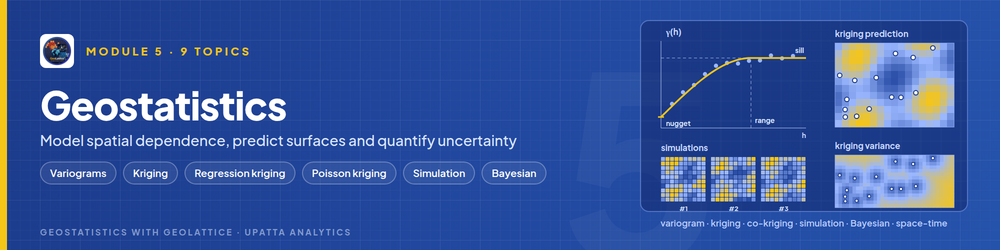
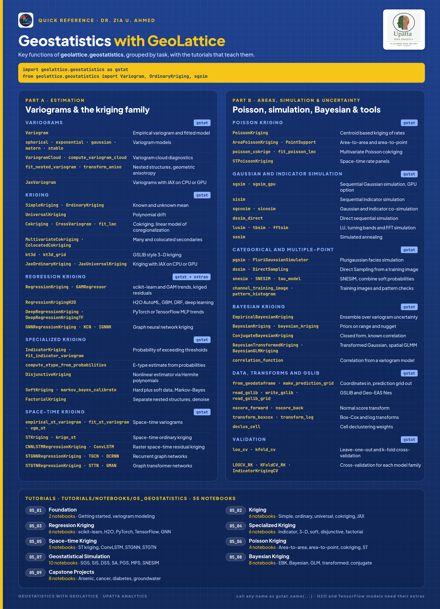

<p align="center">
  
</p>

Geostatistics predicts a continuous surface from a limited number of samples and says how uncertain each prediction is. Soil carbon from a few thousand cores, arsenic in wells, air pollution from a handful of monitors: the variogram measures how quickly similarity fades with distance, kriging turns that into the best linear prediction at unsampled places, and simulation produces many equally likely maps when a single smooth estimate is not enough to judge risk.

These 55 notebooks are chapter 05 of the [GeoLattice](https://github.com/zia207/GeoLattice) tutorials. They cover variograms, the kriging family, regression and space-time kriging, Poisson kriging of rates, geostatistical simulation and Bayesian kriging, and finish with eight capstone projects, using `geolattice.geostatistics` with real data from Switzerland (Jura), the United States and Bangladesh.

## GeoLattice

GeoLattice is a Python library for geospatial analysis that brings vector and raster processing, spatial analysis, spatial statistics, geostatistics, spatial databases, web and cloud GIS and remote sensing together under one import. It is built on GDAL, NumPy, pandas, GeoPandas, Shapely and xarray, so its functions take and return objects these libraries already use: GeoDataFrames, NumPy arrays and GDAL-readable files.

| | |
|---|---|
| **Package** | `geolattice` |
| **Repository** | [github.com/zia207/GeoLattice](https://github.com/zia207/GeoLattice) |
| **Python** | 3.10 or newer |
| **License** | MIT |
| **Author** | Zia Ahmed, Upatta Analytics |

GDAL and PROJ must be installed first, with Python GDAL bindings that match the GDAL library (conda or your system package manager). Then install the geostatistics option. The deep-learning regression kriging notebooks use PyTorch, which `geolattice[all]` includes; the H2O and TensorFlow notebooks need the `geostatistics-h2o` and `geostatistics-tensorflow` extras.

```bash
python3 -m pip install "geolattice[geostats]"
```

Every name in the chapter is available from one import:

```python
import geolattice.geostatistics as gstat
```

## Variograms and kriging

A variogram plots half the average squared difference between pairs of samples against the distance between them. It rises from the nugget (measurement error and very short-range variation) to the sill (the total variance) at the range, beyond which samples are unrelated. Kriging uses the fitted model to weight the samples around each target so that the prediction is unbiased and its error variance is as small as possible, and the kriging variance maps that error.

| Task | Functions (`gstat`) |
|---|---|
| Variograms | `Variogram`, `VariogramCloud`, `fit_nested_variogram`, `transform_aniso`, `JaxVariogram` |
| Variogram models | `spherical`, `exponential`, `gaussian`, `matern`, `stable`, `cubic` |
| Kriging | `SimpleKriging`, `OrdinaryKriging`, `UniversalKriging`, `kt3d`, `JaxOrdinaryKriging` |
| Several variables | `Cokriging`, `CrossVariogram`, `fit_lmc`, `MultivariateCokriging`, `ColocatedCokriging` |
| Validation | `loo_cv`, `kfold_cv` |
| Data and transforms | `from_geodataframe`, `make_prediction_grid`, `nscore_forward`, `nscore_back`, `transform_boxcox`, `declus_cell` |

Ordinary kriging of log cadmium on the Jura data, run from the repository root:

```python
import numpy as np
import pandas as pd
import geolattice.geostatistics as gstat

DATA = "Data/00_shared/data_geostatistics"
jura = pd.read_csv(f"{DATA}/jura_data.csv")                         # 359 soil samples
grid = pd.read_csv(f"{DATA}/jura_grid.csv")                         # prediction nodes
coords, cd = jura[["Xloc", "Yloc"]].to_numpy(), np.log(jura["Cd"].to_numpy())

vg = gstat.Variogram(coords, cd, model="spherical")                 # empirical + fitted model
vg.fit()
ok = gstat.OrdinaryKriging(vg).fit(coords, cd)
pred, var = ok.predict(grid[["Xloc", "Yloc"]].to_numpy(), return_variance=True)

cv = gstat.loo_cv(gstat.OrdinaryKriging(vg), coords, cd)            # leave-one-out check
print(f"LOO RMSE {cv['rmse']:.3f}, R2 {cv['r2']:.3f}")
```

## Regression and specialized kriging

When covariates explain part of the variation, regression kriging fits a trend model (from linear regression to random forests and neural networks) and krigs what the trend leaves behind. Specialized kriging handles questions ordinary kriging cannot: the probability of exceeding a threshold (indicator kriging), three-dimensional data, soft information, strongly skewed variables (disjunctive kriging) and separating the scales of a nested variogram (factorial kriging).

| Task | Functions (`gstat`) |
|---|---|
| Regression kriging | `RegressionKriging`, `GAMRegressor`, `RegressionKrigingH2O`, `DeepRegressionKriging`, `DeepRegressionKrigingTF` |
| Graph neural networks | `GNNRegressionKriging`, `KCN`, `IGNNK` |
| Indicator kriging | `IndicatorKriging`, `fit_indicator_variogram`, `compute_etype_from_probabilities` |
| Other estimators | `DisjunctiveKriging`, `SoftKriging`, `markov_bayes_calibrate`, `FactorialKriging` |
| Cross-validation | `LOOCV_RK`, `KFoldCV_RK`, `IndicatorKrigingCV` |

## Space-time and Poisson kriging

Monitoring networks measure the same places repeatedly, so a space-time variogram describes how similarity fades with both distance and time lag. Poisson kriging is built for rates, such as disease incidence in counties, where small populations make raw rates unreliable: it weights each area by its population and can predict for areas or for points inside them.

| Task | Functions (`gstat`) |
|---|---|
| Space-time variograms | `empirical_st_variogram`, `fit_st_variogram`, `vgm_st` |
| Space-time kriging | `STKriging`, `krige_st` |
| Space-time deep learning | `CNNLSTMRegressionKriging`, `STGNNRegressionKriging`, `TGCN`, `DCRNN`, `STGTNRegressionKriging`, `STTN`, `GMAN` |
| Poisson kriging | `PoissonKriging`, `AreaPoissonKriging`, `PointSupport`, `poisson_cokrige`, `fit_poisson_lmc`, `STPoissonKriging` |

## Simulation and Bayesian kriging

Kriging maps are smoother than reality. Simulation draws many maps that honour the data, the histogram and the variogram, so that uncertainty about areas, volumes or connected paths can be counted directly. Bayesian kriging carries the uncertainty about the variogram itself into the predictions.

| Task | Functions (`gstat`) |
|---|---|
| Gaussian and indicator simulation | `sgsim`, `sgsim_gpu`, `sisim`, `sgcosim`, `sicosim`, `dssim_direct` |
| Other continuous methods | `lusim`, `tbsim`, `fftsim`, `sasim` |
| Categorical and multiple-point | `pgsim`, `PluriGaussianSimulator`, `dssim`, `DirectSampling`, `snesim`, `SNESIM`, `tau_model` |
| Bayesian kriging | `EmpiricalBayesianKriging`, `BayesianKriging`, `bayesian_kriging`, `ConjugateBayesianKriging` |
| Bayesian transforms and counts | `BayesianTransformedKriging`, `BayesianGLMKriging`, `correlation_function` |
| GSLIB files | `read_gslib`, `write_gslib`, `read_gslib_grid` |

## Tutorials {#tutorials}

Start with the foundation notebooks and ordinary kriging, since the variogram and the kriging system introduced there are used everywhere else. The other topics can be read in any order, and the capstones combine them.

### Foundation

| Tutorial | Topic |
|----------|--------|
| [Introduction to Geostatistics](05_01_foundation/05_00_getting_started.ipynb) | Kriging, variogram types and the GeoLattice geostatistics module |
| [Variogram Modeling](05_01_foundation/05_01_variogram_modeling.ipynb) | Robust estimators, isotropic and anisotropic models, CPU vs GPU |

### Kriging

| Tutorial | Topic |
|----------|--------|
| [Kriging](05_02_kriging/05_02_00_introduction_kriging.ipynb) | How kriging works and the four classic estimators |
| [Simple Kriging](05_02_kriging/05_02_01_simple_kriging.ipynb) | Kriging with a known mean on the Jura data |
| [Ordinary Kriging](05_02_kriging/05_02_02_ordinary_kriging.ipynb) | Kriging with an unknown mean, validation and maps |
| [Universal Kriging](05_02_kriging/05_02_03_universal_kriging.ipynb) | Polynomial trends and the residual variogram |
| [Cokriging](05_02_kriging/05_02_04_cokriging.ipynb) | Full and colocated cokriging with a linear model of coregionalization |
| [Kriging with JAX: Great Plains SOC](05_02_kriging/05_02_05_gp_data_5000_jax_comparison.ipynb) | Four kriging methods with JAX on 5,000 soil carbon samples |

### Regression Kriging

| Tutorial | Topic |
|----------|--------|
| [Regression Kriging](05_03_regression_kriging/05_03_00_introduction_regression_kriging.ipynb) | Trend plus kriged residuals, external drift |
| [Regression Kriging: scikit-learn](05_03_regression_kriging/05_03_01_regression_kriging_scikit_learn.ipynb) | Linear, ensemble and GAM trends for soil carbon |
| [Regression Kriging: H2O](05_03_regression_kriging/05_03_02_regression_kriging_h2o.ipynb) | H2O AutoML and boosted trends |
| [Regression Kriging: PyTorch](05_03_regression_kriging/05_03_03_regression_kriging_pytorch.ipynb) | Deep neural network trends in PyTorch |
| [Regression Kriging: TensorFlow](05_03_regression_kriging/05_03_04_regression_kriging_dnn_tf.ipynb) | Deep neural network trends in TensorFlow |
| [Regression Kriging: Graph Neural Networks](05_03_regression_kriging/05_03_05_regression_kriging_gnn.ipynb) | Graph neural network trends |

### Specialized Kriging

| Tutorial | Topic |
|----------|--------|
| [Specialized Kriging](05_04_specialized_kriging/05_04_00_specialized_kriging.ipynb) | Indicator, 3-D, soft, disjunctive and factorial kriging |
| [Indicator Kriging](05_04_specialized_kriging/05_04_01_indicator_kriging.ipynb) | Exceedance probabilities, conditional CDFs, E-type estimates |
| [3-D Kriging (KT3D)](05_04_specialized_kriging/05_04_02_kriging_3d.ipynb) | GSLIB kt3d: 3-D search, anisotropy and block kriging |
| [Soft Kriging](05_04_specialized_kriging/05_04_03_soft_kriging.ipynb) | Hard and soft data with Markov-Bayes calibration |
| [Disjunctive Kriging](05_04_specialized_kriging/05_04_04_disjunctive_kriging.ipynb) | Gaussian anamorphosis and Hermite polynomials |
| [Factorial Kriging](05_04_specialized_kriging/05_04_05_factorial_kriging.ipynb) | Separating the structures of a nested variogram |

### Space-Time Kriging

| Tutorial | Topic |
|----------|--------|
| [Spatio-Temporal Kriging](05_05_spatial_temporal_kriging/05_05_00_spatial_temporal_kriging.ipynb) | Neural trends with kriged space-time residuals |
| [Space-Time Kriging](05_05_spatial_temporal_kriging/05_05_01_kriging_st.ipynb) | Space-time variograms and kriging of California PM2.5 |
| [ConvLSTM Regression Kriging](05_05_spatial_temporal_kriging/05_05_02_kriging_cnn_lstm.ipynb) | Rasterised sensor network with a ConvLSTM |
| [Space-Time GNN Kriging](05_05_spatial_temporal_kriging/05_05_03_kriging_stgnn.ipynb) | TGCN and DCRNN on a sensor graph |
| [Space-Time Graph Transformer Kriging](05_05_spatial_temporal_kriging/05_05_04_kriging_stgtn.ipynb) | STTN and GMAN graph transformers |

### Poisson Kriging

| Tutorial | Topic |
|----------|--------|
| [Poisson Kriging](05_06_poisson_kriging/05_06_00_poisson_kriging.ipynb) | Kriging of rates from small populations |
| [Area-to-Area and Area-to-Point](05_06_poisson_kriging/05_06_01_poisson_kriging_ata_atp.ipynb) | Centroid, area-to-area and area-to-point estimators |
| [Poisson Cokriging](05_06_poisson_kriging/05_06_02_poisson_cokriging.ipynb) | Several diseases with a linear model of coregionalization |
| [Space-Time Poisson Kriging](05_06_poisson_kriging/05_06_03_poisson_kriging_st.ipynb) | Space-time Poisson kriging of cancer rates |

### Geostatistical Simulation

| Tutorial | Topic |
|----------|--------|
| [Geostatistical Simulation](05_07_geostatistical_simulation/05_07_00_introduction_geostatistical_sumulations.ipynb) | What simulation adds to kriging, and which method to use |
| [Sequential Gaussian Simulation](05_07_geostatistical_simulation/05_07_01_sgsim.ipynb) | Sequential Gaussian simulation: conditioning and reproduction |
| [Sequential Gaussian Co-Simulation](05_07_geostatistical_simulation/05_07_02_sgcosim.ipynb) | Co-simulation with an exhaustive secondary variable |
| [Sequential Indicator Simulation](05_07_geostatistical_simulation/05_07_03_sisim.ipynb) | Indicator variograms, order relations and tails |
| [Sequential Indicator Co-Simulation](05_07_geostatistical_simulation/05_07_04_sicosim.ipynb) | Indicator co-simulation with soft data |
| [Direct Sequential Simulation](05_07_geostatistical_simulation/05_07_05_dssim.ipynb) | Simulation in original units |
| [Simulated Annealing](05_07_geostatistical_simulation/05_07_06_sasim.ipynb) | Variogram reproduction by simulated annealing |
| [Plurigaussian Simulation](05_07_geostatistical_simulation/05_07_07_pgs.ipynb) | Facies from truncated latent Gaussian fields |
| [Multiple-Point Simulation](05_07_geostatistical_simulation/05_07_08_mps.ipynb) | Direct Sampling and SNESIM from a training image |
| [SNESIM](05_07_geostatistical_simulation/05_07_09_snesim.ipynb) | Templates, multiple grids and proportion control |

### Bayesian Kriging

| Tutorial | Topic |
|----------|--------|
| [Bayesian Kriging](05_08_bayesian_kriging/05_08_00_introduction_bayesian_kriging.ipynb) | Types of Bayesian kriging and how to choose |
| [Empirical Bayesian Kriging](05_08_bayesian_kriging/05_08_01_empirical_bayesian_kriging.ipynb) | An ensemble of variograms instead of one |
| [Bayesian Kriging Models](05_08_bayesian_kriging/05_08_02_bayesian_kriging.ipynb) | Priors on range and nugget, exceedance maps |
| [Bayesian GLM Kriging](05_08_bayesian_kriging/05_08_03_bayesian_glm_kriging.ipynb) | Poisson spatial GLMM for count data |
| [Bayesian Transformed Kriging](05_08_bayesian_kriging/05_08_04_bayesian_transformed_kriging.ipynb) | Box-Cox uncertainty and back-transformation |
| [Conjugate Bayesian Kriging](05_08_bayesian_kriging/05_08_05_conjugate_bayesian_kriging.ipynb) | Closed-form posterior with a known correlation |
| [Bayesian Kriging in One Call](05_08_bayesian_kriging/05_08_06_bayesian_kriging_function.ipynb) | Validation and maps with bayesian_kriging |
| [Correlation Functions](05_08_bayesian_kriging/05_08_07_correlation_function.ipynb) | Correlation models, ranges and smoothness |

### Capstone Projects

| Tutorial | Topic |
|----------|--------|
| [Groundwater Arsenic Risk](05_09_capstone/05_09_01_groundwater_arsenic_risk.ipynb) | Probability that well arsenic exceeds a limit, Bangladesh |
| [Arsenic and Cancer Risk](05_09_capstone/05_09_02_arsenic_cancer_risk.ipynb) | Arsenic exposure from water and rice, cancer risk |
| [Paddy Soil Arsenic Risk](05_09_capstone/05_09_03_uncertinity_risk_mapping.ipynb) | Four kriging methods for paddy soil arsenic |
| [Soil Cadmium in the USA](05_09_capstone/05_09_04_cd_mapping_in_usa.ipynb) | Factorial and Bayesian kriging of soil cadmium |
| [Diabetes and Obesity](05_09_capstone/05_09_05_poisson_cokriging_diabetes_obesity.ipynb) | Multivariate Poisson cokriging across US counties |
| [Micronutrient Deficiency](05_09_capstone/05_09_06_micronutrient_deficiency_mapping_Bangladesh.ipynb) | Deficiency probability maps for soil nutrients |
| [STIs and HIV in California](05_09_capstone/05_09_07_poisson_kriging_STD.ipynb) | Poisson kriging in space, time and across diseases |
| [Groundwater Forecasting](05_09_capstone/05_09_08_spatial_temporal_forcasting_groundwater_BD.ipynb) | Space-time kriging of groundwater levels, Rajshahi |

### Quick reference

<p align="center">
  
</p>

## Sample data

The notebooks read the sample data in [`Data/00_shared/data_geostatistics/`](https://github.com/zia207/GeoLattice/tree/main/Data/00_shared/data_geostatistics) of the repository: the Jura soil metals data and prediction grid, Great Plains soil organic carbon, California PM2.5 monitors, US county disease rates, Bangladesh groundwater and soil data, and GSLIB files.

## License

GeoLattice is released under the MIT License. See [LICENSE](https://github.com/zia207/GeoLattice/blob/main/LICENSE).

<p align="center">
  <br>
  Developed by Zia Ahmed, Upatta Analytics
</p>
