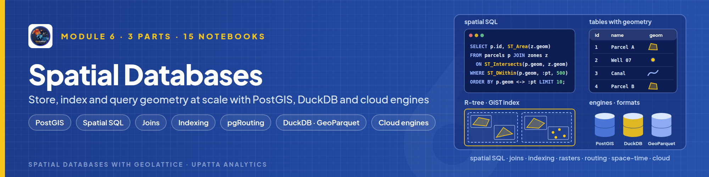
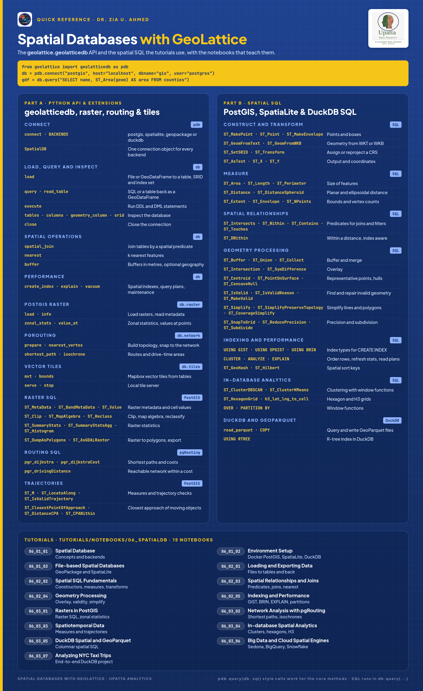

<p align="center">
  
</p>

Files work until the data grow, several people need them at once, or the same question has to be answered every day. A spatial database stores geometries next to the attributes, indexes them so that "what lies within 5 km of this road?" is answered without reading every row, and lets SQL do joins, overlays, raster statistics and routing where the data live.

These 15 notebooks are chapter 06 of the [GeoLattice](https://github.com/zia207/GeoLattice) tutorials. They move from database concepts and setup through spatial SQL, joins, geometry processing and indexing to rasters in PostGIS, routing with pgRouting, space-time data, in-database analytics, DuckDB with GeoParquet and cloud engines, using `geolattice.geolatticedb` with PostGIS, SpatiaLite, GeoPackage and DuckDB.

## GeoLattice

GeoLattice is a Python library for geospatial analysis that brings vector and raster processing, spatial analysis, spatial statistics, geostatistics, spatial databases, web and cloud GIS and remote sensing together under one import. It is built on GDAL, NumPy, pandas, GeoPandas, Shapely and xarray, so its functions take and return objects these libraries already use: GeoDataFrames, NumPy arrays and GDAL-readable files.

| | |
|---|---|
| **Package** | `geolattice` |
| **Repository** | [github.com/zia207/GeoLattice](https://github.com/zia207/GeoLattice) |
| **Python** | 3.10 or newer |
| **License** | MIT |
| **Author** | Zia Ahmed, Upatta Analytics |

GDAL and PROJ must be installed first, with Python GDAL bindings that match the GDAL library (conda or your system package manager). Spatial databases are part of the full installation:

```bash
python3 -m pip install "geolattice[all]"
```

The PostGIS notebooks also need a PostgreSQL server with PostGIS (and pgRouting for routing); the environment setup notebook runs one in Docker. DuckDB, SpatiaLite and GeoPackage need no server.

## One interface for four databases

`geolattice.geolatticedb` connects to PostGIS, SpatiaLite, GeoPackage or DuckDB through the same `connect` call and gives every connection the same methods. Results come back as GeoDataFrames.

| Task | Functions |
|---|---|
| Connect (`pdb`) | `connect`, `BACKENDS`, `SpatialDB` |
| Load and query (`db`) | `load`, `query`, `read_table`, `execute` |
| Inspect (`db`) | `tables`, `columns`, `geometry_column`, `srid` |
| Spatial operations (`db`) | `spatial_join`, `nearest`, `buffer` |
| Performance (`db`) | `create_index`, `explain`, `vacuum` |
| PostGIS raster (`db.raster`) | `load`, `info`, `zonal_stats`, `value_at` |
| pgRouting (`db.network`) | `prepare`, `nearest_vertex`, `shortest_path`, `isochrone` |
| Vector tiles (`db.tiles`) | `mvt`, `bounds`, `serve`, `stop` |

DuckDB runs inside Python, so this example needs no server. Run it from the repository root:

```python
from geolattice import geolatticedb as pdb

db = pdb.connect("duckdb")                                      # in-process, no server
db.load("Data/00_shared/vector_data/USA/US_COUNTY.shp", "counties")

largest = db.query("""
    SELECT STATE, COUNT(*) AS n, SUM(ST_Area(geom)) / 1e6 AS area_km2
    FROM counties GROUP BY STATE ORDER BY area_km2 DESC LIMIT 5
""")
print(largest)                                                  # Texas, California, Montana, ...
db.close()
```

Switching to PostGIS changes only the `connect` call, for example `pdb.connect("postgis", host="localhost", dbname="gis", user="postgres")`.

## Spatial SQL

Most of the work in this chapter is SQL. These are the functions the notebooks use most:

| Task | SQL functions |
|---|---|
| Construct and transform | `ST_MakePoint`, `ST_MakeEnvelope`, `ST_GeomFromText`, `ST_SetSRID`, `ST_Transform` |
| Measure | `ST_Area`, `ST_Length`, `ST_Perimeter`, `ST_Distance`, `ST_DistanceSpheroid` |
| Relationships and joins | `ST_Intersects`, `ST_Within`, `ST_Contains`, `ST_Touches`, `ST_DWithin`, `<->` |
| Geometry processing | `ST_Buffer`, `ST_Union`, `ST_Intersection`, `ST_MakeValid`, `ST_SimplifyPreserveTopology` |
| Indexing and performance | `USING GIST`, `USING BRIN`, `EXPLAIN ANALYZE`, `CLUSTER`, `ST_Subdivide` |
| Rasters (PostGIS) | `ST_Value`, `ST_Clip`, `ST_SummaryStats`, `ST_MapAlgebra`, `ST_DumpAsPolygons` |
| Routing (pgRouting) | `pgr_dijkstra`, `pgr_dijkstraCost`, `pgr_drivingDistance` |
| Analytics | `ST_ClusterDBSCAN`, `ST_ClusterKMeans`, `ST_HexagonGrid`, `h3_lat_lng_to_cell` |
| Files (DuckDB) | `read_parquet`, `COPY`, `USING RTREE` |

## Tutorials {#tutorials}

Work through the foundation and core parts in order; the advanced notebooks can then be read in any order.

### Foundation

| Tutorial | Topic |
|----------|--------|
| [Spatial Databases](06_01_foundation/06_01_01_spatial_database_concepts.ipynb) | Simple Features, SRIDs, geometry vs geography, spatial indexes |
| [Environment Setup](06_01_foundation/06_01_02_environment_setup.ipynb) | PostGIS in Docker or conda, psycopg, SQLAlchemy, pdb.connect |
| [File-based Spatial Databases](06_01_foundation/06_01_03_filebased_spatial_database.ipynb) | SpatiaLite and GeoPackage, and when to move to PostGIS |

### Spatial Database Core

| Tutorial | Topic |
|----------|--------|
| [Loading and Exporting Data](06_02_spatial_database_core/06_02_01_loading_exporting_data.ipynb) | to_postgis, ogr2ogr, shp2pgsql, raster2pgsql, COPY |
| [Spatial SQL Fundamentals](06_02_spatial_database_core/06_02_02_spatial_sql_fundamentals.ipynb) | Areas, lengths, distances, centroids, ST_Transform |
| [Spatial Relationships and Joins](06_02_spatial_database_core/06_02_03_spatial_relationship_joins.ipynb) | Predicates, point-in-polygon, ST_DWithin, nearest with <-> |
| [Geometry Processing](06_02_spatial_database_core/06_02_04_geometry_processing.ipynb) | Buffers, unions, overlay, simplification, validity, snapping |
| [Indexing and Performance](06_02_spatial_database_core/06_02_05_indexing_and_performance.ipynb) | GiST, SP-GiST, BRIN, EXPLAIN ANALYZE, partitioning |

### Advanced Spatial Databases

| Tutorial | Topic |
|----------|--------|
| [Rasters in PostGIS](06_03_advanced_spatial_databases/06_03_01_raster_PostGIS.ipynb) | Raster metadata, ST_Value, ST_Clip, zonal statistics, map algebra |
| [Network Analysis with pgRouting](06_03_advanced_spatial_databases/06_03_02_network_analysis_pgRouting.ipynb) | Routable graphs, pgr_dijkstra, travel-time matrices, isochrones |
| [Spatiotemporal Data](06_03_advanced_spatial_databases/06_03_03_spatiotemporal_data.ipynb) | Validity periods, LINESTRING M trajectories, time series |
| [In-database Spatial Analytics](06_03_advanced_spatial_databases/06_03_04_in_database_spatial_analytics.ipynb) | DBSCAN and k-means clusters, hexagon grids, H3, Moran's I |
| [DuckDB Spatial and GeoParquet](06_03_advanced_spatial_databases/06_03_05_DuckDB_spatial_geoParquet.ipynb) | Parquet queries, row-group pruning, R-tree joins, Overture on S3 |
| [Big Data and Cloud Spatial Engines](06_03_advanced_spatial_databases/06_03_06_bigda_data_cloud_spatial_engines.ipynb) | Translating PostGIS SQL to Sedona, BigQuery and Snowflake |
| [Analyzing NYC Taxi Trips](06_03_advanced_spatial_databases/06_03_07_analyzing_NYC_taxi.ipynb) | Kilometre squares, zones, peak hours and trip lengths in DuckDB |

### Quick reference

<p align="center">
  
</p>

## Sample data

The notebooks read the sample data in [`Data/06_spatialDB/`](https://github.com/zia207/GeoLattice/tree/main/Data/06_spatialDB) and [`Data/00_shared/`](https://github.com/zia207/GeoLattice/tree/main/Data/00_shared) of the repository, and download reference datasets (TIGER/Line, Natural Earth, OpenStreetMap, NYC taxi trips) where a notebook says so.

## License

GeoLattice is released under the MIT License. See [LICENSE](https://github.com/zia207/GeoLattice/blob/main/LICENSE).

<p align="center">
  <br>
  Developed by Zia Ahmed, Upatta Analytics
</p>
