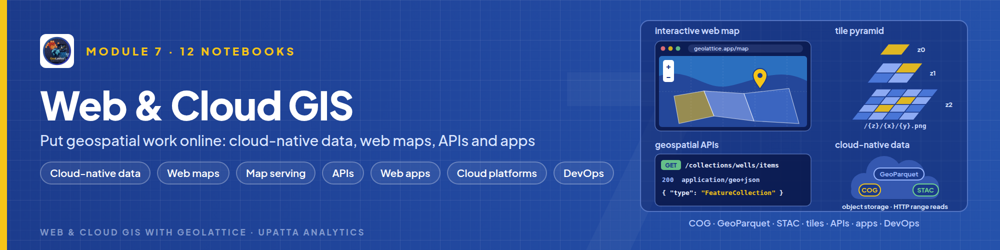
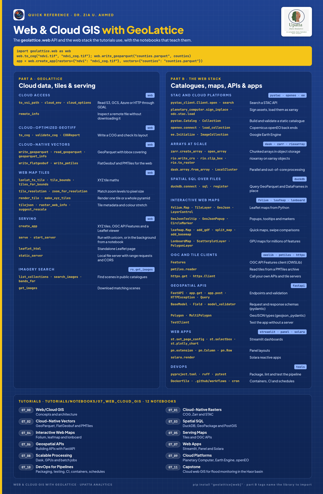

<p align="center">
  
</p>

An analysis that lives on one laptop helps one person. Web and cloud GIS takes it further: data are read straight from cloud storage without downloading whole files, processed next to the catalogue that holds them, and published as maps, tiles, APIs and small web applications that anyone with a browser can use. The same pipeline can then run on a schedule, tested and in a container.

These 12 notebooks are chapter 07 of the [GeoLattice](https://github.com/zia207/GeoLattice) tutorials. They cover cloud-native rasters and vectors, spatial SQL, interactive web maps, map servers, geospatial APIs, web apps, scalable processing, cloud platforms and DevOps, and finish with a flood monitor for the haor basin of Bangladesh, using `geolattice.web` with the vector, raster and remote sensing modules.

## GeoLattice

GeoLattice is a Python library for geospatial analysis that brings vector and raster processing, spatial analysis, spatial statistics, geostatistics, spatial databases, web and cloud GIS and remote sensing together under one import. It is built on GDAL, NumPy, pandas, GeoPandas, Shapely and xarray, so its functions take and return objects these libraries already use: GeoDataFrames, xarray DataArrays, NumPy arrays and GDAL-readable files.

| | |
|---|---|
| **Package** | `geolattice` |
| **Repository** | [github.com/zia207/GeoLattice](https://github.com/zia207/GeoLattice) |
| **Python** | 3.10 or newer |
| **License** | MIT |
| **Author** | Zia Ahmed, Upatta Analytics |

GDAL and PROJ must be installed first, with Python GDAL bindings that match the GDAL library (conda or your system package manager). Then install the web and remote sensing options:

```bash
python3 -m pip install "geolattice[web,rsense]"
```

The Earth Engine and openEO cells in the cloud platforms notebook need accounts with those services.

## Cloud-native data and serving

Cloud-native formats are laid out so that a client can fetch only the bytes it needs with HTTP range requests: a Cloud-Optimized GeoTIFF (COG) stores tiles and overviews in a fixed order, GeoParquet stores columns and row groups with bounding boxes, and PMTiles packs a whole tile pyramid into one file. `geolattice.web` writes and checks these formats, does the tile arithmetic and serves data as XYZ tiles and an OGC API.

| Task | Functions (`web`) |
|---|---|
| Cloud access | `to_vsi_path`, `cloud_env`, `cloud_options`, `remote_info` |
| Cloud-Optimized GeoTIFF | `to_cog`, `validate_cog` |
| Cloud-native vectors | `write_geoparquet`, `read_geoparquet`, `geoparquet_info`, `write_flatgeobuf`, `write_pmtiles` |
| Tile arithmetic | `lonlat_to_tile`, `tile_bounds`, `tiles_for_bounds`, `tile_resolution`, `zoom_for_resolution` |
| Rendering tiles | `render_tile`, `make_xyz_tiles`, `tilejson`, `raster_web_info`, `suggest_rescale` |
| Serving | `create_app`, `serve`, `start_server`, `leaflet_html`, `static_server` |

Imagery for these notebooks is searched and downloaded with `geolattice.rsense.get_images` (`list_collections`, `search_images`, `bands_for`, `get_images`).

Run from the repository root:

```python
import geopandas as gpd
import geolattice.web as web

web.to_cog("Data/00_shared/raster_data/output_folder/utm_deflate.tif", "dem_cog.tif")  # Cloud-Optimized GeoTIFF
print(web.validate_cog("dem_cog.tif"))                                               # tiles, overviews, layout

counties = gpd.read_file("Data/00_shared/vector_data/USA/US_COUNTY.shp")
web.write_geoparquet("counties.parquet", counties)                                   # sorted, with bbox covering
ny = web.read_geoparquet("counties.parquet", bbox=(-80, 40, -72, 45), bbox_crs="EPSG:4326")
print(len(ny), web.lonlat_to_tile(-76.15, 43.05, 12))                                # Syracuse at zoom 12

app = web.create_app(rasters={"dem": "dem_cog.tif"}, vectors={"counties": "counties.parquet"})
# web.serve(app, port=8000) runs XYZ tiles, OGC API Features and a Leaflet viewer
```

## The web stack

Beyond `geolattice.web`, the notebooks use the standard Python web and cloud tools:

| Task | Libraries |
|---|---|
| Catalogues and cloud platforms | pystac-client, Planetary Computer, odc-stac, openEO, Earth Engine |
| Arrays at scale | Zarr, rioxarray, Dask, CuPy |
| Spatial SQL over files | DuckDB |
| Interactive web maps | Folium, leafmap, lonboard |
| Clients for services | OWSLib, pmtiles, httpx |
| APIs | FastAPI, pydantic, geojson-pydantic |
| Web apps | Streamlit, Panel, Solara (in [`apps/`](https://github.com/zia207/GeoLattice/tree/main/Tutorials/notebooks/07_web_cloud_gis/apps)) |
| DevOps | pyproject.toml, ruff, pytest, Docker, GitHub Actions, cron (the [`haor_monitor/`](https://github.com/zia207/GeoLattice/tree/main/Tutorials/notebooks/07_web_cloud_gis/haor_monitor) project) |

## Tutorials {#tutorials}

Read the notebooks in order: the later ones reuse the data the early ones download, and the capstone brings every part together.

### Cloud-Native Data

| Tutorial | Topic |
|----------|--------|
| [Web and Cloud GIS](07_00_introduction_web_cloud_gis.ipynb) | Web vs cloud GIS, architecture, standards, range requests, tiles, catalogues |
| [Cloud-Native Rasters](07_01_cloud_native_raster.ipynb) | COG, Zarr and STAC: creating, validating, reading remotely, cataloguing |
| [Cloud-Native Vectors](07_02_cloud_native_vector.ipynb) | GeoParquet, FlatGeobuf, PMTiles, GeoJSON sequences, measured remote reads |
| [Spatial SQL](07_03_spatial_sql.ipynb) | DuckDB spatial SQL, join quality, GeoPackage SQL, PostGIS and cloud SQL |

### Maps, Services and Apps

| Tutorial | Topic |
|----------|--------|
| [Interactive Web Maps](07_04_interactive_web_maps.ipynb) | Folium, leafmap and lonboard; preparing vectors, choropleth classes, many points, rasters |
| [Serving Maps](07_05_serving_maps.ipynb) | Static vs dynamic tiles, OGC API Features, PMTiles with MapLibre |
| [Geospatial APIs](07_06_geospatial_apis.ipynb) | FastAPI: validation, spatial and raster endpoints, background jobs, keys, tests |
| [Web Apps](07_07_web_apps.ipynb) | One district explorer in Streamlit, Panel and Solara |

### Scale and Operations

| Tutorial | Topic |
|----------|--------|
| [Scalable Processing](07_08_scalable_processing.ipynb) | National NDVI trend with Dask, Zarr chunking, CuPy and batch jobs |
| [Cloud Platforms](07_09_cloud_platforms.ipynb) | Three STAC catalogues, odc-stac composites, openEO, Earth Engine |
| [DevOps for Geospatial Pipelines](07_10_devops_geospatial.ipynb) | Packaging, tests, CI, Dockerfile and scheduled runs for haor_monitor |
| [Capstone: Haor Flood Monitor](07_11_capstone.ipynb) | Sentinel-1 water maps, validation, COG, GeoParquet, STAC, API and web map |

### Quick reference

<p align="center">
  
</p>

## Sample data

The notebooks read the vector and raster data in [`Data/00_shared/`](https://github.com/zia207/GeoLattice/tree/main/Data/00_shared) of the repository, and download Sentinel-1, Sentinel-2 and Landsat scenes with `get_images` into `Data/00_shared/data_web_cloud_gis/`, which later notebooks reuse.

## License

GeoLattice is released under the MIT License. See [LICENSE](https://github.com/zia207/GeoLattice/blob/main/LICENSE).

<p align="center">
  <br>
  Developed by Zia Ahmed, Upatta Analytics
</p>
