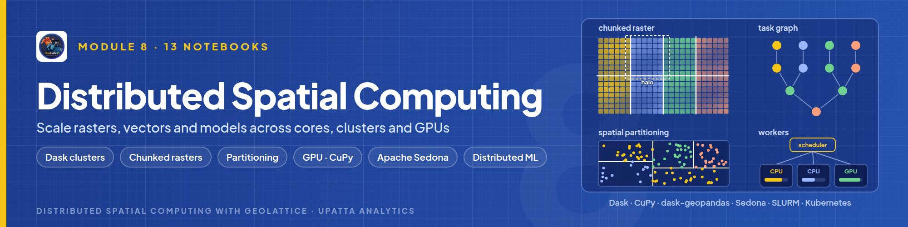
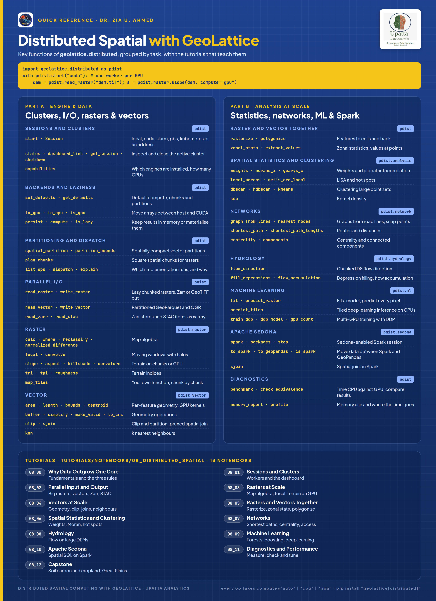

<p align="center">
  
</p>

Spatial data outgrow one core quickly. A 90 m raster of the Great Plains has 262 million pixels per layer, a national crop map at 10 m has 152 billion, and a year of taxi trips has tens of millions of rows. Distributed computing splits that work into chunks and partitions, runs them on every core, on a cluster or on a GPU, and handles what makes spatial data different: moving windows that need a halo of neighbouring cells, and joins that only work if nearby features share a partition.

These 13 notebooks are chapter 08 of the [GeoLattice](https://github.com/zia207/GeoLattice) tutorials. They start with sessions, clusters and parallel I/O, scale up raster, vector, statistics, network, hydrology and machine learning work, run spatial SQL on Spark with Apache Sedona, measure and tune the result, and finish with soil carbon and cropland for every Great Plains county, using `geolattice.distributed`.

## GeoLattice

GeoLattice is a Python library for geospatial analysis that brings vector and raster processing, spatial analysis, spatial statistics, geostatistics, spatial databases, web and cloud GIS and remote sensing together under one import. It is built on GDAL, NumPy, pandas, GeoPandas, Shapely and xarray, so its functions take and return objects these libraries already use: GeoDataFrames, xarray DataArrays, NumPy arrays and GDAL-readable files.

| | |
|---|---|
| **Package** | `geolattice` |
| **Repository** | [github.com/zia207/GeoLattice](https://github.com/zia207/GeoLattice) |
| **Python** | 3.10 or newer |
| **License** | MIT |
| **Author** | Zia Ahmed, Upatta Analytics |

GDAL and PROJ must be installed first, with Python GDAL bindings that match the GDAL library (conda or your system package manager). Then install the distributed option; GPUs, HPC schedulers and Spark each have their own extra:

```bash
python3 -m pip install "geolattice[distributed]"
python3 -m pip install "geolattice[distributed-gpu]"     # CuPy and dask-cuda (cuDF, cuML, cuGraph from the RAPIDS index)
python3 -m pip install "geolattice[distributed-hpc]"     # SLURM, PBS and Kubernetes clusters
python3 -m pip install "geolattice[distributed-spark]"   # Apache Sedona, needs Java 17 or newer
```

Every notebook runs on a CPU-only machine: GPU cells fall back to the CPU with one warning.

## One API on cores, clusters and GPUs

Every operation in `geolattice.distributed` takes `compute="auto" | "cpu" | "gpu"`, returns the same type it was given (NumPy in, NumPy out; GeoDataFrame in, GeoDataFrame out; Dask in, lazy Dask out) and runs on Dask's local threads unless a session was started.

| Task | Functions |
|---|---|
| Sessions and clusters (`pdist`) | `start`, `Session`, `status`, `dashboard_link`, `shutdown`, `capabilities` |
| Backends and laziness (`pdist`) | `set_defaults`, `to_gpu`, `to_cpu`, `persist`, `compute`, `is_lazy` |
| Partitioning and dispatch (`pdist`) | `spatial_partition`, `partition_bounds`, `plan_chunks`, `list_ops`, `dispatch`, `explain` |
| Parallel I/O (`pdist`) | `read_raster`, `write_raster`, `read_vector`, `write_vector`, `read_zarr`, `read_stac` |
| Rasters (`pdist.raster`) | `calc`, `where`, `reclassify`, `focal`, `convolve`, `slope`, `aspect`, `hillshade`, `map_tiles` |
| Vectors (`pdist.vector`) | `area`, `length`, `centroid`, `buffer`, `to_crs`, `clip`, `sjoin`, `knn` |
| Rasters and vectors (`pdist`) | `rasterize`, `polygonize`, `zonal_stats`, `extract_values` |
| Statistics and clustering (`pdist.analysis`) | `weights`, `morans_i`, `local_morans`, `getis_ord_local`, `dbscan`, `hdbscan`, `kmeans`, `kde` |
| Networks (`pdist.network`) | `graph_from_lines`, `nearest_nodes`, `shortest_path`, `centrality`, `components` |
| Hydrology (`pdist.hydrology`) | `flow_direction`, `fill_depressions`, `flow_accumulation` |
| Machine learning (`pdist.ml`) | `fit`, `predict_raster`, `predict_tiles`, `train_ddp` |
| Apache Sedona (`pdist.sedona`) | `spark`, `to_spark`, `to_geopandas`, `sjoin` |
| Diagnostics (`pdist`) | `benchmark`, `check_equivalence`, `memory_report`, `profile` |

Run as a script from the repository root. The `if __name__ == "__main__":` guard is required because Dask workers import the script:

```python
import geopandas as gpd
import geolattice.distributed as pdist

if __name__ == "__main__":
    print(pdist.capabilities())                                    # engines and GPUs on this machine
    with pdist.start("local", n_workers=2):                        # a local Dask cluster
        dem = pdist.read_raster("Data/03_spatial_analysis/MCSM_data/dem_texas_utm.tif")  # lazy, chunked
        slope = pdist.raster.slope(dem, compute="auto")            # halo-aware, CPU or GPU
        pdist.write_raster(slope, "slope.zarr")                    # Zarr; format="cog" for a COG
        print(pdist.explain("raster.slope", compute="auto"))       # which implementation, and why

        counties = gpd.read_file("Data/00_shared/vector_data/USA/US_COUNTY.shp")
        points = counties.representative_point().to_frame("geometry")
        hits = pdist.vector.sjoin(points, counties, predicate="within")  # partition-pruned join
        print(len(hits))
```

## Tutorials {#tutorials}

Read the foundation notebooks first; sessions, chunks and partitions are used in every later notebook.

### Foundations

| Tutorial | Topic |
|----------|--------|
| [Fundamentals](08_00_distributed_spatial_computing_fundamentals.ipynb) | Why Spatial Data Outgrow One Core, and What to Do About It |
| [Sessions and Clusters](08_01_sessions_and_clusters.ipynb) | From a Laptop to a Cluster: Sessions, Workers and the Dashboard |
| [Parallel Input and Output](08_02_distributed_input_and_output.ipynb) | Reading and Writing Big Spatial Data in Parallel |

### Processing at Scale

| Tutorial | Topic |
|----------|--------|
| [Rasters at Scale](08_03_raster_processing_at_scale.ipynb) | Map Algebra, Focal Operations and Terrain on Chunked and GPU Rasters |
| [Vectors at Scale](08_04_vector_processing_at_scale.ipynb) | Geometry Operations, Clipping, Spatial Joins and Nearest Neighbours on Millions of Features |
| [Rasters and Vectors Together](08_05_rasters_and_vectors_together.ipynb) | Rasterize, Zonal Statistics, Point Extraction and Polygonize at Scale |
| [Spatial Statistics and Clustering](08_06_spatial_statistics_and_clustering.ipynb) | Spatial Weights, Autocorrelation, Hot Spots and Clustering for Large Data |
| [Networks](08_07_networks.ipynb) | Shortest Paths, Centrality and Accessibility on Large Road Networks |
| [Hydrology](08_08_hydrology.ipynb) | Flow Direction and Accumulation on Large DEMs |

### Models, Spark and Tuning

| Tutorial | Topic |
|----------|--------|
| [Machine Learning](08_09_machine_learning.ipynb) | Training and Prediction at Scale: Random Forests, Boosting and Deep Learning on GPUs |
| [Apache Sedona](08_10_apache_sedona.ipynb) | Spatial SQL on Spark with Apache Sedona |
| [Diagnostics and Performance](08_11_diagnostics_and_performance.ipynb) | Measuring, Checking and Tuning Distributed and GPU Workloads |
| [Capstone: Great Plains Soil Carbon](08_12_capstone_great_plains_soil_carbon_and_cropland.ipynb) | Capstone: Soil Carbon and Cropland of Every Great Plains County |

### Quick reference

<p align="center">
  
</p>

## Sample data

The notebooks reuse data from other chapters in [`Data/`](https://github.com/zia207/GeoLattice/tree/main/Data): the Great Plains covariate rasters and soil carbon points, the USDA Cropland Data Layer, NYC taxi trips and large remote sensing images. Downloads (taxi zones, building footprints, OpenStreetMap roads) are cached under `Data/08_distributed_spatial/`.

## License

GeoLattice is released under the MIT License. See [LICENSE](https://github.com/zia207/GeoLattice/blob/main/LICENSE).

<p align="center">
  <br>
  Developed by Zia Ahmed, Upatta Analytics
</p>
