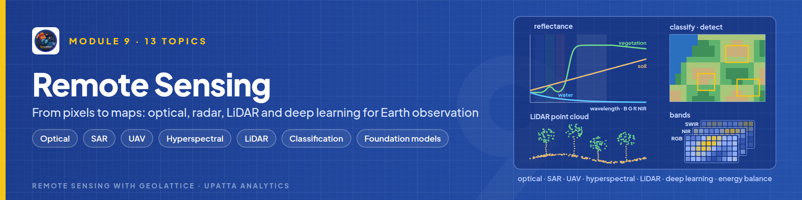

<p align="center">
  
</p>

Remote sensing measures the Earth without touching it. Optical sensors record reflected sunlight in a few broad bands or hundreds of narrow ones, radar sends its own microwaves and works through cloud and at night, LiDAR times laser pulses to map terrain and trees in three dimensions, and drones fly the same field every week. Turning those measurements into crop maps, flood extents, forest loss, field boundaries or the water a crop uses is the work of this chapter.

These 139 notebooks are chapter 09 of the [GeoLattice](https://github.com/zia207/GeoLattice) tutorials. They cover data access, optical, radar, UAV, hyperspectral and LiDAR data, texture analysis, super-resolution, image classification, object detection, foundation models and the surface energy balance, and finish with sixteen capstone projects, using `geolattice.rsense` with real imagery from Bangladesh, the United States and around the world.

## GeoLattice

GeoLattice is a Python library for geospatial analysis that brings vector and raster processing, spatial analysis, spatial statistics, geostatistics, spatial databases, web and cloud GIS and remote sensing together under one import. It is built on GDAL, NumPy, pandas, GeoPandas, Shapely and xarray, so its functions take and return objects these libraries already use: GeoDataFrames, xarray DataArrays and Datasets, NumPy arrays and GDAL-readable files.

| | |
|---|---|
| **Package** | `geolattice` |
| **Repository** | [github.com/zia207/GeoLattice](https://github.com/zia207/GeoLattice) |
| **Python** | 3.10 or newer |
| **License** | MIT |
| **Author** | Zia Ahmed, Upatta Analytics |

GDAL and PROJ must be installed first, with Python GDAL bindings that match the GDAL library (conda or your system package manager). Then install the remote sensing option, or the full set for the deep-learning notebooks:

```bash
python3 -m pip install "geolattice[remote-sensing]"
python3 -m pip install "geolattice[all]"                # adds PyTorch and torchgeo for deep learning
```

GPUs, large vision models and foundation models have their own extras (`rsense-gpu`, `rsense-vision`, `rsense-foundation`, `rsense-uav-dl`), which a plain install leaves out.

The chapter uses five imports:

```python
import geolattice.rsense as rs
import geolattice.rsense.classify.image_classification as ic
import geolattice.rsense.foundation_models as fm
import geolattice.rsense.surface_energy_balance as seb
from geolattice.rsense import edge_detectors as ed
```

## Data and sensors

`geolattice.rsense` reads imagery into xarray, runs on the CPU or a GPU, and has a submodule for each kind of sensor.

| Task | Functions |
|---|---|
| Core and backends (`rs`) | `set_backend`, `available_backends`, `read`, `write`, `clip`, `mosaic`, `reproject` |
| Data access (`rs.access`) | `stac_search`, `earthdata_search`, `asf_download` |
| Optical (`rs.optical`) | `load_sentinel2`, `load_landsat`, `load_hls`, `load_modis`, `scale`, `mask_clouds`, `composite`, `index`, `list_indices` |
| SAR (`rs.sar`) | `to_db`, `lee`, `refined_lee`, `multitemporal_speckle_filter`, `multilook`, `terrain_correct`, `load_rtc` |
| InSAR (`rs.insar`) | `differential_interferogram`, `goldstein_filter`, `unwrap`, `phase_to_los`, `sbas_inversion`, `velocity` |
| UAV (`rs.uav`) | `flight_plan`, `read_frame`, `vegetation_indices`, `canopy_cover`, `count_plants`, `trait_table` |
| Hyperspectral (`rs.hyperspectral`) | `read_envi`, `read_tanager`, `mnf`, `continuum_removal`, `extract_endmembers`, `unmix`, `rx`, `matched_filter` |
| LiDAR (`rs.lidar`) | `read_las`, `smrf`, `csf`, `dem`, `dsm`, `chm`, `normalize_heights`, `detect_trees`, `building_footprints` |

Run from the repository root:

```python
import xarray as xr
import geolattice.rsense as rs

rs.set_backend("auto")                                            # GPU if available, else CPU
SCENE = "Data/00_shared/data_remote_sensing/landsat9_vegas_20240708/LC09_L2SP_039035_20240708_02_T1"

bands = xr.Dataset({b: rs.read(f"{SCENE}/{b}.tif").squeeze(drop=True) for b in ["red", "nir", "swir16"]})
sr = rs.optical.scale(bands, sensor="landsat")                    # Collection 2 surface reflectance
ndvi = rs.optical.index(sr, "NDVI")                               # (NIR - red) / (NIR + red)
rs.write(ndvi, "ndvi.tif")                                        # Cloud-Optimized GeoTIFF by default
```

## Analysis and learning

| Task | Functions |
|---|---|
| Texture (`rs.texture`) | `glcm_texture`, `glrlm_texture`, `lbp_texture`, `fourier_texture`, `gabor_texture`, `fractal_dimension`, `deep_texture_features` |
| Super-resolution (`rs.super_resolution`) | `upsample`, `pansharpen`, `build_sr_model`, `train_super_resolution`, `predict_super_resolution` |
| Image classification (`ic`) | `spatial_block_split`, `train_pixel_classifier`, `build_cnn`, `build_segmenter`, `train_model`, `predict_map`, `classification_report` |
| Object detection (`ic`) | `build_object_detector`, `detection_tiles`, `merge_detections`, `mean_average_precision` |
| Field boundaries (`ed`) | `classical_edges`, `build_edge_model`, `detect_fields_ftw`, `boundary_to_instances` |
| Foundation models (`fm`) | `list_models`, `load_model`, `prepare`, `chip_raster`, `embedding_rgb`, `embedding_change`, `linear_probe` |
| Surface energy balance (`seb`) | `net_radiation`, `soil_heat_flux`, `asce_pm_hourly`, `run_sebal`, `run_metric`, `run_ssebop`, `tseb_pt`, `seasonal_et` |
| Time series and fusion (`rs`) | `timeseries.whittaker`, `timeseries.phenology`, `fusion.upscale` |

## Tutorials {#tutorials}

Start with the foundation notebooks; they set up the environment, data access and the CPU and GPU backends used everywhere else. The sensor chapters (optical, radar, UAV, hyperspectral and LiDAR) can then be read in any order, followed by the analysis and learning chapters and the capstones.

### Foundations

| Tutorial | Covers |
|----------|--------|
| [Remote Sensing Fundamentals](09_01_foundations/09_01_00_remote_sensing_fundamentals.ipynb) | What is remote sensing?, Physical principles, Branches of remote sensing |
| [The Python Geospatial Environment](09_01_foundations/09_01_01_the_python_geospatial_environment.ipynb) | Installing the environment, Checking the installation and hardware |
| [Raster and Vector Data Essentials](09_01_foundations/09_01_02_raster_and_vector_data_essentials.ipynb) | Reading rasters and inspecting metadata, Raster formats: COG, NetCDF, Zarr and HDF |
| [Data Discovery and Access](09_01_foundations/09_01_03_data_discovery_and_access.ipynb) | The data-access landscape, Areas of interest |
| [Getting Access to Remote Sensing Images](09_01_foundations/09_01_04_getting_access_to_remote_sensing_images.ipynb) | Three ways GeoLattice gets an image, Which call for which image, The catalogue inside `get_images` |

### Optical

| Tutorial | Covers |
|----------|--------|
| [Introduction to Optical Satellite Images](09_02_optical/09_02_01_introduction_to_optical_satellite_images.ipynb) | What makes an image "optical", How optical sensors form an image, Image quality: resolution |
| [Preprocessing of Optical Images](09_02_optical/09_02_02_preprocessing_of_optical_images.ipynb) | Radiometric correction and DOS1, Topographic correction, Cloud-free compositing |
| [MODIS: Global Monitoring Every Day](09_02_optical/09_02_03_modis_global_monitoring_every_day.ipynb) | MODIS characteristics, spatial resolution and spectral bands |
| [Landsat: Half a Century of Earth Observation](09_02_optical/09_02_04_landsat_half_a_century_of_earth_observation.ipynb) | The Landsat program, its platforms and sensors |
| [Sentinel-2: Red Edge, 10 m and Five-Day Revisits](09_02_optical/09_02_05_sentinel_2_red_edge_10_m_and_five_day_revisits.ipynb) | The Copernicus mission, Platforms, The MultiSpectral Instrument |
| [Sentinel-3: Ocean Colour, Surface Temperature and Altimetry](09_02_optical/09_02_06_sentinel_3_ocean_colour_surface_temperature_and_altimetry.ipynb) | The Sentinel-3 mission, platforms and sensors |
| [Sentinel-5P and Sentinel-5: Mapping Air Pollution from Orbit](09_02_optical/09_02_07_sentinel_5p_and_sentinel_5_mapping_air_pollution_from_orbit.ipynb) | Sentinel-5P and Sentinel-5 missions, platforms and sensors |

### Radar (SAR and InSAR)

| Tutorial | Covers |
|----------|--------|
| [SAR Fundamentals](09_03_radar/09_03_00_sar_fundamentals.ipynb) | What is SAR, How to read brightness, Types of radar images |
| [Sentinel-1 SAR](09_03_radar/09_03_01_00_sentinel_1_sar.ipynb) | Constellation history and current status, Orbit Details, Sentinel-1 SAR Instrument (Exokain) |
| [Sentinel-1 SAR Processing](09_03_radar/09_03_01_01_sentinel_1_sar_processing.ipynb) | Before processing: selecting scenes, GRD Backscatter Workflow (σ⁰ or γ⁰) |
| [Sentinel-1 GRD Processing](09_03_radar/09_03_01_02_sentinel_1_grd_processing.ipynb) | Study area and real data, The GRD processing chain, Calibration and noise look-up tables |
| [Sentinel-1 Multitemporal GRD Time Series: Deforestation around the Rohingya Camps (2017)](09_03_radar/09_03_01_03_sentinel_1_multitemporal_grd_time_series_deforestation_around_the_rohingya_camps_2017.ipynb) | The 2017 clearing and the processing chain, Area, dates and the Sentinel-1 archive |
| [Topographic InSAR: a DEM from a Sentinel-1 SLC Pair](09_03_radar/09_03_01_04_topographic_insar_a_dem_from_a_sentinel_1_slc_pair.ipynb) | The processing chain, Study area, Pair selection |
| [Differential InSAR (DInSAR)](09_03_radar/09_03_01_05_differential_insar_dinsar.ipynb) | Phase decomposition, DInSAR configurations, LOS geometry and 3D motion |
| [SBAS (Small Baseline Subset) InSAR](09_03_radar/09_03_01_06_sbas_small_baseline_subset_insar.ipynb) | Building the interferogram network, Interferogram processing, The inversion |
| [Persistent Scatterer InSAR (PS-InSAR)](09_03_radar/09_03_01_07_persistent_scatterer_insar_ps_insar.ipynb) | Phase model, Core algorithm, Sentinel-1 workflow |
| [Dual-Pol Polarimetric Decomposition (SLC)](09_03_radar/09_03_01_08_dual_pol_polarimetric_decomposition_slc.ipynb) | How it works, Real-data example: Cox's Bazar -- Teknaf coast, Bangladesh, Takeaways and limitations |
| [Interferometric Coherence of SLCs](09_03_radar/09_03_01_09_interferometric_coherence_of_slcs.ipynb) | Spatial References of the Sentinel-1 SAR Mission, Interferometric Coherence Workflow |
| [Sentinel-1 Based Indices](09_03_radar/09_03_01_10_sentinel_1_based_indices.ipynb) | Understanding Sentinel-1 data, Major Sentinel-1-based indices, Other useful Sentinel-1-derived metrics |
| [RADARSAT Constellation Mission (RCM)](09_03_radar/09_03_02_00_radarsat_constellation_mission_rcm.ipynb) | Mission, System characteristics, Beam modes |
| [RADARSAT Constellation Mission (RCM) Processing](09_03_radar/09_03_02_01_radarsat_constellation_mission_rcm_processing.ipynb) | Know the product before processing, Overall workflows, RADARSAT processing functions in GeoLattice |
| [RADARSAT GRD Data](09_03_radar/09_03_02_02_radarsat_grd_data.ipynb) | Backscatter workflow, step by step, Real-data example: Cox's Bazar -- Teknaf coast, Bangladesh |
| [RADARSAT Constellation Mission (RCM) InSAR Processing](09_03_radar/09_03_02_03_radarsat_constellation_mission_rcm_insar_processing.ipynb) | Real-data example: Montreal, 4-day repeat, Takeaways and limitations |
| [RADARSAT Polarimetric SAR (PolSAR)](09_03_radar/09_03_02_04_radarsat_polarimetric_sar_polsar.ipynb) | Scattering, covariance and coherency matrices, Real data: RADARSAT-2 Fine Quad |
| [Compact-polarimetry (CP)](09_03_radar/09_03_02_05_compact_polarimetry_cp.ipynb) | Compact-polarimetry (CP) processing, Real data: simulating RCM's compact-pol from a real RADARSAT-2 |
| [NISAR: NASA-ISRO Synthetic Aperture Radar](09_03_radar/09_03_03_00_nisar_nasa_isro_synthetic_aperture_radar.ipynb) | Launch and current status, Orbit, The two radars |
| [NISAR Processing](09_03_radar/09_03_03_01_nisar_processing.ipynb) | Planning and data selection, Reading NISAR HDF5 files (common to all workflows) |
| [NISAR RSLC: Range-Doppler Single Look Complex Processing](09_03_radar/09_03_03_02_nisar_rslc_range_doppler_single_look_complex_processing.ipynb) | Processing overview and limitations, Inspect the product and its metadata |
| [NISAR GSLC: Geocoded Single Look Complex Processing](09_03_radar/09_03_03_03_nisar_gslc_geocoded_single_look_complex_processing.ipynb) | Processing overview and limitations, Inspect the product and geocoded grid, Select the AOI window |
| [NISAR GCOV: Geocoded Polarimetric Covariance Processing](09_03_radar/09_03_03_04_nisar_gcov_geocoded_polarimetric_covariance_processing.ipynb) | Processing overview and limitations, Inspect the product and covariance layers |
| [NISAR GUNW: Geocoded Unwrapped Interferogram](09_03_radar/09_03_03_05_nisar_gunw_geocoded_unwrapped_interferogram.ipynb) | Processing overview and limitations, Inspect product metadata and layers |

### UAV

| Tutorial | Covers |
|----------|--------|
| [UAV Fundamentals and Mission Planning](09_04_uav/09_04_01_uav_fundamentals_and_mission_planning.ipynb) | Platforms and sensors, Ground sampling distance and footprint, Overlap, line spacing and trigger distance |
| [Reading and Inspecting UAV Imagery](09_04_uav/09_04_02_reading_and_inspecting_uav_imagery.ipynb) | What is inside a PNG frame?, Reading frames into xarray, RGB + NIR pairs |
| [Photogrammetry: Orthomosaic, DSM and DTM](09_04_uav/09_04_03_photogrammetry_orthomosaic_dsm_and_dtm.ipynb) | The SfM pipeline, Features and matching on real frames, Ground control: GCP / RTK vs infrastructure-free |
| [RGB Vegetation Indices and Canopy Cover](09_04_uav/09_04_04_rgb_vegetation_indices_and_canopy_cover.ipynb) | The indices, Reproducing `make_tgi_vari.py`, Brightness and chromatic normalisation |
| [RGB + NIR Multispectral Analysis](09_04_uav/09_04_05_rgb_plus_nir_multispectral_analysis.ipynb) | How far apart are the two cameras?, Co-registration, NDVI, GNDVI and SAVI |
| [DEM Correction and Canopy Height](09_04_uav/09_04_06_dem_correction_and_canopy_height.ipynb) | A season of GCP-free DEMs, Fitting the trend surface with RANSAC, One correction for all dates |
| [Plant Counting and Size](09_04_uav/09_04_07_plant_counting_and_size.ipynb) | Classical counting: peaks of Excess Green, Large images: tiles, stitching and merging, Plant size |
| [Crop Health: SAM Plant Masks and Senescence Detection](09_04_uav/09_04_08_crop_health_sam_plant_masks_and_senescence_detection.ipynb) | Plant masks from colour, SAM with automatic prompts, Green or senescent? |
| [Panicle Detection with YOLO](09_04_uav/09_04_09_panicle_detection_with_yolo.ipynb) | Sliding windows, Checking the machinery on a scene with known answers, Panicle candidates on real frames |
| [Season-Long Phenotyping](09_04_uav/09_04_10_season_long_phenotyping.ipynb) | Traits for every frame, One table from many methods, Growth curves and stage dates |

### Hyperspectral

| Tutorial | Covers |
|----------|--------|
| [Introduction to Imaging Spectroscopy](09_05_HyperSpectral/09_05_00_introduction_to_imaging_spectroscopy.ipynb) | Why narrow bands matter, The GeoLattice cube: a laboratory example, The chapter data at a glance |
| [Reading and Exploring Hyperspectral Data](09_05_HyperSpectral/09_05_01_reading_and_exploring_hyperspectral_data.ipynb) | Inside a Tanager HDF-EOS5 file, Reading Tanager products by subset, Ortho grid and basic swath |
| [Preprocessing Hyperspectral Cubes](09_05_HyperSpectral/09_05_02_preprocessing_hyperspectral_cubes.ipynb) | Bad bands, Noise and signal to noise ratio, Detector striping |
| [Dimensionality Reduction and Band Selection](09_05_HyperSpectral/09_05_03_dimensionality_reduction_and_band_selection.ipynb) | How redundant are the bands?, Principal component analysis, Minimum noise fraction |
| [Narrowband Indices and Vegetation Analysis](09_05_HyperSpectral/09_05_04_narrowband_indices_and_vegetation_analysis.ipynb) | The index catalogue, Index maps, How many independent indices? |
| [Biophysical and Biochemical Trait Retrieval](09_05_HyperSpectral/09_05_05_biophysical_and_biochemical_trait_retrieval.ipynb) | The PROSAIL forward model, Which wavelengths carry which trait?, A look-up table for the scene |
| [Spectral Libraries and Spectral Matching](09_05_HyperSpectral/09_05_06_spectral_libraries_and_spectral_matching.ipynb) | Building libraries, Similarity measures, A laboratory scene: sugar, salt and flour |
| [Endmember Extraction and Spectral Unmixing](09_05_HyperSpectral/09_05_07_endmember_extraction_and_spectral_unmixing.ipynb) | A synthetic scene with known answers, Endmember extraction on the synthetic scene, Four solvers |
| [Target and Anomaly Detection](09_05_HyperSpectral/09_05_08_target_and_anomaly_detection.ipynb) | Anomalies in a laboratory scene, A target spectrum from another scene, Four target detectors |
| [Greenhouse Gas Plume Detection](09_05_HyperSpectral/09_05_09_greenhouse_gas_plume_detection.ipynb) | Methane absorption from HITRAN, The unit absorption spectrum, The enhancement map |
| [Thematic Applications Across Tanager Scenes](09_05_HyperSpectral/09_05_10_thematic_applications_across_tanager_scenes.ipynb) | A burn scar on the Malibu coast, Snow, sea ice and grain size on Baffin Island |
| [Deep Learning for Hyperspectral Classification](09_05_HyperSpectral/09_05_11_deep_learning_for_hyperspectral_classification.ipynb) | Data and a spatial split, Baselines: SAM and random forest, Datasets and training |

### LiDAR

| Tutorial | Covers |
|----------|--------|
| [LiDAR Fundamentals](09_06_lidar/09_06_01_lidar_fundamentals.ipynb) | Working with LiDAR Data in GeoLattice, The LiDAR equations in numbers |
| [LiDAR Processing: Quality Control, Cleaning, Ground Classification and Surface Models](09_06_lidar/09_06_02_lidar_processing_quality_control_cleaning_ground_classification_and_surface_models.ipynb) | Loading and preparing the two sites, Quality control: density, flight lines and swath overlap, Noise |
| [Terrain and Hydrology from LiDAR DEMs](09_06_lidar/09_06_03_terrain_and_hydrology_from_lidar_dems.ipynb) | A seamless 1 m DEM from four tiles, Shaded relief, Local terrain derivatives |
| [Forest Structure and Individual Trees from LiDAR](09_06_lidar/09_06_04_forest_structure_and_individual_trees_from_lidar.ipynb) | Height normalisation and vegetation classes, Canopy height model and canopy cover |
| [Buildings and Urban Features from LiDAR](09_06_lidar/09_06_05_buildings_and_urban_features_from_lidar.ipynb) | Ground filters, large roofs and the normalised DSM, Eigenvalue features of roofs and trees |
| [Point Cloud Classification with Machine Learning and Deep Learning](09_06_lidar/09_06_06_point_cloud_classification_with_machine_learning_and_deep_learning.ipynb) | Labels and a spatial split, Height above ground without using the labels, Point features |
| [Spaceborne LiDAR: GEDI and ICESat-2](09_06_lidar/09_06_07_spaceborne_lidar_gedi_and_icesat_2.ipynb) | Finding real GEDI and ICESat-2 granules, The airborne reference, Reading GEDI L2A and quality filtering |
| [Large-Area LiDAR Processing: Tiling, Streaming, Parallel Work and the GPU](09_06_lidar/09_06_08_large_area_lidar_processing_tiling_streaming_parallel_work_and_the_gpu.ipynb) | A tile index from the headers, Memory and reading only what is needed, Streaming a file in chunks |

### Texture Analysis

| Tutorial | Covers |
|----------|--------|
| [Texture Analysis](09_07_texture_analysis/09_07_00_texture_analysis.ipynb) | Statistical, structural, transform, model, local-pattern and deep texture methods |
| [Texture Analysis of Landsat Imagery: Statistical and Structural Methods](09_07_texture_analysis/09_07_01_texture_analysis_of_landsat_imagery_statistical_and_structural_methods.ipynb) | Why texture? Same histogram, different arrangement, First-order statistics, Gray-Level Co-occurrenc |
| [Texture Analysis of Landsat Imagery: Transform-Based (Spectral) Methods](09_07_texture_analysis/09_07_02_texture_analysis_of_landsat_imagery_transform_based_spectral_methods.ipynb) | Fourier power spectrum and ring energy, Gabor filter bank, Haar wavelet decomposition |
| [Texture Analysis of Landsat Imagery: Local Pattern-Based Methods (LBP)](09_07_texture_analysis/09_07_03_texture_analysis_of_landsat_imagery_local_pattern_based_methods_lbp.ipynb) | A worked LBP example, LBP code maps, LBP texture features |
| [Texture Analysis of Landsat Imagery: Model-Based Methods](09_07_texture_analysis/09_07_04_texture_analysis_of_landsat_imagery_model_based_methods.ipynb) | Markov Random Field energy, Fractal dimension, Autoregressive texture |
| [Texture Analysis of Landsat Imagery: Deep-Learning-Based Methods](09_07_texture_analysis/09_07_05_texture_analysis_of_landsat_imagery_deep_learning_based_methods.ipynb) | Inside the network: first-layer filters, Feature maps of the ResNet-18 stages, Choosing the input b |

### Image Super-Resolution

| Tutorial | Covers |
|----------|--------|
| [Image Super-Resolution](09_08_image_super_resolution/09_08_00_image_super_resolution.ipynb) | Why spatial resolution runs out, The observation model, Families of methods |
| [Landsat 8 to Sentinel-2: six-band super-resolution](09_08_image_super_resolution/09_08_01_landsat_8_to_sentinel_2_six_band_super_resolution.ipynb) | Classical methods, Deep learning: paired multispectral EDSR-style CNN, Inference and held-out evaluation |
| [Sentinel-2 to PlanetScope: multispectral super-resolution](09_08_image_super_resolution/09_08_02_sentinel_2_to_planetscope_multispectral_super_resolution.ipynb) | Classical methods, Deep learning: paired multispectral EDSR-style CNN, Inference and held-out evaluation |
| [PlanetScope to high-resolution NAIP-style imagery: super-resolution](09_08_image_super_resolution/09_08_03_planetscope_to_high_resolution_naip_style_imagery_super_resolution.ipynb) | Classical methods, Deep learning: paired multispectral EDSR-style CNN, Inference and held-out evaluation |
| [Landsat 8, Sentinel-2, PlanetScope, and high-resolution imagery](09_08_image_super_resolution/09_08_04_landsat_8_sentinel_2_planetscope_and_high_resolution_imagery.ipynb) | Landsat 8 → Sentinel-2 (30 m to 10 m), PlanetScope → HR (3 m to 0.6 m), an independent experiment |

### Image Classification

| Tutorial | Covers |
|----------|--------|
| [Introduction to Image Classification](09_09_image_classification/09_09_01_01_introduction_to_image_classification.ipynb) | Image Classification, The spatial unit: pixel or object, Learning paradigms |
| [Image Processing](09_09_image_classification/09_09_01_02_image_processing.ipynb) | The image model, I/O and image information, Color spaces |
| [Sampling, Accuracy Assessment and Reproducible Runs](09_09_image_classification/09_09_01_03_sampling_accuracy_assessment_and_reproducible_runs.ipynb) | Labels, rasterization and sampling, Normalization without leakage |
| [Classical Image Classification: Pixel-Based and Object-Based](09_09_image_classification/09_09_02_01_classical_image_classification_pixel_based_and_object_based.ipynb) | Landsat data: scale, mask, indices, CDL 2025 reference labels, Train / validation / test split |
| [Image Classification with a CNN on the GPU: Landsat and the Cropland Data Layer](09_09_image_classification/09_09_02_02_image_classification_with_a_cnn_on_the_gpu_landsat_and_the_cropland_data_layer.ipynb) | Preparing the imagery, labels and chips, Part 1: one global split into train / validation / test |
| [Deep Learning for Sentinel-2: CNN, ResNet, EfficientNet, ConvNeXt, ViT and Swin on the GPU](09_09_image_classification/09_09_02_03_deep_learning_for_sentinel_2_cnn_resnet_efficientnet_convnext_vit_and_swin_on_the_gpu.ipynb) | From rasters to tensors: Sentinel-2 stack, CDL labels, chips, datasets and loaders, Scene l |
| [Transfer Learning and Vision Transformers for Sentinel-2: ImageNet vs Remote-Sensing Weights](09_09_image_classification/09_09_02_04_transfer_learning_and_vision_transformers_for_sentinel_2_imagenet_vs_remote_sensing_weights.ipynb) | Sentinel-2 imagery and CDL labels, A class-balanced chip data set with spatial hold-out |
| [Crop Classification with Sentinel-1 SAR Time Series: Pixel Classifiers and Deep CNNs (VV/VH, May-October 2024)](09_09_image_classification/09_09_03_01_crop_classification_with_sentinel_1_sar_time_series_pixel_classifiers_and_deep_cnns_vv_vh_may_october_2024.ipynb) | Radar backscatter, speckle and crops: concepts and mathematics, Loading the 2024 Sentinel-1 |
| [Spatio-Temporal and Multi-Sensor Crop Mapping: Sentinel-2, Sentinel-1 and Landsat Time Series, 2020 to 2025](09_09_image_classification/09_09_03_02_spatio_temporal_and_multi_sensor_crop_mapping_sentinel_2_sentinel_1_and_landsat_time_series_2020_to_2025.ipynb) | The data: three sensors, six seasons, labels, Building a pixel time series: `pixel_time_ser |
| [Change Detection: Classical, Post-Classification and Deep Methods on Landsat and Sentinel-2, 2020 to 2025](09_09_image_classification/09_09_03_03_change_detection_classical_post_classification_and_deep_methods_on_landsat_and_sentinel_2_2020_to_2025.ipynb) | The data: mid-July Landsat and Sentinel-2 pairs and CDL on one 30 m grid, Before you compar |
| [Semantic Segmentation of Crop Types from Sentinel-2: FCN, U-Net, DeepLabV3(+) and SegFormer on the GPU](09_09_image_classification/09_09_04_01_semantic_segmentation_of_crop_types_from_sentinel_2_fcn_u_net_deeplabv3_plus_and_segformer_on_the_gpu.ipynb) | From colour masks to index masks: Sentinel-2 stack and CDL labels, Patch sampling, spatial |
| [Instance Segmentation of Agricultural Fields with Mask R-CNN](09_09_image_classification/09_09_04_02_instance_segmentation_of_agricultural_fields_with_mask_r_cnn.ipynb) | WorldView-2 imagery and field-polygon labels, Instance masks, patch sampling and spatial sp |
| [Imperfect labels and domain shift](09_09_image_classification/09_09_05_03_imperfect_labels_and_domain_shift.ipynb) | Active learning, Semi-supervised learning |
| [Multi-sensor image fusion](09_09_image_classification/09_09_05_04_multi_sensor_image_fusion.ipynb) | Spatiotemporal fusion with STARFM, Optical-SAR gap filling |

### Object Detection

| Tutorial | Covers |
|----------|--------|
| [Object Detection](09_10_object_detection/09_10_00_object_detection.ipynb) | What object detection is, Task types: boxes, masks and boundaries |
| [Object Detection in Aerial Imagery](09_10_object_detection/09_10_01_object_detection_in_aerial_imagery.ipynb) | HSV colour thresholding and contour proposals, Overlapping-window detection and duplicate suppression |
| [Field Boundary Detection in Google Satellite Screenshots (Bangladesh)](09_10_object_detection/09_10_02_field_boundary_detection_in_google_satellite_screenshots_bangladesh.ipynb) | Preparing tiles at 0.25 m and building the reference, Evaluation protocol: instance and boundary scores |
| [Field Edge Detection in WorldView Imagery: RGB versus RGB + NIR](09_10_object_detection/09_10_03_field_edge_detection_in_worldview_imagery_rgb_versus_rgb_plus_nir.ipynb) | What differs from the paper, The boundary reference on a 0.5 m grid, Tiles, a spatial split |
| [Field Edge Detection in Sentinel-2: Fields of The World versus Delineate Anything](09_10_object_detection/09_10_04_field_edge_detection_in_sentinel_2_fields_of_the_world_versus_delineate_anything.ipynb) | Rules of the comparison, A field reference from the CDL, The FTW input: two windows per year |

### Foundation Models

| Tutorial | Covers |
|----------|--------|
| [What Foundation Models Are and Why Remote Sensing Needs Them](09_11_foundations_models/09_11_00_what_foundation_models_are_and_why_remote_sensing_needs_them.ipynb) | What two pretraining objectives see, The model catalog, Choosing a model for a task |
| [Self-supervised pretraining for Sentinel-2 crop mapping](09_11_foundations_models/09_11_01_self_supervised_pretraining_for_sentinel_2_crop_mapping.ipynb) | Why self-supervised learning for remote sensing, Contrastive learning |
| [Geospatial foundation models: embeddings, promptable segmentation and zero-shot classification](09_11_foundations_models/09_11_02_geospatial_foundation_models_embeddings_promptable_segmentation_and_zero_shot_classification.ipynb) | Model zoo, Load foundation encoders |
| [From a GeoTIFF to an Embedding Map](09_11_foundations_models/09_11_03_from_a_geotiff_to_an_embedding_map.ipynb) | The input contract, Anatomy of a FoundationEncoder, Preparing a raster for a model |
| [Prithvi, SSL4EO, SatlasPretrain and Scale-MAE on Sentinel-2](09_11_foundations_models/09_11_04_prithvi_ssl4eo_satlaspretrain_and_scale_mae_on_sentinel_2.ipynb) | Two dates of the Corn Belt, Patch features from four encoders, How much crop information do they hold? |
| [One Model for Many Sensors: DOFA, Panopticon, Copernicus-FM, CROMA and TerraMind](09_11_foundations_models/09_11_05_one_model_for_many_sensors_dofa_panopticon_copernicus_fm_croma_and_terramind.ipynb) | Three sensors, one week, one landscape, One model, three sensors |
| [Time in Foundation Models: Prithvi-TL, AnySat, Presto and Galileo](09_11_foundations_models/09_11_06_time_in_foundation_models_prithvi_tl_anysat_presto_and_galileo.ipynb) | A four-date season, Phenology from NDVI, Prithvi with one to four frames |
| [AlphaEarth Foundations: Precomputed Embeddings for the Whole Planet](09_11_foundations_models/09_11_07_alphaearth_foundations_precomputed_embeddings_for_the_whole_planet.ipynb) | Where the embeddings live, Reading two years for the Corn Belt, What the 64 dimensions show |
| [Foundation Model Embeddings as Covariates: Digital Soil Mapping of SOC](09_11_foundations_models/09_11_08_foundation_model_embeddings_as_covariates_digital_soil_mapping_of_soc.ipynb) | Samples and covariates, Three covariate sets under spatial cross-validation, How many embedding dimension |
| [Very High Resolution: DINOv3-sat, Satlas NAIP, Scale-MAE and SAM 2](09_11_foundations_models/09_11_09_very_high_resolution_dinov3_sat_satlas_naip_scale_mae_and_sam_2.ipynb) | Which encoders are available, A WorldView-2 scene and its fields, Dense features of the scene |
| [Vision-Language Models: Zero-Shot Classification and Text Retrieval](09_11_foundations_models/09_11_10_vision_language_models_zero_shot_classification_and_text_retrieval.ipynb) | EuroSAT, Zero-shot classification, Prompt wording and ensembling |
| [Change and Similarity in Embedding Space](09_11_foundations_models/09_11_11_change_and_similarity_in_embedding_space.ipynb) | Before and after the Bug Fire, dNBR, the reference index, Embeddings of both dates |
| [Weather and Earth System Foundation Models](09_11_foundations_models/09_11_12_weather_and_earth_system_foundation_models.ipynb) | The weather models in the catalog, ERA5 from the cloud, Building an Aurora batch |
| [Benchmarking Foundation Models on Your Own Data](09_11_foundations_models/09_11_13_benchmarking_foundation_models_on_your_own_data.ipynb) | Task 1: EuroSAT RGB, Label efficiency on EuroSAT, Task 2: early-season crops in the Corn Belt |

### Surface Energy Balance

| Tutorial | Covers |
|----------|--------|
| [Evapotranspiration and the Surface Energy Balance](09_12_surface_energy_balance_modeling/09_12_00_evapotranspiration_and_the_surface_energy_balance.ipynb) | The scene, Crops, fallow land and temperature, The LST and NDVI scatter |
| [Building an Analysis-Ready Stack for Energy Balance Models](09_12_surface_energy_balance_modeling/09_12_01_building_an_analysis_ready_stack_for_energy_balance_models.ipynb) | Finding the scenes, Reading a window and applying scale factors, Decoding the quality band |
| [Reference ET with the ASCE Standardized Penman-Monteith Equation](09_12_surface_energy_balance_modeling/09_12_02_reference_et_with_the_asce_standardized_penman_monteith_equation.ipynb) | Checking the equation with the FAO-56 examples, One day term by term |
| [Net Radiation from Landsat: Albedo, Emissivity and Surface Temperature](09_12_surface_energy_balance_modeling/09_12_03_net_radiation_from_landsat_albedo_emissivity_and_surface_temperature.ipynb) | Land surface temperature from thermal radiance, Broadband albedo, Albedo against MODIS |
| [Soil Heat Flux, Roughness and Aerodynamic Resistance](09_12_surface_energy_balance_modeling/09_12_04_soil_heat_flux_roughness_and_aerodynamic_resistance.ipynb) | Soil heat flux, The wind profile and the blending height, Roughness length |
| [SEBAL: Solving for Sensible Heat with Hot and Cold Pixels](09_12_surface_energy_balance_modeling/09_12_05_sebal_solving_for_sensible_heat_with_hot_and_cold_pixels.ipynb) | Anchor candidates, Choosing the anchors, One calibration step by hand |
| [METRIC: Internal Calibration against Reference ET](09_12_surface_energy_balance_modeling/09_12_06_metric_internal_calibration_against_reference_et.ipynb) | Reference ET and the hot anchor, Calibrating METRIC, Sensible heat below zero |
| [SSEBop, S-SEBI, the Triangle Method and PT-JPL](09_12_surface_energy_balance_modeling/09_12_07_ssebop_s_sebi_the_triangle_method_and_pt_jpl.ipynb) | SSEBop, S-SEBI, The triangle method |
| [Two-Source Energy Balance: Separating Soil Evaporation and Transpiration](09_12_surface_energy_balance_modeling/09_12_08_two_source_energy_balance_separating_soil_evaporation_and_transpiration.ipynb) | Canopy structure, Running TSEB-PT, Soil and canopy temperatures |
| [ET at Other Resolutions: MODIS, Sentinel-3 and Sentinel-2 with Thermal Sharpening](09_12_surface_energy_balance_modeling/09_12_09_et_at_other_resolutions_modis_sentinel_3_and_sentinel_2_with_thermal_sharpening.ipynb) | MODIS at 1 km, METRIC on MODIS, MODIS against Landsat |
| [From Snapshots to Seasonal ET and Crop Water Use](09_12_surface_energy_balance_modeling/09_12_10_from_snapshots_to_seasonal_et_and_crop_water_use.ipynb) | The hot anchor's ETrF from a soil water balance, METRIC on every image, Daily ETrF |
| [How Good Is the ET Map? Validation, Sensitivity and Uncertainty](09_12_surface_energy_balance_modeling/09_12_11_how_good_is_the_et_map_validation_sensitivity_and_uncertainty.ipynb) | The water balance of unirrigated land, MOD16 annual ET, Which reference ET? |
| [Capstone: Water Use of Boro Rice in Bangladesh](09_12_surface_energy_balance_modeling/09_12_12_capstone_water_use_of_boro_rice_in_bangladesh.ipynb) | The season in images, Mapping Boro rice, Reference ET and rain |

### Capstone Projects

| Tutorial | Covers |
|----------|--------|
| [Thirty-five Years of Change around Pucallpa, Peru](09_13_Capstones/09_13_01_thirty_five_years_of_change_around_pucallpa_peru.ipynb) | Landsat time series, moisture index and persistent forest loss |
| [Fifty Years of Change in the Bangladesh Delta](09_13_Capstones/09_13_02_fifty_years_of_change_in_the_bangladesh_delta.ipynb) | Every usable Landsat scene, 1972 to 2024, and land loss and gain |
| [Wild Fire Burned-area Mapping](09_13_Capstones/09_13_03_wild_fire_burned_area_mapping.ipynb) | Comparison of the main burn indices, How to calculate burn indices from Sentinel-2 imagery |
| [Timeline of the Rohingya Exodus: Deforestation in Bangladesh (2016-2018)](09_13_Capstones/09_13_04_timeline_of_the_rohingya_exodus_deforestation_in_bangladesh_2016_2018.ipynb) | Sentinel-2 NDVI and forest loss before and after the 2017 crisis |
| [Flood Mapping with Sentinel-1 Data - Sylhet, Bangladesh](09_13_Capstones/09_13_05_flood_mapping_with_sentinel_1_data_sylhet_bangladesh.ipynb) | Define the study area with Leafmap, Set dates and Sentinel-1 parameters |
| [Timeline of the Rohingya Exodus: Deforestation in Bangladesh (2016-2018), Sentinel-1 Radar](09_13_Capstones/09_13_06_timeline_of_the_rohingya_exodus_deforestation_in_bangladesh_2016_2018_sentinel_1_radar.ipynb) | Sentinel-1 time cube, speckle filtering and radar forest loss |
| [Ship Detection in the Strait of Hormuz with Sentinel-1](09_13_Capstones/09_13_07_ship_detection_in_the_strait_of_hormuz_with_sentinel_1.ipynb) | AOI and acquisition search, Read calibrated VV/VH over the AOI, Mask land and build a sea-clutter field |
| [Crop Classification with NISAR GCOV Time Series and Self-Supervised Learning](09_13_Capstones/09_13_08_crop_classification_with_nisar_gcov_time_series_and_self_supervised_learning.ipynb) | Choosing the AOI from the CDL and the NISAR mask, Reading the AOI time series |
| [Sea Ice Mapping for Shipping Routes in the St. Lawrence Estuary with RADARSAT Constellation Mission (RCM)](09_13_Capstones/09_13_09_sea_ice_mapping_for_shipping_routes_in_the_st_lawrence_estuary_with_radarsat_constellation_mission_rcm.ipynb) | Inspect the scenes and their coverage, Read calibrated, noise-corrected HH and HV over the AOI |
| [Charland Monitoring with Sentinel-1 SAR (and NISAR L-band), Lower Meghna Estuary of Bangladesh](09_13_Capstones/09_13_10_charland_monitoring_with_sentinel_1_sar_and_nisar_l_band_lower_meghna_estuary_of_bangladesh.ipynb) | Study area and master grid, Scene inventory and selection |
| [Mapping Shrimp Ghers in Coastal Bangladesh with a 2025–2026 Sentinel-1 Time Series and Sentinel-2](09_13_Capstones/09_13_11_mapping_shrimp_ghers_in_coastal_bangladesh_with_a_2025_2026_sentinel_1_time_series_and_sentinel_2.ipynb) | Task and evaluation design, Why SAR for shrimp ghers: backscatter physics and pond signatures |
| [Mapping the 2026 Big Sur Wildfire with Time-Series Sentinel-1 SAR and Sentinel-2 Optical Images](09_13_Capstones/09_13_12_mapping_the_2026_big_sur_wildfire_with_time_series_sentinel_1_sar_and_sentinel_2_optical_images.ipynb) | Task and evaluation design, Why both sensors: burn indices, smoke and the SAR response to fire |
| [Mapping Wetland Paddy in Bangladesh with a 2025 to 2026 Sentinel-1 Time Series](09_13_Capstones/09_13_13_mapping_wetland_paddy_in_bangladesh_with_a_2025_to_2026_sentinel_1_time_series.ipynb) | Task and evaluation design, Why Sentinel-1 for paddy: backscatter physics and rice signatures |
| [Field Edge Detection across Four Countries: Training in Mexico, Mali, Cambodia and Bangladesh, Testing on an Unseen Bangladesh Site](09_13_Capstones/09_13_14_field_edge_detection_across_four_countries_training_in_mexico_mali_cambodia_and_bangladesh_testing_on_an_unseen_bangladesh_site.ipynb) | A 0.5 m grid per site and the boundary reference, Tiles, a spatial split and rotation augmentation |
| [Tree Inventory, Biomass and Carbon from Airborne Lidar](09_13_Capstones/09_13_15_tree_inventory_biomass_and_carbon_from_airborne_lidar.ipynb) | Prepare the point cloud, Terrain and canopy height, Individual-tree inventory |
| [UAV-Based High-Throughput Phenotyping of Maize Nitrogen Response](09_13_Capstones/09_13_16_uav_based_high_throughput_phenotyping_of_maize_nitrogen_response.ipynb) | Study design and field layout, Pixel-level pipeline on raw UAV frames |

### Quick reference

<p align="center">
  
</p>

## Sample data

The notebooks read the imagery in [`Data/00_shared/data_remote_sensing/`](https://github.com/zia207/GeoLattice/tree/main/Data/00_shared/data_remote_sensing) and [`Data/08_remote_sensing/`](https://github.com/zia207/GeoLattice/tree/main/Data/08_remote_sensing) of the repository (Landsat, Sentinel-1, Sentinel-2, MODIS, UAV, LiDAR and commercial images), and download further scenes from STAC catalogues, NASA Earthdata and ASF where a notebook says so.

## License

GeoLattice is released under the MIT License. See [LICENSE](https://github.com/zia207/GeoLattice/blob/main/LICENSE).

<p align="center">
  <br>
  Developed by Zia Ahmed, Upatta Analytics
</p>
