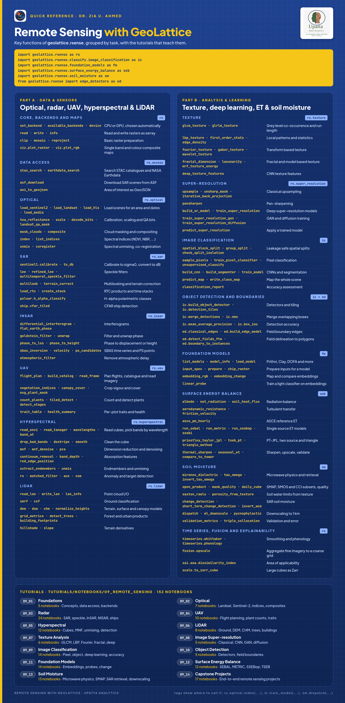

<p align="center">
  
</p>

Remote sensing measures the Earth without touching it. Optical sensors record reflected sunlight in a few broad bands or hundreds of narrow ones, radar sends its own microwaves and works through cloud and at night, LiDAR times laser pulses to map terrain and trees in three dimensions, and drones fly the same field every week. Turning those measurements into crop maps, flood extents, forest loss, field boundaries or the water a crop uses is the work of this chapter.

These 152 notebooks are chapter 09 of the [GeoLattice](https://github.com/zia207/GeoLattice) tutorials. They cover data access, optical, radar, UAV, hyperspectral and LiDAR data, texture analysis, super-resolution, image classification, object detection, foundation models, the surface energy balance and soil moisture, and finish with seventeen capstone projects, using `geolattice.rsense` with real imagery from Bangladesh, the United States and around the world.

## GeoLattice

GeoLattice is a Python library for geospatial analysis that brings vector and raster processing, spatial analysis, spatial statistics, geostatistics, spatial databases, web and cloud GIS and remote sensing together under one import. It is built on GDAL, NumPy, pandas, GeoPandas, Shapely and xarray, so its functions take and return objects these libraries already use: GeoDataFrames, xarray DataArrays and Datasets, NumPy arrays and GDAL-readable files.

| | |
|---|---|
| **Package** | `geolattice` |
| **Repository** | [github.com/zia207/GeoLattice](https://github.com/zia207/GeoLattice) |
| **Python** | 3.10 or newer |
| **License** | MIT |
| **Author** | Zia Ahmed, Upatta Analytics |

GDAL and PROJ must be installed first, with Python GDAL bindings that match the GDAL library (conda or your system package manager). Then install the remote sensing option, or the full set for the deep-learning notebooks:

```bash
python3 -m pip install "geolattice[remote-sensing]"
python3 -m pip install "geolattice[all]"                # adds PyTorch and torchgeo for deep learning
```

GPUs, large vision models and foundation models have their own extras (`rsense-gpu`, `rsense-vision`, `rsense-foundation`, `rsense-uav-dl`), which a plain install leaves out.

The chapter uses six imports:

```python
import geolattice.rsense as rs
import geolattice.rsense.classify.image_classification as ic
import geolattice.rsense.foundation_models as fm
import geolattice.rsense.surface_energy_balance as seb
import geolattice.rsense.soil_moisture as sm
from geolattice.rsense import edge_detectors as ed
```

## Data and sensors

`geolattice.rsense` reads imagery into xarray, runs on the CPU or a GPU, and has a submodule for each kind of sensor.

| Task | Functions |
|---|---|
| Core and backends (`rs`) | `set_backend`, `available_backends`, `read`, `write`, `clip`, `mosaic`, `reproject` |
| Data access (`rs.access`) | `stac_search`, `earthdata_search`, `asf_download` |
| Optical (`rs.optical`) | `load_sentinel2`, `load_landsat`, `load_hls`, `load_modis`, `scale`, `mask_clouds`, `composite`, `index`, `list_indices` |
| SAR (`rs.sar`) | `to_db`, `lee`, `refined_lee`, `multitemporal_speckle_filter`, `multilook`, `terrain_correct`, `load_rtc` |
| InSAR (`rs.insar`) | `differential_interferogram`, `goldstein_filter`, `unwrap`, `phase_to_los`, `sbas_inversion`, `velocity` |
| UAV (`rs.uav`) | `flight_plan`, `read_frame`, `vegetation_indices`, `canopy_cover`, `count_plants`, `trait_table` |
| Hyperspectral (`rs.hyperspectral`) | `read_envi`, `read_tanager`, `mnf`, `continuum_removal`, `extract_endmembers`, `unmix`, `rx`, `matched_filter` |
| LiDAR (`rs.lidar`) | `read_las`, `smrf`, `csf`, `dem`, `dsm`, `chm`, `normalize_heights`, `detect_trees`, `building_footprints` |

Run from the repository root:

```python
import xarray as xr
import geolattice.rsense as rs

rs.set_backend("auto")                                            # GPU if available, else CPU
SCENE = "Data/00_shared/data_remote_sensing/landsat9_vegas_20240708/LC09_L2SP_039035_20240708_02_T1"

bands = xr.Dataset({b: rs.read(f"{SCENE}/{b}.tif").squeeze(drop=True) for b in ["red", "nir", "swir16"]})
sr = rs.optical.scale(bands, sensor="landsat")                    # Collection 2 surface reflectance
ndvi = rs.optical.index(sr, "NDVI")                               # (NIR - red) / (NIR + red)
rs.write(ndvi, "ndvi.tif")                                        # Cloud-Optimized GeoTIFF by default
```

## Analysis and learning

| Task | Functions |
|---|---|
| Texture (`rs.texture`) | `glcm_texture`, `glrlm_texture`, `lbp_texture`, `fourier_texture`, `gabor_texture`, `fractal_dimension`, `deep_texture_features` |
| Super-resolution (`rs.super_resolution`) | `upsample`, `pansharpen`, `build_sr_model`, `train_super_resolution`, `predict_super_resolution` |
| Image classification (`ic`) | `spatial_block_split`, `train_pixel_classifier`, `build_cnn`, `build_segmenter`, `train_model`, `predict_map`, `classification_report` |
| Object detection (`ic`) | `build_object_detector`, `detection_tiles`, `merge_detections`, `mean_average_precision` |
| Field boundaries (`ed`) | `classical_edges`, `build_edge_model`, `detect_fields_ftw`, `boundary_to_instances` |
| Foundation models (`fm`) | `list_models`, `load_model`, `prepare`, `chip_raster`, `embedding_rgb`, `embedding_change`, `linear_probe` |
| Surface energy balance (`seb`) | `net_radiation`, `soil_heat_flux`, `asce_pm_hourly`, `run_sebal`, `run_metric`, `run_ssebop`, `tseb_pt`, `seasonal_et` |
| Soil moisture (`sm`) | `open_product`, `daily_cube`, `mironov_dielectric`, `tau_omega`, `saxton_rawls`, `change_detection`, `invert_wcm`, `dispatch`, `ml_downscale`, `validation_metrics`, `triple_collocation` |
| Time series and fusion (`rs`) | `timeseries.whittaker`, `timeseries.phenology`, `fusion.upscale` |

## Tutorials {#tutorials}

Start with the foundation notebooks; they set up the environment, data access and the CPU and GPU backends used everywhere else. The sensor chapters (optical, radar, UAV, hyperspectral and LiDAR) can then be read in any order, followed by the analysis and learning chapters and the capstones.

### Foundations

| Tutorial | Topic |
|----------|--------|
| [Remote Sensing Fundamentals](09_01_foundations/09_01_00_remote_sensing_fundamentals.ipynb) | Remote Sensing Fundamentals |
| [The Python Geospatial Environment](09_01_foundations/09_01_01_the_python_geospatial_environment.ipynb) | The Python Geospatial Environment |
| [Raster and Vector Data Essentials](09_01_foundations/09_01_02_raster_and_vector_data_essentials.ipynb) | Raster and Vector Data Essentials |
| [Data Discovery and Access](09_01_foundations/09_01_03_data_discovery_and_access.ipynb) | Data Discovery and Access |
| [Getting Access to Remote Sensing Images](09_01_foundations/09_01_04_getting_access_to_remote_sensing_images.ipynb) | Getting Access to Remote Sensing Images |

### Optical

| Tutorial | Topic |
|----------|--------|
| [Introduction to Optical Satellite Images](09_02_optical/09_02_01_introduction_to_optical_satellite_images.ipynb) | Introduction to Optical Satellite Images |
| [Preprocessing of Optical Images](09_02_optical/09_02_02_preprocessing_of_optical_images.ipynb) | Preprocessing of Optical Images |
| [Global Monitoring Every Day](09_02_optical/09_02_03_modis_global_monitoring_every_day.ipynb) | MODIS: Global Monitoring Every Day |
| [Landsat](09_02_optical/09_02_04_landsat_half_a_century_of_earth_observation.ipynb) | Landsat: Half a Century of Earth Observation |
| [Sentinel-2](09_02_optical/09_02_05_sentinel_2_red_edge_10_m_and_five_day_revisits.ipynb) | Sentinel-2: Red Edge, 10 m and Five-Day Revisits |
| [Sentinel-3](09_02_optical/09_02_06_sentinel_3_ocean_colour_surface_temperature_and_altimetry.ipynb) | Sentinel-3: Ocean Colour, Surface Temperature and Altimetry |
| [Sentinel-5P and Sentinel-5](09_02_optical/09_02_07_sentinel_5p_and_sentinel_5_mapping_air_pollution_from_orbit.ipynb) | Sentinel-5P and Sentinel-5: Mapping Air Pollution from Orbit |

### Radar (SAR and InSAR)

| Tutorial | Topic |
|----------|--------|
| [SAR Fundamentals](09_03_radar/09_03_00_sar_fundamentals.ipynb) | SAR Fundamentals |
| [Sentinel-1 SAR](09_03_radar/09_03_01_00_sentinel_1_sar.ipynb) | Sentinel-1 SAR |
| [Sentinel-1 SAR Processing](09_03_radar/09_03_01_01_sentinel_1_sar_processing.ipynb) | Sentinel-1 SAR Processing |
| [Sentinel-1 GRD Processing](09_03_radar/09_03_01_02_sentinel_1_grd_processing.ipynb) | Sentinel-1 GRD Processing |
| [Sentinel-1 GRD Time Series](09_03_radar/09_03_01_03_sentinel_1_multitemporal_grd_time_series_deforestation_around_the_rohingya_camps_2017.ipynb) | Sentinel-1 Multitemporal GRD Time Series: Deforestation around the Rohingya Camps (2017) |
| [Topographic InSAR](09_03_radar/09_03_01_04_topographic_insar_a_dem_from_a_sentinel_1_slc_pair.ipynb) | Topographic InSAR: a DEM from a Sentinel-1 SLC Pair |
| [Differential InSAR](09_03_radar/09_03_01_05_differential_insar_dinsar.ipynb) | Differential InSAR (DInSAR) |
| [SBAS InSAR](09_03_radar/09_03_01_06_sbas_small_baseline_subset_insar.ipynb) | SBAS (Small Baseline Subset) InSAR |
| [Persistent Scatterer InSAR](09_03_radar/09_03_01_07_persistent_scatterer_insar_ps_insar.ipynb) | Persistent Scatterer InSAR (PS-InSAR) |
| [Dual-Pol Polarimetric Decomposition](09_03_radar/09_03_01_08_dual_pol_polarimetric_decomposition_slc.ipynb) | Dual-Pol Polarimetric Decomposition (SLC) |
| [Interferometric Coherence of SLCs](09_03_radar/09_03_01_09_interferometric_coherence_of_slcs.ipynb) | Interferometric Coherence of SLCs |
| [Sentinel-1 Based Indices](09_03_radar/09_03_01_10_sentinel_1_based_indices.ipynb) | Sentinel-1 Based Indices |
| [RADARSAT Constellation Mission](09_03_radar/09_03_02_00_radarsat_constellation_mission_rcm.ipynb) | RADARSAT Constellation Mission (RCM) |
| [RCM Processing](09_03_radar/09_03_02_01_radarsat_constellation_mission_rcm_processing.ipynb) | RADARSAT Constellation Mission (RCM) Processing |
| [RADARSAT GRD Data](09_03_radar/09_03_02_02_radarsat_grd_data.ipynb) | RADARSAT GRD Data |
| [RCM InSAR Processing](09_03_radar/09_03_02_03_radarsat_constellation_mission_rcm_insar_processing.ipynb) | RADARSAT Constellation Mission (RCM) InSAR Processing |
| [RADARSAT Polarimetric SAR](09_03_radar/09_03_02_04_radarsat_polarimetric_sar_polsar.ipynb) | RADARSAT Polarimetric SAR (PolSAR) |
| [Compact-polarimetry](09_03_radar/09_03_02_05_compact_polarimetry_cp.ipynb) | Compact-polarimetry (CP) |
| [NISAR](09_03_radar/09_03_03_00_nisar_nasa_isro_synthetic_aperture_radar.ipynb) | NISAR: NASA-ISRO Synthetic Aperture Radar |
| [NISAR Processing](09_03_radar/09_03_03_01_nisar_processing.ipynb) | NISAR Processing |
| [NISAR RSLC](09_03_radar/09_03_03_02_nisar_rslc_range_doppler_single_look_complex_processing.ipynb) | NISAR RSLC: Range-Doppler Single Look Complex Processing |
| [NISAR GSLC](09_03_radar/09_03_03_03_nisar_gslc_geocoded_single_look_complex_processing.ipynb) | NISAR GSLC: Geocoded Single Look Complex Processing |
| [NISAR GCOV](09_03_radar/09_03_03_04_nisar_gcov_geocoded_polarimetric_covariance_processing.ipynb) | NISAR GCOV: Geocoded Polarimetric Covariance Processing |
| [NISAR GUNW](09_03_radar/09_03_03_05_nisar_gunw_geocoded_unwrapped_interferogram.ipynb) | NISAR GUNW: Geocoded Unwrapped Interferogram |

### UAV

| Tutorial | Topic |
|----------|--------|
| [UAV Fundamentals and Mission Planning](09_04_uav/09_04_01_uav_fundamentals_and_mission_planning.ipynb) | UAV Fundamentals and Mission Planning |
| [Reading and Inspecting UAV Imagery](09_04_uav/09_04_02_reading_and_inspecting_uav_imagery.ipynb) | Reading and Inspecting UAV Imagery |
| [Photogrammetry](09_04_uav/09_04_03_photogrammetry_orthomosaic_dsm_and_dtm.ipynb) | Photogrammetry: Orthomosaic, DSM and DTM |
| [RGB Vegetation Indices and Canopy Cover](09_04_uav/09_04_04_rgb_vegetation_indices_and_canopy_cover.ipynb) | RGB Vegetation Indices and Canopy Cover |
| [RGB + NIR Multispectral Analysis](09_04_uav/09_04_05_rgb_plus_nir_multispectral_analysis.ipynb) | RGB + NIR Multispectral Analysis |
| [DEM Correction and Canopy Height](09_04_uav/09_04_06_dem_correction_and_canopy_height.ipynb) | DEM Correction and Canopy Height |
| [Plant Counting and Size](09_04_uav/09_04_07_plant_counting_and_size.ipynb) | Plant Counting and Size |
| [Crop Health](09_04_uav/09_04_08_crop_health_sam_plant_masks_and_senescence_detection.ipynb) | Crop Health: SAM Plant Masks and Senescence Detection |
| [Panicle Detection with YOLO](09_04_uav/09_04_09_panicle_detection_with_yolo.ipynb) | Panicle Detection with YOLO |
| [Season-Long Phenotyping](09_04_uav/09_04_10_season_long_phenotyping.ipynb) | Season-Long Phenotyping |

### Hyperspectral

| Tutorial | Topic |
|----------|--------|
| [Introduction to Imaging Spectroscopy](09_05_HyperSpectral/09_05_00_introduction_to_imaging_spectroscopy.ipynb) | Introduction to Imaging Spectroscopy |
| [Reading and Exploring Hyperspectral Data](09_05_HyperSpectral/09_05_01_reading_and_exploring_hyperspectral_data.ipynb) | Reading and Exploring Hyperspectral Data |
| [Preprocessing Hyperspectral Cubes](09_05_HyperSpectral/09_05_02_preprocessing_hyperspectral_cubes.ipynb) | Preprocessing Hyperspectral Cubes |
| [Dimensionality Reduction and Band Selection](09_05_HyperSpectral/09_05_03_dimensionality_reduction_and_band_selection.ipynb) | Dimensionality Reduction and Band Selection |
| [Narrowband Indices and Vegetation Analysis](09_05_HyperSpectral/09_05_04_narrowband_indices_and_vegetation_analysis.ipynb) | Narrowband Indices and Vegetation Analysis |
| [Biophysical and Biochemical Trait Retrieval](09_05_HyperSpectral/09_05_05_biophysical_and_biochemical_trait_retrieval.ipynb) | Biophysical and Biochemical Trait Retrieval |
| [Spectral Libraries and Spectral Matching](09_05_HyperSpectral/09_05_06_spectral_libraries_and_spectral_matching.ipynb) | Spectral Libraries and Spectral Matching |
| [Endmember Extraction and Spectral Unmixing](09_05_HyperSpectral/09_05_07_endmember_extraction_and_spectral_unmixing.ipynb) | Endmember Extraction and Spectral Unmixing |
| [Target and Anomaly Detection](09_05_HyperSpectral/09_05_08_target_and_anomaly_detection.ipynb) | Target and Anomaly Detection |
| [Greenhouse Gas Plume Detection](09_05_HyperSpectral/09_05_09_greenhouse_gas_plume_detection.ipynb) | Greenhouse Gas Plume Detection |
| [Thematic Applications Across Tanager Scenes](09_05_HyperSpectral/09_05_10_thematic_applications_across_tanager_scenes.ipynb) | Thematic Applications Across Tanager Scenes |
| [Deep Learning for Hyperspectral Classification](09_05_HyperSpectral/09_05_11_deep_learning_for_hyperspectral_classification.ipynb) | Deep Learning for Hyperspectral Classification |

### LiDAR

| Tutorial | Topic |
|----------|--------|
| [LiDAR Fundamentals](09_06_lidar/09_06_01_lidar_fundamentals.ipynb) | LiDAR Fundamentals |
| [LiDAR Processing](09_06_lidar/09_06_02_lidar_processing_quality_control_cleaning_ground_classification_and_surface_models.ipynb) | LiDAR Processing: Quality Control, Cleaning, Ground Classification and Surface Models |
| [Terrain and Hydrology from LiDAR DEMs](09_06_lidar/09_06_03_terrain_and_hydrology_from_lidar_dems.ipynb) | Terrain and Hydrology from LiDAR DEMs |
| [Forest Structure and Individual Trees from LiDAR](09_06_lidar/09_06_04_forest_structure_and_individual_trees_from_lidar.ipynb) | Forest Structure and Individual Trees from LiDAR |
| [Buildings and Urban Features from LiDAR](09_06_lidar/09_06_05_buildings_and_urban_features_from_lidar.ipynb) | Buildings and Urban Features from LiDAR |
| [Point Cloud Classification](09_06_lidar/09_06_06_point_cloud_classification_with_machine_learning_and_deep_learning.ipynb) | Point Cloud Classification with Machine Learning and Deep Learning |
| [Spaceborne LiDAR](09_06_lidar/09_06_07_spaceborne_lidar_gedi_and_icesat_2.ipynb) | Spaceborne LiDAR: GEDI and ICESat-2 |
| [Large-Area LiDAR Processing](09_06_lidar/09_06_08_large_area_lidar_processing_tiling_streaming_parallel_work_and_the_gpu.ipynb) | Large-Area LiDAR Processing: Tiling, Streaming, Parallel Work and the GPU |

### Texture Analysis

| Tutorial | Topic |
|----------|--------|
| [Texture Analysis](09_07_texture_analysis/09_07_00_texture_analysis.ipynb) | Texture Analysis |
| [Statistical and Structural Methods](09_07_texture_analysis/09_07_01_texture_analysis_of_landsat_imagery_statistical_and_structural_methods.ipynb) | Texture Analysis of Landsat Imagery: Statistical and Structural Methods |
| [Transform-Based Methods](09_07_texture_analysis/09_07_02_texture_analysis_of_landsat_imagery_transform_based_spectral_methods.ipynb) | Texture Analysis of Landsat Imagery: Transform-Based (Spectral) Methods |
| [Local Pattern-Based Methods](09_07_texture_analysis/09_07_03_texture_analysis_of_landsat_imagery_local_pattern_based_methods_lbp.ipynb) | Texture Analysis of Landsat Imagery: Local Pattern-Based Methods (LBP) |
| [Model-Based Methods](09_07_texture_analysis/09_07_04_texture_analysis_of_landsat_imagery_model_based_methods.ipynb) | Texture Analysis of Landsat Imagery: Model-Based Methods |
| [Deep-Learning-Based Methods](09_07_texture_analysis/09_07_05_texture_analysis_of_landsat_imagery_deep_learning_based_methods.ipynb) | Texture Analysis of Landsat Imagery: Deep-Learning-Based Methods |

### Image Super-Resolution

| Tutorial | Topic |
|----------|--------|
| [Image Super-Resolution](09_08_image_super_resolution/09_08_00_image_super_resolution.ipynb) | Image Super-Resolution |
| [Landsat 8 to Sentinel-2](09_08_image_super_resolution/09_08_01_landsat_8_to_sentinel_2_six_band_super_resolution.ipynb) | Landsat 8 to Sentinel-2: six-band super-resolution |
| [Sentinel-2 to PlanetScope](09_08_image_super_resolution/09_08_02_sentinel_2_to_planetscope_multispectral_super_resolution.ipynb) | Sentinel-2 to PlanetScope: multispectral super-resolution |
| [PlanetScope to NAIP-style Imagery](09_08_image_super_resolution/09_08_03_planetscope_to_high_resolution_naip_style_imagery_super_resolution.ipynb) | PlanetScope to high-resolution NAIP-style imagery: super-resolution |
| [Landsat 8 to High Resolution](09_08_image_super_resolution/09_08_04_landsat_8_sentinel_2_planetscope_and_high_resolution_imagery.ipynb) | Landsat 8, Sentinel-2, PlanetScope, and high-resolution imagery |

### Image Classification

| Tutorial | Topic |
|----------|--------|
| [Introduction to Image Classification](09_09_image_classification/09_09_01_01_introduction_to_image_classification.ipynb) | Introduction to Image Classification |
| [Image Processing](09_09_image_classification/09_09_01_02_image_processing.ipynb) | Image Processing |
| [Sampling and Accuracy Assessment](09_09_image_classification/09_09_01_03_sampling_accuracy_assessment_and_reproducible_runs.ipynb) | Sampling, Accuracy Assessment and Reproducible Runs |
| [Classical Image Classification](09_09_image_classification/09_09_02_01_classical_image_classification_pixel_based_and_object_based.ipynb) | Classical Image Classification: Pixel-Based and Object-Based |
| [CNN Classification on the GPU](09_09_image_classification/09_09_02_02_image_classification_with_a_cnn_on_the_gpu_landsat_and_the_cropland_data_layer.ipynb) | Image Classification with a CNN on the GPU: Landsat and the Cropland Data Layer |
| [Deep Learning for Sentinel-2](09_09_image_classification/09_09_02_03_deep_learning_for_sentinel_2_cnn_resnet_efficientnet_convnext_vit_and_swin_on_the_gpu.ipynb) | Deep Learning for Sentinel-2: CNN, ResNet, EfficientNet, ConvNeXt, ViT and Swin on the GPU |
| [Transfer Learning and Transformers](09_09_image_classification/09_09_02_04_transfer_learning_and_vision_transformers_for_sentinel_2_imagenet_vs_remote_sensing_weights.ipynb) | Transfer Learning and Vision Transformers for Sentinel-2: ImageNet vs Remote-Sensing Weights |
| [Crops from Sentinel-1 Time Series](09_09_image_classification/09_09_03_01_crop_classification_with_sentinel_1_sar_time_series_pixel_classifiers_and_deep_cnns_vv_vh_may_october_2024.ipynb) | Crop Classification with Sentinel-1 SAR Time Series: Pixel Classifiers and Deep CNNs (VV/VH, May-October 2024) |
| [Multi-Sensor Crop Mapping](09_09_image_classification/09_09_03_02_spatio_temporal_and_multi_sensor_crop_mapping_sentinel_2_sentinel_1_and_landsat_time_series_2020_to_2025.ipynb) | Spatio-Temporal and Multi-Sensor Crop Mapping: Sentinel-2, Sentinel-1 and Landsat Time Series, 2020 to 2025 |
| [Change Detection](09_09_image_classification/09_09_03_03_change_detection_classical_post_classification_and_deep_methods_on_landsat_and_sentinel_2_2020_to_2025.ipynb) | Change Detection: Classical, Post-Classification and Deep Methods on Landsat and Sentinel-2, 2020 to 2025 |
| [Semantic Segmentation of Crops](09_09_image_classification/09_09_04_01_semantic_segmentation_of_crop_types_from_sentinel_2_fcn_u_net_deeplabv3_plus_and_segformer_on_the_gpu.ipynb) | Semantic Segmentation of Crop Types from Sentinel-2: FCN, U-Net, DeepLabV3(+) and SegFormer on the GPU |
| [Instance Segmentation of Fields](09_09_image_classification/09_09_04_02_instance_segmentation_of_agricultural_fields_with_mask_r_cnn.ipynb) | Instance Segmentation of Agricultural Fields with Mask R-CNN |
| [Imperfect Labels and Domain Shift](09_09_image_classification/09_09_05_03_imperfect_labels_and_domain_shift.ipynb) | Imperfect labels and domain shift |
| [Multi-Sensor Image Fusion](09_09_image_classification/09_09_05_04_multi_sensor_image_fusion.ipynb) | Multi-sensor image fusion |

### Object Detection

| Tutorial | Topic |
|----------|--------|
| [Object Detection](09_10_object_detection/09_10_00_object_detection.ipynb) | Object Detection |
| [Object Detection in Aerial Imagery](09_10_object_detection/09_10_01_object_detection_in_aerial_imagery.ipynb) | Object Detection in Aerial Imagery |
| [Field Boundaries in Google Imagery](09_10_object_detection/09_10_02_field_boundary_detection_in_google_satellite_screenshots_bangladesh.ipynb) | Field Boundary Detection in Google Satellite Screenshots (Bangladesh) |
| [Field Edges in WorldView Imagery](09_10_object_detection/09_10_03_field_edge_detection_in_worldview_imagery_rgb_versus_rgb_plus_nir.ipynb) | Field Edge Detection in WorldView Imagery: RGB versus RGB + NIR |
| [Field Edges in Sentinel-2](09_10_object_detection/09_10_04_field_edge_detection_in_sentinel_2_fields_of_the_world_versus_delineate_anything.ipynb) | Field Edge Detection in Sentinel-2: Fields of The World versus Delineate Anything |

### Foundation Models

| Tutorial | Topic |
|----------|--------|
| [What Foundation Models Are](09_11_foundations_models/09_11_00_what_foundation_models_are_and_why_remote_sensing_needs_them.ipynb) | What Foundation Models Are and Why Remote Sensing Needs Them |
| [Self-Supervised Pretraining](09_11_foundations_models/09_11_01_self_supervised_pretraining_for_sentinel_2_crop_mapping.ipynb) | Self-supervised pretraining for Sentinel-2 crop mapping |
| [Geospatial Foundation Models](09_11_foundations_models/09_11_02_geospatial_foundation_models_embeddings_promptable_segmentation_and_zero_shot_classification.ipynb) | Geospatial foundation models: embeddings, promptable segmentation and zero-shot classification |
| [From a GeoTIFF to an Embedding Map](09_11_foundations_models/09_11_03_from_a_geotiff_to_an_embedding_map.ipynb) | From a GeoTIFF to an Embedding Map |
| [Optical Encoders on Sentinel-2](09_11_foundations_models/09_11_04_prithvi_ssl4eo_satlaspretrain_and_scale_mae_on_sentinel_2.ipynb) | Prithvi, SSL4EO, SatlasPretrain and Scale-MAE on Sentinel-2 |
| [One Model for Many Sensors](09_11_foundations_models/09_11_05_one_model_for_many_sensors_dofa_panopticon_copernicus_fm_croma_and_terramind.ipynb) | One Model for Many Sensors: DOFA, Panopticon, Copernicus-FM, CROMA and TerraMind |
| [Time in Foundation Models](09_11_foundations_models/09_11_06_time_in_foundation_models_prithvi_tl_anysat_presto_and_galileo.ipynb) | Time in Foundation Models: Prithvi-TL, AnySat, Presto and Galileo |
| [AlphaEarth Foundations](09_11_foundations_models/09_11_07_alphaearth_foundations_precomputed_embeddings_for_the_whole_planet.ipynb) | AlphaEarth Foundations: Precomputed Embeddings for the Whole Planet |
| [Embeddings as Covariates](09_11_foundations_models/09_11_08_foundation_model_embeddings_as_covariates_digital_soil_mapping_of_soc.ipynb) | Foundation Model Embeddings as Covariates: Digital Soil Mapping of SOC |
| [Very High Resolution Models](09_11_foundations_models/09_11_09_very_high_resolution_dinov3_sat_satlas_naip_scale_mae_and_sam_2.ipynb) | Very High Resolution: DINOv3-sat, Satlas NAIP, Scale-MAE and SAM 2 |
| [Vision-Language Models](09_11_foundations_models/09_11_10_vision_language_models_zero_shot_classification_and_text_retrieval.ipynb) | Vision-Language Models: Zero-Shot Classification and Text Retrieval |
| [Change and Similarity in Embedding Space](09_11_foundations_models/09_11_11_change_and_similarity_in_embedding_space.ipynb) | Change and Similarity in Embedding Space |
| [Weather and Earth System Foundation Models](09_11_foundations_models/09_11_12_weather_and_earth_system_foundation_models.ipynb) | Weather and Earth System Foundation Models |
| [Benchmarking Foundation Models](09_11_foundations_models/09_11_13_benchmarking_foundation_models_on_your_own_data.ipynb) | Benchmarking Foundation Models on Your Own Data |

### Surface Energy Balance

| Tutorial | Topic |
|----------|--------|
| [ET and the Energy Balance](09_12_surface_energy_balance_modeling/09_12_00_evapotranspiration_and_the_surface_energy_balance.ipynb) | Evapotranspiration and the Surface Energy Balance |
| [An Analysis-Ready Stack](09_12_surface_energy_balance_modeling/09_12_01_building_an_analysis_ready_stack_for_energy_balance_models.ipynb) | Building an Analysis-Ready Stack for Energy Balance Models |
| [Reference ET (ASCE Penman-Monteith)](09_12_surface_energy_balance_modeling/09_12_02_reference_et_with_the_asce_standardized_penman_monteith_equation.ipynb) | Reference ET with the ASCE Standardized Penman-Monteith Equation |
| [Net Radiation from Landsat](09_12_surface_energy_balance_modeling/09_12_03_net_radiation_from_landsat_albedo_emissivity_and_surface_temperature.ipynb) | Net Radiation from Landsat: Albedo, Emissivity and Surface Temperature |
| [Soil Heat Flux and Aerodynamics](09_12_surface_energy_balance_modeling/09_12_04_soil_heat_flux_roughness_and_aerodynamic_resistance.ipynb) | Soil Heat Flux, Roughness and Aerodynamic Resistance |
| [SEBAL](09_12_surface_energy_balance_modeling/09_12_05_sebal_solving_for_sensible_heat_with_hot_and_cold_pixels.ipynb) | SEBAL: Solving for Sensible Heat with Hot and Cold Pixels |
| [METRIC](09_12_surface_energy_balance_modeling/09_12_06_metric_internal_calibration_against_reference_et.ipynb) | METRIC: Internal Calibration against Reference ET |
| [SSEBop, S-SEBI, Triangle, PT-JPL](09_12_surface_energy_balance_modeling/09_12_07_ssebop_s_sebi_the_triangle_method_and_pt_jpl.ipynb) | SSEBop, S-SEBI, the Triangle Method and PT-JPL |
| [Two-Source Energy Balance](09_12_surface_energy_balance_modeling/09_12_08_two_source_energy_balance_separating_soil_evaporation_and_transpiration.ipynb) | Two-Source Energy Balance: Separating Soil Evaporation and Transpiration |
| [ET at Other Resolutions](09_12_surface_energy_balance_modeling/09_12_09_et_at_other_resolutions_modis_sentinel_3_and_sentinel_2_with_thermal_sharpening.ipynb) | ET at Other Resolutions: MODIS, Sentinel-3 and Sentinel-2 with Thermal Sharpening |
| [Seasonal ET and Crop Water Use](09_12_surface_energy_balance_modeling/09_12_10_from_snapshots_to_seasonal_et_and_crop_water_use.ipynb) | From Snapshots to Seasonal ET and Crop Water Use |
| [Validation and Uncertainty](09_12_surface_energy_balance_modeling/09_12_11_how_good_is_the_et_map_validation_sensitivity_and_uncertainty.ipynb) | How Good Is the ET Map? Validation, Sensitivity and Uncertainty |

### Soil Moisture

| Tutorial | Topic |
|----------|--------|
| [Soil Moisture Concepts](09_13_soil_moisture/09_13_00_soil_moisture_concepts_and_why_it_matters.ipynb) | Soil Moisture: Concepts and Why It Matters |
| [Microwave Remote Sensing](09_13_soil_moisture/09_13_01_microwave_remote_sensing_of_soil_moisture.ipynb) | Microwave Remote Sensing of Soil Moisture |
| [Missions and Products](09_13_soil_moisture/09_13_02_the_mission_and_product_landscape.ipynb) | The Mission and Product Landscape |
| [Environment and Data Access](09_13_soil_moisture/09_13_03_python_environment_and_data_access.ipynb) | Python Environment and Data Access |
| [SMAP L3 Enhanced Daily Cube](09_13_soil_moisture/09_13_04_smap_l3_enhanced_daily_cube_and_climatology.ipynb) | SMAP L3 Enhanced: a Daily Cube and its Climatology |
| [ASCAT and TU Wien Change Detection](09_13_soil_moisture/09_13_08_ascat_and_the_tu_wien_change_detection_approach.ipynb) | ASCAT and the TU Wien Change Detection Approach |
| [ESA CCI Trends and Anomalies](09_13_soil_moisture/09_13_09_esa_cci_long_term_trends_and_anomalies.ipynb) | ESA CCI: Long-Term Trends and Anomalies |
| [ESA CCI vs ERA5-Land](09_13_soil_moisture/09_13_10_esa_cci_vs_era5_land.ipynb) | ESA CCI vs ERA5-Land |
| [Sentinel-1 Preprocessing](09_13_soil_moisture/09_13_11_sentinel_1_preprocessing_for_soil_moisture.ipynb) | Sentinel-1 Preprocessing for Soil Moisture |
| [Sentinel-1 Change Detection](09_13_soil_moisture/09_13_12_change_detection_soil_moisture_from_sentinel_1.ipynb) | Change Detection Soil Moisture from Sentinel-1 |
| [Water Cloud Model Inversion](09_13_soil_moisture/09_13_13_water_cloud_model_and_surface_scattering_inversion.ipynb) | Water Cloud Model and Surface Scattering Inversion |
| [Operational 1 km Products](09_13_soil_moisture/09_13_14_operational_high_resolution_products.ipynb) | Operational High-Resolution Products |
| [Downscaling: Six Methods Compared](09_13_soil_moisture/09_13_15_downscale_soil_moisture.ipynb) | Downscaling Soil Moisture: Six Methods Compared |

### Capstone Projects

| Tutorial | Topic |
|----------|--------|
| [Change around Pucallpa, Peru](09_14_Capstones/09_14_01_thirty_five_years_of_change_around_pucallpa_peru.ipynb) | Thirty-five Years of Change around Pucallpa, Peru |
| [Fifty Years in the Bangladesh Delta](09_14_Capstones/09_14_02_fifty_years_of_change_in_the_bangladesh_delta.ipynb) | Fifty Years of Change in the Bangladesh Delta |
| [Wildfire Burned Area](09_14_Capstones/09_14_03_wild_fire_burned_area_mapping.ipynb) | Wild Fire Burned-area Mapping |
| [Rohingya Deforestation: Sentinel-2](09_14_Capstones/09_14_04_timeline_of_the_rohingya_exodus_deforestation_in_bangladesh_2016_2018.ipynb) | Timeline of the Rohingya Exodus: Deforestation in Bangladesh (2016-2018) |
| [Flood Mapping in Sylhet](09_14_Capstones/09_14_05_flood_mapping_with_sentinel_1_data_sylhet_bangladesh.ipynb) | Flood Mapping with Sentinel-1 Data - Sylhet, Bangladesh |
| [Rohingya Deforestation: Sentinel-1](09_14_Capstones/09_14_06_timeline_of_the_rohingya_exodus_deforestation_in_bangladesh_2016_2018_sentinel_1_radar.ipynb) | Timeline of the Rohingya Exodus: Deforestation in Bangladesh (2016-2018), Sentinel-1 Radar |
| [Ship Detection, Strait of Hormuz](09_14_Capstones/09_14_07_ship_detection_in_the_strait_of_hormuz_with_sentinel_1.ipynb) | Ship Detection in the Strait of Hormuz with Sentinel-1 |
| [Crops from NISAR GCOV](09_14_Capstones/09_14_08_crop_classification_with_nisar_gcov_time_series_and_self_supervised_learning.ipynb) | Crop Classification with NISAR GCOV Time Series and Self-Supervised Learning |
| [Sea Ice in the St. Lawrence](09_14_Capstones/09_14_09_sea_ice_mapping_for_shipping_routes_in_the_st_lawrence_estuary_with_radarsat_constellation_mission_rcm.ipynb) | Sea Ice Mapping for Shipping Routes in the St. Lawrence Estuary with RADARSAT Constellation Mission (RCM) |
| [Charland Monitoring, Lower Meghna](09_14_Capstones/09_14_10_charland_monitoring_with_sentinel_1_sar_and_nisar_l_band_lower_meghna_estuary_of_bangladesh.ipynb) | Charland Monitoring with Sentinel-1 SAR (and NISAR L-band), Lower Meghna Estuary of Bangladesh |
| [Shrimp Ghers in Coastal Bangladesh](09_14_Capstones/09_14_11_mapping_shrimp_ghers_in_coastal_bangladesh_with_a_2025_2026_sentinel_1_time_series_and_sentinel_2.ipynb) | Mapping Shrimp Ghers in Coastal Bangladesh with a 2025–2026 Sentinel-1 Time Series and Sentinel-2 |
| [Big Sur Wildfire, 2026](09_14_Capstones/09_14_12_mapping_the_2026_big_sur_wildfire_with_time_series_sentinel_1_sar_and_sentinel_2_optical_images.ipynb) | Mapping the 2026 Big Sur Wildfire with Time-Series Sentinel-1 SAR and Sentinel-2 Optical Images |
| [Wetland Paddy in Bangladesh](09_14_Capstones/09_14_13_mapping_wetland_paddy_in_bangladesh_with_a_2025_to_2026_sentinel_1_time_series.ipynb) | Mapping Wetland Paddy in Bangladesh with a 2025 to 2026 Sentinel-1 Time Series |
| [Field Edges across Four Countries](09_14_Capstones/09_14_14_field_edge_detection_across_four_countries_training_in_mexico_mali_cambodia_and_bangladesh_testing_on_an_unseen_bangladesh_site.ipynb) | Field Edge Detection across Four Countries: Training in Mexico, Mali, Cambodia and Bangladesh, Testing on an Unseen Bangladesh Site |
| [Tree Biomass and Carbon from LiDAR](09_14_Capstones/09_14_15_tree_inventory_biomass_and_carbon_from_airborne_lidar.ipynb) | Tree Inventory, Biomass and Carbon from Airborne Lidar |
| [UAV Phenotyping of Maize Nitrogen](09_14_Capstones/09_14_16_uav_based_high_throughput_phenotyping_of_maize_nitrogen_response.ipynb) | UAV-Based High-Throughput Phenotyping of Maize Nitrogen Response |
| [Boro Rice Water Use, Bangladesh](09_14_Capstones/09_14_17_capstone_water_use_of_boro_rice_in_bangladesh.ipynb) | Capstone: Water Use of Boro Rice in Bangladesh |

### Quick reference

<p align="center">
  
</p>

## Sample data

The notebooks read the imagery in [`Data/00_shared/data_remote_sensing/`](https://github.com/zia207/GeoLattice/tree/main/Data/00_shared/data_remote_sensing) and [`Data/08_remote_sensing/`](https://github.com/zia207/GeoLattice/tree/main/Data/08_remote_sensing) of the repository (Landsat, Sentinel-1, Sentinel-2, MODIS, UAV, LiDAR and commercial images), and download further scenes from STAC catalogues, NASA Earthdata and ASF where a notebook says so.

## License

GeoLattice is released under the MIT License. See [LICENSE](https://github.com/zia207/GeoLattice/blob/main/LICENSE).

<p align="center">
  <br>
  Developed by Zia Ahmed, Upatta Analytics
</p>
